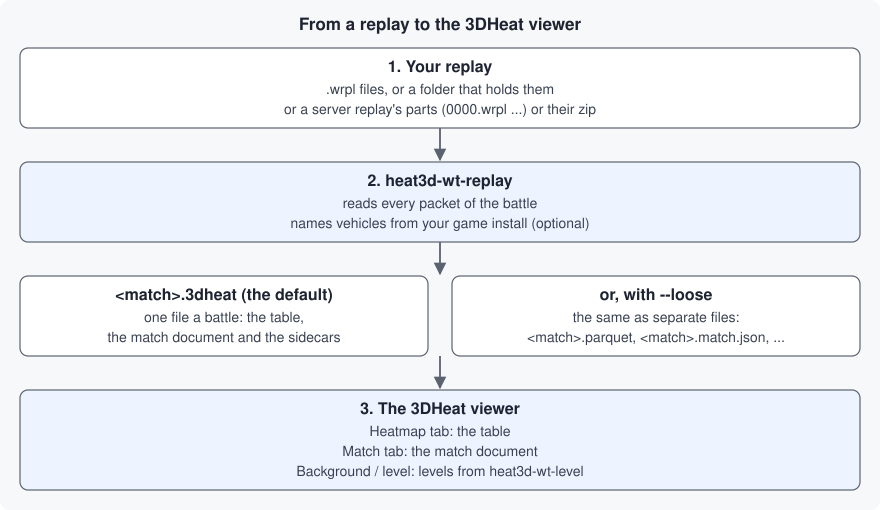

# 3DHeat War Thunder replays

**What is it?** War Thunder can record a battle as a replay file. This tool
turns the recording into a file you can watch from above in the
[3DHeat viewer](https://holdi601.github.io/3DHeat/), with every plane, tank
and ship, every missile and bomb, and every hit where it happened. A second
command turns the levels of your own game install into 3D levels to show the
battles on.

**Why would I use it?** For a debrief of a battle in 3D; for heatmaps of
where you and others fly, drive, fight and die over many battles; to see
where hits landed on a vehicle; to see what a battle cost and earned. The
output is plain Parquet and JSON, so other tools (pandas, DuckDB) can read
it too.

**Example:** `battle.wrpl` in, `out/<map>/<match>.3dheat` out.



**Documentation, step by step with pictures:
<https://holdi601.github.io/3DHeat-Ext-WarThunder/>** (Documentation in your
language: choose it at the top of any page there.)

Part of [3DHeat](https://github.com/Holdi601/3DHeat), the realtime 3D
telemetry and replay viewer ([documentation](https://holdi601.github.io/3DHeat/)).

Each game reader is its own small project with its own licence file, releases and issue
tracker, so it can be installed, updated, maintained - or withdrawn on a rights holder's
request - on its own, without affecting the viewer or the other tools.

## Quick start for new users

You need: Windows, [Python](https://www.python.org/downloads/) 3.10 or later
("Add python.exe to PATH" ticked in its installer), War Thunder installed, and
replay saving switched on in the game's options (it then saves your battles as
`.wrpl` files in its `Replays` folder). No Git is needed.

1. Install the tool (one line, in PowerShell or a command prompt):

   ```bash
   python -m pip install https://github.com/Holdi601/3DHeat-Ext-WarThunder/archive/refs/tags/v0.2.1.zip
   ```

2. Convert the replays, and if you like the level they were played on
   (`list` prints the level names; the game's folder is found by itself,
   `--game "<folder>"` names it otherwise):

   ```bash
   heat3d-wt-replay "C:\Program Files (x86)\Steam\steamapps\common\War Thunder\Replays" -o out
   heat3d-wt-level list
   heat3d-wt-level extract <level> -o levels
   ```

3. The output is one `out\<map>\<match>.3dheat` file per battle (it prints
   `ok out/<map>/<match>.3dheat` for each), and `levels\<level>\<level>.glb`
   for a level (up to about 250 MB with `--detail high`).
4. Open it in the [3DHeat viewer](https://github.com/Holdi601/3DHeat#quick-start):
   download the viewer (**Code -> Download ZIP**, unpack) and double-click
   `start.bat`; it offers to install [Node.js](https://nodejs.org/) when it is
   missing and opens Chrome or Edge at `http://127.0.0.1:5273`. There,
   **Source -> Files...** and pick the `.3dheat` (or drop it on the Source
   panel) for the Heatmap tab; for the battle itself, the **Match** tab's
   **Load match files...** and the same `.3dheat`. For the level,
   **Background / level -> 3D model...** and pick the `.glb`.

When a new release is out, the tool says so when it starts and offers to
update itself (`python -m heat3d_ext_warthunder.update` does the same).

## Install from a checkout

New to the command line? Read
[Before you start](https://holdi601.github.io/3DHeat-Ext-WarThunder/before-you-start.html)
first. Needs Python 3.10 or later.

```bash
git clone https://github.com/Holdi601/3DHeat-Ext-WarThunder.git
cd 3DHeat-Ext-WarThunder
pip install -e .                 # installs heat3d-wt-replay and heat3d-wt-level
heat3d-wt-replay --version       # you should see: heat3d-wt-replay 0.2.1
```

`python -m heat3d_ext_warthunder ...` does the same as `heat3d-wt-replay ...`,
and `python -m heat3d_ext_warthunder.levelcli ...` as `heat3d-wt-level ...`.

## Converting replays: `heat3d-wt-replay`

War Thunder saves client replays in its `Replays` folder when replay saving
is on in the game's options. A server replay saved from the game's replay
page (a zip with `0000.wrpl`, `0001.wrpl`, ...) can be converted too.

```bash
heat3d-wt-replay "<War Thunder>/Replays" -o out
heat3d-wt-replay a.wrpl b.wrpl -o out           # files, folders, or both
heat3d-wt-replay battle.zip -o out              # a server replay's zip
heat3d-wt-replay a.wrpl -o out --loose          # separate files instead of one .3dheat
```

You should see one line per battle: `ok out/<map>/<match>.3dheat` (with
`--loose`: `ok <table> <match document>`), or `failed <file>: <why>`.

| Option | Default | Does |
|---|---|---|
| `replays` (one or more) | - | `.wrpl` files, folders of them (not their subfolders), or zips of them |
| `-o`, `--out` | required | where to write: a folder per map inside |
| `--game FOLDER` | found | the War Thunder folder whose text names vehicles, weapons and ammunition, and whose tables price the economy; also `HEAT3D_WT_GAME` |
| `--no-smoothing` | off | keep other units' dead-reckoned and received samples as the replay has them |
| `--container` | on | pack each battle into one `.3dheat` file |
| `--loose` | off | keep each battle as separate files |
| `--version` | - | print `heat3d-wt-replay <version>` and stop |
| `-h`, `--help` | - | print the options and stop |

Exit status: `0` every battle converted, `1` any failed (the rest are still
converted), `2` no replay file found. Every start first looks for a newer
release and asks before installing it; `HEAT3D_NO_UPDATE=1` switches that
off. Step by step: [Converting replays](https://holdi601.github.io/3DHeat-Ext-WarThunder/converting.html).

## Ranges catalogue: `heat3d-wt-ranges`

```bash
heat3d-wt-ranges -o ranges.json     # or: heat3d-wt-replay ranges -o ranges.json
```

Builds a catalogue from your own installation - each weapon's reach, each
vehicle's weapons, sights and sensors - for the viewer's engagement ranges,
view cones and sensor sectors. `--game FOLDER` as for the levels. The file
stays on your machine. Details:
[Ranges catalogue](https://holdi601.github.io/3DHeat-Ext-WarThunder/ranges.html).

## Levels: `heat3d-wt-level`

```bash
heat3d-wt-level list                              # every level of your install
heat3d-wt-level extract <level> -o levels         # one level (wildcards allowed)
heat3d-wt-level extract --all -o levels --skip-existing
```

| Option of `extract` | Default | Does |
|---|---|---|
| `<levels...>`, `--all` | - | the levels named (as `list` prints them), or every level |
| `-o`, `--out` | required | output folder; each level goes in `<out>/<level>/` |
| `--game FOLDER` | found | the War Thunder folder; also `HEAT3D_WT_GAME` (`list` takes it too) |
| `--detail low/medium/high` | `medium` | ground sampling, ground colour and object budget over the tank map |
| `--max-object-triangles N` | the detail's | the object budget: over it, costly types step down a level of detail, then to a crown or their collision shape, then are left out |
| `--max-grid N` | 1024 | heightmap samples a side, per part |
| `--no-objects`, `--no-generated` | off | leave out placed objects; leave out generated ones (forests, towns) |
| `--no-terrain-colour`, `--no-texture` | off | texture the ground with the tactical map; leave it untextured |
| `--skip-existing` | off | leave levels whose `.glb` exists |

The levels you write stay on your machine: **never publish them**. Details:
[Levels](https://holdi601.github.io/3DHeat-Ext-WarThunder/levels.html). All
options as the programs print them:
[Command reference](https://holdi601.github.io/3DHeat-Ext-WarThunder/cli-reference.html).

## Output

One `.3dheat` file a battle by default
([One file a match](https://holdi601.github.io/3DHeat/container.html)): the
table, the match document and three sidecars, packed. With `--loose`:

| File | What | In the viewer |
|---|---|---|
| `<match>.parquet` | the table: one row per sample or event | Heatmap tab |
| `<match>.match.json` | the match document: mission, players, units, kills, hits, weapons, scoreboard, economy, results | Match tab |
| `<match>.messages.parquet`, `.objectives.parquet`, `.flight.parquet` | sidecars: everything else, kept whole | - |

`<match>` is `<map>_<AB|RB|SB>_<mode>_<start, UTC>_<session id>`.

The table's columns (105), in short:

| Columns | What |
|---|---|
| `time`, `event`, `match`, `track`, `life`, `uid` | when (seconds), what the row is, which battle, which unit's track |
| `player`, `userId`, `team`, `ai`, `isPlayer` | who |
| `kind`, `type`, `Vehicle`, `VehicleName`, `VehicleShortName`, `VehicleNameKey` | what: aircraft, tank, ship, weapon ...; the vehicle and its English name |
| `x`, `y`, `z`, `dirX/Y/Z`, `heading`, `pitch`, `roll`, `speed`, `vx/vy/vz` | where, in metres (x east, y up, z north), and which way it points and moves |
| `alive`, `extrapolated`, `moved`, `xRaw` ... `rollRaw` | wreck or alive; dead-reckoned or worked-out samples; the replay's values before smoothing |
| `other`, `otherVehicle`, `otherLife`, `weapon`, `weaponName`, `mission` | the other unit of an event; the weapon |
| `targetX/Y/Z`, `hitLocalX/Y/Z`, `hitDirX/Y/Z`, `hitPart`, `hitFlag(s)`, `hitOutcome`, `hitShell` | where a hit landed, in the world and on the vehicle; what it did |
| `calibre`, `ammoType`, `ammoName`, `ammoSlot` | the ammunition |
| `fireId`, `fireKind`, `fireLocalX/Y/Z` | a vehicle on fire |
| `rpm`, `engine`, `afterburner`, `engineCondition`, `ammo`, `throttle`, `elevator`, `aileron`, `rudder`, `ias`, `vario`, `fuel`, `manifoldPressure`, `gear`, `oilTemperature`, `headTemperature` | aircraft engines, controls and cockpit instruments |
| `turretYaw`, `gunPitch`, `turrets`, `turretYawRaw`, `gunPitchRaw`, `viewYaw`, `viewPitch`, `aimHeading`, `aimPitch`, `aimDistance`, `zoom` | tank turrets, where players look and aim, the camera |
| `difficulty`, `gameMode` | the battle mode |
| `cost_fired_sl`, `cost_lost_sl`, `earn_sl`, `earn_rp`, `currency`, `econ_basis`, `rewardType`, `won` | what the battle cost and earned, who won |

Every column with its unit:
[The table](https://holdi601.github.io/3DHeat-Ext-WarThunder/table.html);
every key of the match document:
[The match document](https://holdi601.github.io/3DHeat-Ext-WarThunder/match-document.html);
how the viewer reads columns and roles:
[Column mapping](https://holdi601.github.io/3DHeat/column-mapping.html).

## Good to know

- How a replay is read and how each part was checked:
  [How it reads a replay](https://holdi601.github.io/3DHeat-Ext-WarThunder/how-it-reads.html).
- The 3DHeat Watcher runs this converter on new replays when it is
  installed, and works without it.
- It reads the replays War Thunder saves on your computer and the level files
  of your own install; nothing from the game is included or redistributed:
  [Terms and licence](https://holdi601.github.io/3DHeat-Ext-WarThunder/terms.html).

## The 3DHeat tools

| Tool | What it does | Source | Documentation |
|---|---|---|---|
| 3DHeat viewer | shows the data in 3D: heatmaps, replays, race analysis | [3DHeat](https://github.com/Holdi601/3DHeat) | [site](https://holdi601.github.io/3DHeat/) |
| GameFiles | courses and levels out of the files games ship | [3DHeat-GameFiles](https://github.com/Holdi601/3DHeat-GameFiles) | [site](https://holdi601.github.io/3DHeat-GameFiles/) |
| GameCapture | lap telemetry, and levels rebuilt from gameplay video | [3DHeat-GameCapture](https://github.com/Holdi601/3DHeat-GameCapture) | [site](https://holdi601.github.io/3DHeat-GameCapture/) |
| Unreal Exporter | an Unreal Editor plugin that exports a level | [3DHeat-UnrealExporter](https://github.com/Holdi601/3DHeat-UnrealExporter) | [site](https://holdi601.github.io/3DHeat-UnrealExporter/) |
| CS2 | Counter-Strike 2 demos and maps | [3DHeat-CS2](https://github.com/Holdi601/3DHeat-CS2) | [site](https://holdi601.github.io/3DHeat-CS2/) |
| Watcher | records what games publish while you play | [3DHeat-Watcher](https://github.com/Holdi601/3DHeat-Watcher) | [site](https://holdi601.github.io/3DHeat-Watcher/) |
| War Thunder replays | `.wrpl` replays and War Thunder levels | [3DHeat-Ext-WarThunder](https://github.com/Holdi601/3DHeat-Ext-WarThunder) | [site](https://holdi601.github.io/3DHeat-Ext-WarThunder/) |
| World of Tanks replays | `.wotreplay` replays | [3DHeat-Ext-WoT](https://github.com/Holdi601/3DHeat-Ext-WoT) | [site](https://holdi601.github.io/3DHeat-Ext-WoT/) |
| World of Warships replays | `.wowsreplay` replays | [3DHeat-Ext-WoWs](https://github.com/Holdi601/3DHeat-Ext-WoWs) | [site](https://holdi601.github.io/3DHeat-Ext-WoWs/) |
| Squad demos | Squad server demos | [3DHeat-Ext-Squad](https://github.com/Holdi601/3DHeat-Ext-Squad) | [site](https://holdi601.github.io/3DHeat-Ext-Squad/) |
| DCS maps | DCS World maps as 3D levels | [3DHeat-Ext-DCS](https://github.com/Holdi601/3DHeat-Ext-DCS) | [site](https://holdi601.github.io/3DHeat-Ext-DCS/) |
| IL-2 maps | IL-2 Great Battles maps as 3D levels | [3DHeat-Ext-IL2](https://github.com/Holdi601/3DHeat-Ext-IL2) | [site](https://holdi601.github.io/3DHeat-Ext-IL2/) |
| Dota 2 map | the Dota 2 map from your own install as a 3D level | [3DHeat-Ext-Dota](https://github.com/Holdi601/3DHeat-Ext-Dota) | [site](https://holdi601.github.io/3DHeat-Ext-Dota/) |
| Dota 2 replays | Dota 2 replays | [3DHeat-Ext-DotaReplay](https://github.com/Holdi601/3DHeat-Ext-DotaReplay) | [site](https://holdi601.github.io/3DHeat-Ext-DotaReplay/) |
| Riot replays | League of Legends and VALORANT replays (what they carry unencrypted) | [3DHeat-Ext-Riot](https://github.com/Holdi601/3DHeat-Ext-Riot) | [site](https://holdi601.github.io/3DHeat-Ext-Riot/) |
| Forza maps | Forza courses, races and cars from your own install | [3DHeat-Ext-Forza](https://github.com/Holdi601/3DHeat-Ext-Forza) | [site](https://holdi601.github.io/3DHeat-Ext-Forza/) |
| Battlefield maps | Battlefield levels (Frostbite) as 3D levels | [3DHeat-Ext-Battlefield](https://github.com/Holdi601/3DHeat-Ext-Battlefield) | [site](https://holdi601.github.io/3DHeat-Ext-Battlefield/) |
| BeamNG maps | BeamNG.drive courses | [3DHeat-Ext-BeamNG](https://github.com/Holdi601/3DHeat-Ext-BeamNG) | [site](https://holdi601.github.io/3DHeat-Ext-BeamNG/) |
| AC Rally maps | Assetto Corsa Rally stages as courses | [3DHeat-Ext-ACRally](https://github.com/Holdi601/3DHeat-Ext-ACRally) | [site](https://holdi601.github.io/3DHeat-Ext-ACRally/) |
| Reforger maps | Arma Reforger worlds (Enfusion) as 3D levels | [3DHeat-Ext-Reforger](https://github.com/Holdi601/3DHeat-Ext-Reforger) | [site](https://holdi601.github.io/3DHeat-Ext-Reforger/) |
| R6 replays | Rainbow Six Siege match replays | [3DHeat-Ext-R6](https://github.com/Holdi601/3DHeat-Ext-R6) | [site](https://holdi601.github.io/3DHeat-Ext-R6/) |

## Licence

MIT ([`LICENSE`](LICENSE)). Uses pyarrow (Apache-2.0), numpy (BSD-3-Clause),
zstandard (BSD-3-Clause) and Pillow (MIT-CMU). The level readers were written
from the Dagor Engine's published source (Gaijin Entertainment, BSD 3-Clause);
no code of it is copied here. Levels use Oodle from your own game install;
nothing of Oodle is included. Sources and tests:
[Terms and licence](https://holdi601.github.io/3DHeat-Ext-WarThunder/terms.html).
For maintainers: [Maintaining](https://holdi601.github.io/3DHeat-Ext-WarThunder/maintaining.html).

3DHeat is not affiliated with or endorsed by Gaijin Entertainment. War Thunder
and related names and trademarks belong to their owners. Rights holders: open
an issue at <https://github.com/Holdi601/3DHeat-Ext-WarThunder/issues> - we
respond quickly and remove anything on request.
