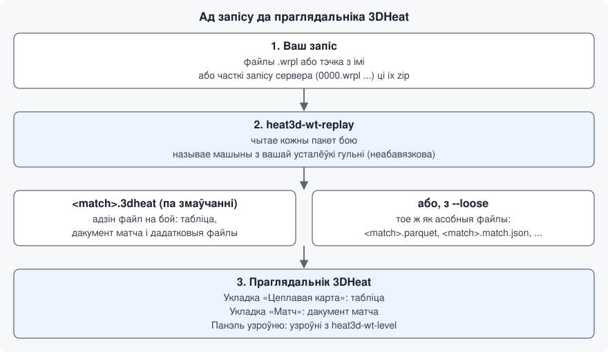

# Запісы 3DHeat War Thunder {#dheat-war-thunder-replays}

**Што гэта?** War Thunder можа запісаць бой як файл запісу. Гэты інструмент
ператварае запіс у файл, які можна глядзець зверху ў
[праглядальніку 3DHeat](https://holdi601.github.io/3DHeat/): з кожным
самалётам, танкам і караблём, кожнай ракетай і бомбай і кожным трапленнем
там, дзе яно адбылося. Другая каманда ператварае ўзроўні вашай уласнай
усталёўкі гульні ў 3D-узроўні, на якіх паказваюцца баі.

**Навошта гэта мне?** Для разбору бою ў 3D; для цеплавых карт таго, дзе вы і
іншыя лятаеце, ездзіце, б'яцеся і гінеце за многія баі; каб бачыць, куды
трапляюць трапленні па машыне; каб бачыць, што бой каштаваў і прынёс. Вывад -
звычайныя Parquet і JSON, таму іх могуць чытаць і іншыя інструменты.

**Прыклад:** адзін запіс `.wrpl` на ўваходзе, адзін файл `<match>.3dheat` на
выхадзе:



## Хуткі старт {#quick-start}

Вы новічок у камандным радку? Спачатку прачытайце [Перад пачаткам](before-you-start.md).

```bash
git clone https://github.com/Holdi601/3DHeat-Ext-WarThunder.git
cd 3DHeat-Ext-WarThunder
pip install -e .                                  # installs heat3d-wt-replay and heat3d-wt-level
heat3d-wt-replay "<War Thunder>/Replays" -o out
```

Вы павінны ўбачыць па радку на кожны бой: `ok out/<map>/<match>.3dheat`.
Адкрыйце гэты файл у праглядальніку 3DHeat.

## Гэта дакументацыя {#this-documentation}

| Старонка | Пра што яна |
|---|---|
| [Перад пачаткам](before-you-start.md) | Python, тэрмінал і як выглядае поспех |
| [Усталёўка](installing.md) | усталёўка, назвы з вашай усталёўкі, абнаўленні |
| [Канвертаванне запісаў](converting.md) | `heat3d-wt-replay` крок за крокам, кожны параметр, паведамленні |
| [Файлы вываду](output-files.md) | файл `.3dheat`, файлы `--loose`, назвы |
| [Табліца](table.md) | кожны слупок і падзея |
| [Дакумент матча](match-document.md) | кожны ключ `<match>.match.json` |
| [Дапаможныя файлы і паўната](sidecars.md) | што захоўваецца цалкам, апроч табліцы, і лічбы |
| [Узроўні](levels.md) | `heat3d-wt-level`: узроўні з вашай усталёўкі як `.glb` |
| [Як чытаецца запіс](how-it-reads.md) | што чытаецца і як гэта правярана |
| [Самалёты](aircraft.md), [Наземныя адзінкі і камера](ground.md), [Трапленні, стрэльба і пажары](hits.md) | падрабязнасці за слупкамі |
| [Эканоміка](economy.md), [Задачы](objectives.md) | Silver Lions і ачкі даследавання; зоны захопу, аэрадромы |
| [Умовы і ліцэнзія](terms.md) | што чытаецца, крыніцы, тэсты, ліцэнзія |
| [Даведнік каманд](../cli-reference.md), [Спіс слупкоў](../columns.md) | ствараюцца з кода |

## Частка 3DHeat {#part-of-3dheat}

Гэты канвертар - адзін з інструментаў [3DHeat](https://github.com/Holdi601/3DHeat),
праглядальніка 3D-тэлеметрыі і запісаў у рэальным часе ([дакументацыя](https://holdi601.github.io/3DHeat/)).
Праглядальнік адкрывае файл `.3dheat`: табліцу - на ўкладцы «Цеплавая карта»,
дакумент матча - на ўкладцы «Матч» ([One file a match](https://holdi601.github.io/3DHeat/container.html)).
Што павінен захоўваць кожны канвертар: [Converters keep everything](https://holdi601.github.io/3DHeat/converters.html).

Кожны модуль чытання гульні - асобны невялікі праект з уласным файлам ліцэнзіі, выпускамі і трэкерам задач, таму яго можна ўсталёўваць, абнаўляць, падтрымліваць - або адклікаць па просьбе праваўладальніка - асобна, не закранаючы праглядальнік і іншыя інструменты.
3DHeat Watcher запускае гэты канвертар на новых запісах, калі ён усталяваны, і працуе без яго.

| Інструмент | Што робіць | Крыніца | Дакументацыя |
|---|---|---|---|
| Праглядальнік 3DHeat | паказвае дадзеныя ў 3D: цеплавыя карты, запісы, аналіз гонак | [3DHeat](https://github.com/Holdi601/3DHeat) | [сайт](https://holdi601.github.io/3DHeat/) |
| GameFiles | трасы і ўзроўні з файлаў, якія пастаўляюць гульні | [3DHeat-GameFiles](https://github.com/Holdi601/3DHeat-GameFiles) | [сайт](https://holdi601.github.io/3DHeat-GameFiles/) |
| GameCapture | тэлеметрыя кругоў і ўзроўні, адноўленыя з відэа гульні | [3DHeat-GameCapture](https://github.com/Holdi601/3DHeat-GameCapture) | [сайт](https://holdi601.github.io/3DHeat-GameCapture/) |
| Unreal Exporter | убудова Unreal Editor, якая экспартуе ўзровень | [3DHeat-UnrealExporter](https://github.com/Holdi601/3DHeat-UnrealExporter) | [сайт](https://holdi601.github.io/3DHeat-UnrealExporter/) |
| CS2 | дэмо і карты Counter-Strike 2 | [3DHeat-CS2](https://github.com/Holdi601/3DHeat-CS2) | [сайт](https://holdi601.github.io/3DHeat-CS2/) |
| Watcher | запісвае тое, што гульні публікуюць, пакуль вы гуляеце | [3DHeat-Watcher](https://github.com/Holdi601/3DHeat-Watcher) | [сайт](https://holdi601.github.io/3DHeat-Watcher/) |
| Рэплеі War Thunder | рэплеі `.wrpl` і ўзроўні War Thunder | [3DHeat-Ext-WarThunder](https://github.com/Holdi601/3DHeat-Ext-WarThunder) | [сайт](https://holdi601.github.io/3DHeat-Ext-WarThunder/) |
| Рэплеі World of Tanks | рэплеі `.wotreplay` | [3DHeat-Ext-WoT](https://github.com/Holdi601/3DHeat-Ext-WoT) | [сайт](https://holdi601.github.io/3DHeat-Ext-WoT/) |
| Рэплеі World of Warships | рэплеі `.wowsreplay` | [3DHeat-Ext-WoWs](https://github.com/Holdi601/3DHeat-Ext-WoWs) | [сайт](https://holdi601.github.io/3DHeat-Ext-WoWs/) |
| Дэмо Squad | дэмо сервера Squad | [3DHeat-Ext-Squad](https://github.com/Holdi601/3DHeat-Ext-Squad) | [сайт](https://holdi601.github.io/3DHeat-Ext-Squad/) |
| Карты DCS | карты DCS World як 3D-узроўні | [3DHeat-Ext-DCS](https://github.com/Holdi601/3DHeat-Ext-DCS) | [сайт](https://holdi601.github.io/3DHeat-Ext-DCS/) |
| Карты IL-2 | карты IL-2 Great Battles як 3D-узроўні | [3DHeat-Ext-IL2](https://github.com/Holdi601/3DHeat-Ext-IL2) | [сайт](https://holdi601.github.io/3DHeat-Ext-IL2/) |

---

Частка [3DHeat](https://github.com/Holdi601/3DHeat) ([дакументацыя](https://holdi601.github.io/3DHeat/)). Крыніца: [3DHeat-Ext-WarThunder](https://github.com/Holdi601/3DHeat-Ext-WarThunder).
