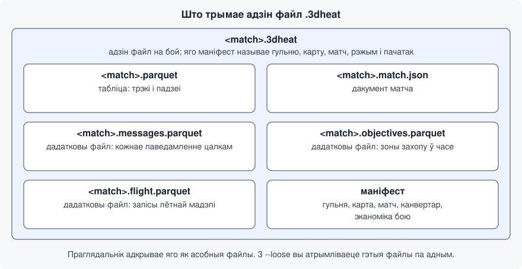
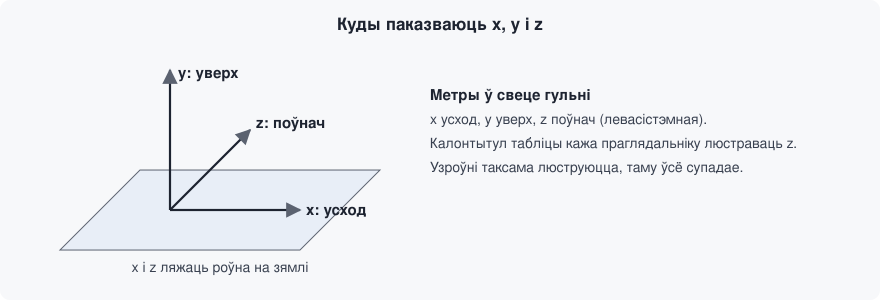

# Файлы вываду {#output-files}

Па змаўчанні кожны бой - **адзін файл**, `out/<map>/<match>.3dheat`: табліца,
дакумент матча і дадатковыя файлы, спакаваныя разам, з маніфестам, які
называе гульню, карту, матч, рэжым бою, час пачатку і канвертар (і эканоміку
бою пад `extensions["heat3d/economy"]`). Фармат належыць праглядальніку:
[One file a match (.3dheat)](https://holdi601.github.io/3DHeat/container.html).

З `--loose` тыя ж файлы замест гэтага запісваюцца побач:

| Файл | Што | Старонка |
|---|---|---|
| `<match>.parquet` | адзін радок на адлік або падзею | [Табліца](table.md) |
| `<match>.match.json` | усё астатняе, што кажа запіс | [Дакумент матча](match-document.md) |
| `<match>.messages.parquet` | кожнае паведамленне, значэнне кампанента і пакет, цалкам | [Дадатковыя файлы](sidecars.md) |
| `<match>.objectives.parquet` | зоны захопу ў часе | [Дадатковыя файлы](sidecars.md) |
| `<match>.flight.parquet` | кожны запіс лётнай мадэлі кожнага самалёта, цалкам | [Дадатковыя файлы](sidecars.md) |

Калі спакаваць не ўдаецца, асобныя файлы захоўваюцца, і радок пра гэта кажа.

## Назвы {#names}

`<match>` - гэта `<map>_<AB|RB|SB>_<mode>_<start, UTC>_<session id>`, як на
малюнку: гл. [Якія файлы складаюць адзін бой](converting.md#which-files-are-one-battle).
`<map>` - гэта ўласны id карты ў гульні (`99_testmap` на малюнках).

## Каардынаты {#coordinates}

Метры, у ўласным свеце гульні: x усход, y уверх, z поўнач. Калонтытул
табліцы кажа праглядальніку люстраваць z, а ўзроўні з `heat3d-wt-level`
запісваюцца гэтак жа, таму запіс і яго ўзровень ляжаць адзін на адным.

---

Частка [3DHeat](https://github.com/Holdi601/3DHeat) ([дакументацыя](https://holdi601.github.io/3DHeat/)). Крыніца: [3DHeat-Ext-WarThunder](https://github.com/Holdi601/3DHeat-Ext-WarThunder).
