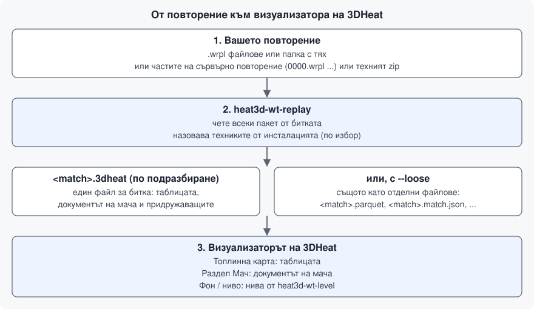

# 3DHeat репликите на War Thunder {#dheat-war-thunder-replays}

**Какво е това?** War Thunder може да запише битка като файл с повторение. Този инструмент
превръща записа във файл, който можете да гледате отгоре в
[3DHeat визуализатора](https://holdi601.github.io/3DHeat/), с всеки самолет, танк
и кораб, всяка ракета и бомба и всяко попадение на мястото, където е станало.
Втора команда превръща нивата от вашата собствена инсталация на играта в 3D нива,
върху които се показват битките.

**Защо да го използвам?** За разбор на битка в 3D; за топлинни карти на това
къде летите, карате, се биете и загивате, при много битки; за да видите къде са
попаднали удари по една техника; за да видите колко е струвала една битка и колко
е донесла. Резултатът е обикновен Parquet и JSON, така че и други инструменти могат
да го четат.

**Пример:** един `.wrpl` файл с повторение на входа, един файл `<match>.3dheat` на изхода:



## Бърз старт {#quick-start}

Нов ли сте в командния ред? Първо прочетете [Преди да започнете](before-you-start.md).

```bash
git clone https://github.com/Holdi601/3DHeat-Ext-WarThunder.git
cd 3DHeat-Ext-WarThunder
pip install -e .                                  # installs heat3d-wt-replay and heat3d-wt-level
heat3d-wt-replay "<War Thunder>/Replays" -o out
```

За всяка битка ще видите по един ред: `ok out/<map>/<match>.3dheat`. Отворете този
файл във 3DHeat визуализатора.

## Тази документация {#this-documentation}

| Страница | Какво разглежда |
|---|---|
| [Преди да започнете](before-you-start.md) | Python, терминал и как изглежда успехът |
| [Инсталиране](installing.md) | инсталиране, имена от вашата инсталация, обновявания |
| [Преобразуване на повторенията](converting.md) | `heat3d-wt-replay` стъпка по стъпка, всяка опция, съобщения |
| [Изходни файлове](output-files.md) | файлът `.3dheat`, файловете `--loose`, имената |
| [Таблицата](table.md) | всяка колона и всяко събитие |
| [Документът на мача](match-document.md) | всеки ключ на `<match>.match.json` |
| [Придружаващи файлове и пълнота](sidecars.md) | какво се пази цяло освен таблицата, и броенията |
| [Нива](levels.md) | `heat3d-wt-level`: нива от вашата инсталация като `.glb` |
| [Как се чете повторението](how-it-reads.md) | какво се чете и как е проверено |
| [Самолети](aircraft.md), [Наземни единици и камера](ground.md), [Попадения, стрелба и пожари](hits.md) | подробностите зад колоните |
| [Икономика](economy.md), [Цели](objectives.md) | Silver Lions и точки за изследвания; зони за превземане, летища |
| [Условия и лиценз](terms.md) | условията на Gaijin, източници, тестове, лиценз |
| [Справка за командите](../cli-reference.md), [Списък на колоните](../columns.md) | генерирани от кода |

## Част от 3DHeat {#part-of-3dheat}

Този преобразувател е един от инструментите на [3DHeat](https://github.com/Holdi601/3DHeat),
реалновремева 3D визуализация на телеметрия и повторения ([документация](https://holdi601.github.io/3DHeat/)).
Визуализаторът отваря файла `.3dheat`: таблицата в своя раздел Топлинна карта,
документа на мача в своя раздел Мач
([Един файл за мач](https://holdi601.github.io/3DHeat/container.html)).
Какво трябва да запазва всеки преобразувател: [Преобразувателите запазват всичко](https://holdi601.github.io/3DHeat/converters.html).

**Защо е отделен инструмент.** Форматът `.wrpl` не е документиран, а лицензионното
споразумение на Gaijin (3.2.2, 3.2.9) забранява обратното инженерство на играта и
добиването на данни, които не са предназначени за показване; то не споменава
повторенията, които самата игра показва на играча. За да засяга един лицензионен
въпрос само този преобразувател, той живее извън 3DHeat Watcher: Watcher го пуска
върху новите повторения, когато е инсталиран, и работи и без него.

| Инструмент | Какво прави | Източник | Документация |
|---|---|---|---|
| 3DHeat визуализатор | показва данните в 3D: топлинни карти, повторения, анализ на състезания | [3DHeat](https://github.com/Holdi601/3DHeat) | [сайт](https://holdi601.github.io/3DHeat/) |
| GameFiles | трасета и нива от файловете, които игрите носят | [3DHeat-GameFiles](https://github.com/Holdi601/3DHeat-GameFiles) | [сайт](https://holdi601.github.io/3DHeat-GameFiles/) |
| GameCapture | телеметрия от обиколки и нива, възстановени от видеозаписи на играта | [3DHeat-GameCapture](https://github.com/Holdi601/3DHeat-GameCapture) | [сайт](https://holdi601.github.io/3DHeat-GameCapture/) |
| Unreal Exporter | приставка за Unreal Editor, която експортира нива | [3DHeat-UnrealExporter](https://github.com/Holdi601/3DHeat-UnrealExporter) | [сайт](https://holdi601.github.io/3DHeat-UnrealExporter/) |
| CS2 | демота и карти на Counter-Strike 2 | [3DHeat-CS2](https://github.com/Holdi601/3DHeat-CS2) | [сайт](https://holdi601.github.io/3DHeat-CS2/) |
| Watcher | записва това, което игрите публикуват, докато играете | [3DHeat-Watcher](https://github.com/Holdi601/3DHeat-Watcher) | [сайт](https://holdi601.github.io/3DHeat-Watcher/) |
| War Thunder повторения | повторения `.wrpl` и нива на War Thunder | [3DHeat-Ext-WarThunder](https://github.com/Holdi601/3DHeat-Ext-WarThunder) | [сайт](https://holdi601.github.io/3DHeat-Ext-WarThunder/) |
| World of Tanks повторения | повторения `.wotreplay` | [3DHeat-Ext-WoT](https://github.com/Holdi601/3DHeat-Ext-WoT) | [сайт](https://holdi601.github.io/3DHeat-Ext-WoT/) |
| World of Warships повторения | повторения `.wowsreplay` | [3DHeat-Ext-WoWs](https://github.com/Holdi601/3DHeat-Ext-WoWs) | [сайт](https://holdi601.github.io/3DHeat-Ext-WoWs/) |
| Squad демота | демота от сървъри на Squad | [3DHeat-Ext-Squad](https://github.com/Holdi601/3DHeat-Ext-Squad) | [сайт](https://holdi601.github.io/3DHeat-Ext-Squad/) |
| DCS карти | карти на DCS World като 3D нива | [3DHeat-Ext-DCS](https://github.com/Holdi601/3DHeat-Ext-DCS) | [сайт](https://holdi601.github.io/3DHeat-Ext-DCS/) |
| IL-2 карти | карти на IL-2 Great Battles като 3D нива | [3DHeat-Ext-IL2](https://github.com/Holdi601/3DHeat-Ext-IL2) | [сайт](https://holdi601.github.io/3DHeat-Ext-IL2/) |

---

Част от [3DHeat](https://github.com/Holdi601/3DHeat) ([документация](https://holdi601.github.io/3DHeat/)). Източник: [3DHeat-Ext-WarThunder](https://github.com/Holdi601/3DHeat-Ext-WarThunder).
