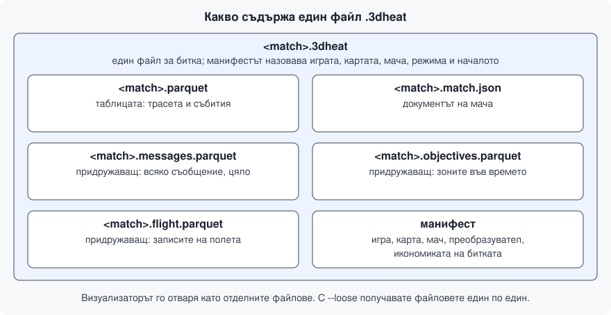
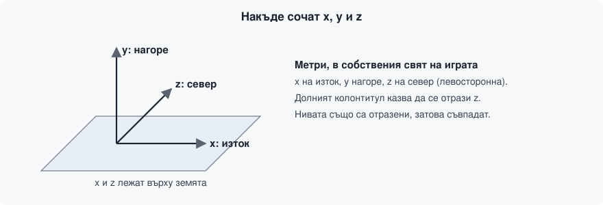

# Изходни файлове {#output-files}

По подразбиране всяка битка е **един файл**, `out/<map>/<match>.3dheat`: таблицата, документът на мача и
придружаващите файлове, събрани заедно, с манифест, който назовава играта, картата, мача, режима на битката, часа на
започване и преобразувателя (а икономиката на битката – под `extensions["heat3d/economy"]`). Форматът е този на
визуализатора: [Един файл за мач (.3dheat)](https://holdi601.github.io/3DHeat/container.html).

С `--loose` същите файлове се записват един до друг:

| Файл | Какво е | Страница |
|---|---|---|
| `<match>.parquet` | по един ред за всяка проба или събитие | [Таблицата](table.md) |
| `<match>.match.json` | всичко останало, което казва повторението | [Документът на мача](match-document.md) |
| `<match>.messages.parquet` | всяко съобщение, стойност на компонент и пакет, цели | [Придружаващи файлове](sidecars.md) |
| `<match>.objectives.parquet` | зоните за превземане във времето | [Придружаващи файлове](sidecars.md) |
| `<match>.flight.parquet` | всеки запис на полетния модел на всеки самолет, цял | [Придружаващи файлове](sidecars.md) |

Ако опаковането не успее, отделните файлове се запазват и редът казва това.

## Имена {#names}

`<match>` е `<map>_<AB|RB|SB>_<mode>_<start, UTC>_<session id>`, както на картинката: вижте
[Кои файлове са една битка](converting.md#which-files-are-one-battle).
`<map>` е собственият идентификатор на картата в играта (`99_testmap` на картинките).

## Координати {#coordinates}

Метри, в собствения свят на играта: x на изток, y нагоре, z на север. Футърът на таблицата
казва на визуализатора да отрази z, а нивата от `heat3d-wt-level` се записват по същия начин,
така че повторението и нивото му легват едно върху друго.

---

Част от [3DHeat](https://github.com/Holdi601/3DHeat) ([документация](https://holdi601.github.io/3DHeat/)). Източник: [3DHeat-Ext-WarThunder](https://github.com/Holdi601/3DHeat-Ext-WarThunder).
