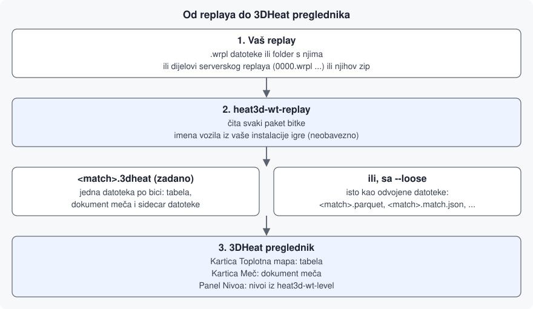

# 3DHeat War Thunder replayevi {#dheat-war-thunder-replays}

**Šta je to?** War Thunder može snimiti bitku kao replay datoteku. Ovaj alat
pretvara snimak u datoteku koju možete gledati odozgo u
[3DHeat pregledniku](https://holdi601.github.io/3DHeat/), sa svakim avionom, tenkom
i brodom, svakom raketom i bombom i svakim pogotkom na mjestu gdje se desio. Druga
naredba pretvara nivoe vaše vlastite instalacije igre u 3D nivoe na kojima se
bitke prikazuju.

**Zašto bih ga koristio?** Za analizu bitke u 3D-u; za toplotne mape
mjesta gdje vi i drugi letite, vozite, borite se i poginete kroz mnogo bitaka; da vidite
gdje su pogoci pali na vozilo; da vidite šta je bitka koštala i donijela. Izlaz
su obični Parquet i JSON, pa ga mogu čitati i drugi alati.

**Primjer:** jedan `.wrpl` replay na ulazu, jedna `<match>.3dheat` datoteka na izlazu:



## Brzi početak {#quick-start}

Niste navikli na komandnu liniju? Prvo pročitajte [Prije nego počnete](before-you-start.md).

```bash
git clone https://github.com/Holdi601/3DHeat-Ext-WarThunder.git
cd 3DHeat-Ext-WarThunder
pip install -e .                                  # installs heat3d-wt-replay and heat3d-wt-level
heat3d-wt-replay "<War Thunder>/Replays" -o out
```

Trebali biste vidjeti jedan red po bici: `ok out/<map>/<match>.3dheat`. Otvorite tu
datoteku u 3DHeat pregledniku.

## Ova dokumentacija {#this-documentation}

| Stranica | Šta pokriva |
|---|---|
| [Prije nego počnete](before-you-start.md) | Python, terminal i kako izgleda uspjeh |
| [Instalacija](installing.md) | instalacija, imena iz vaše instalacije, ažuriranja |
| [Pretvaranje replayeva](converting.md) | `heat3d-wt-replay` korak po korak, sve opcije, poruke |
| [Izlazne datoteke](output-files.md) | `.3dheat` datoteka, `--loose` datoteke, imena |
| [Tabela](table.md) | svaka kolona i događaj |
| [Dokument meča](match-document.md) | svaki ključ u `<match>.match.json` |
| [Sidecar datoteke i potpunost](sidecars.md) | šta se još čuva cijelo osim tabele, i brojevi |
| [Nivoi](levels.md) | `heat3d-wt-level`: nivoi iz vaše instalacije kao `.glb` |
| [Kako čita replay](how-it-reads.md) | šta se čita i kako je provjereno |
| [Avioni](aircraft.md), [Kopnene jedinice i kamera](ground.md), [Pogoci, paljba i požari](hits.md) | detalji iza kolona |
| [Ekonomija](economy.md), [Ciljevi](objectives.md) | Silver Lions i bodovi istraživanja; zone zauzimanja, aerodromi |
| [Uvjeti i licenca](terms.md) | Gaijinovi uvjeti, izvori, testovi, licenca |
| [Referenca naredbi](../cli-reference.md), [Lista kolona](../columns.md) | generisano iz koda |

## Dio 3DHeata {#part-of-3dheat}

Ovaj konverter je jedan od alata [3DHeata](https://github.com/Holdi601/3DHeat),
3D preglednika telemetrije i replayeva u stvarnom vremenu ([dokumentacija](https://holdi601.github.io/3DHeat/)).
Preglednik otvara `.3dheat` datoteku: tabelu u kartici Toplotna mapa, dokument
meča u kartici Meč ([Jedna datoteka po meču](https://holdi601.github.io/3DHeat/container.html)).
Šta svaki konverter mora zadržati: [Konverteri čuvaju sve](https://holdi601.github.io/3DHeat/converters.html).

**Zašto je to poseban alat.** Format `.wrpl` nije dokumentiran, a
Gaijinov EULA (3.2.2, 3.2.9) zabranjuje reverzno inženjerstvo igre i vađenje
podataka koji nisu namijenjeni prikazivanju; replayeve ne spominje, a igra ih sama
pokazuje igraču. Da bi se pitanje licence ticalo samo ovog konvertera, on
živi izvan 3DHeat Watchera: Watcher ga pokreće nad novim replayevima kada je
instaliran, i radi i bez njega.

| Alat | Šta radi | Izvor | Dokumentacija |
|---|---|---|---|
| 3DHeat preglednik | prikazuje podatke u 3D-u: toplotne mape, replayeve, analizu utrka | [3DHeat](https://github.com/Holdi601/3DHeat) | [stranica](https://holdi601.github.io/3DHeat/) |
| GameFiles | staze i nivoi iz datoteka koje igre isporučuju | [3DHeat-GameFiles](https://github.com/Holdi601/3DHeat-GameFiles) | [stranica](https://holdi601.github.io/3DHeat-GameFiles/) |
| GameCapture | telemetrija krugova i nivoi rekonstruirani iz video snimka igranja | [3DHeat-GameCapture](https://github.com/Holdi601/3DHeat-GameCapture) | [stranica](https://holdi601.github.io/3DHeat-GameCapture/) |
| Unreal Exporter | dodatak za Unreal Editor koji izvozi nivo | [3DHeat-UnrealExporter](https://github.com/Holdi601/3DHeat-UnrealExporter) | [stranica](https://holdi601.github.io/3DHeat-UnrealExporter/) |
| CS2 | Counter-Strike 2 demo snimci i mape | [3DHeat-CS2](https://github.com/Holdi601/3DHeat-CS2) | [stranica](https://holdi601.github.io/3DHeat-CS2/) |
| Watcher | bilježi ono što igre objavljuju dok igrate | [3DHeat-Watcher](https://github.com/Holdi601/3DHeat-Watcher) | [stranica](https://holdi601.github.io/3DHeat-Watcher/) |
| War Thunder replayevi | `.wrpl` replayevi i War Thunder nivoi | [3DHeat-Ext-WarThunder](https://github.com/Holdi601/3DHeat-Ext-WarThunder) | [stranica](https://holdi601.github.io/3DHeat-Ext-WarThunder/) |
| World of Tanks replayevi | `.wotreplay` replayevi | [3DHeat-Ext-WoT](https://github.com/Holdi601/3DHeat-Ext-WoT) | [stranica](https://holdi601.github.io/3DHeat-Ext-WoT/) |
| World of Warships replayevi | `.wowsreplay` replayevi | [3DHeat-Ext-WoWs](https://github.com/Holdi601/3DHeat-Ext-WoWs) | [stranica](https://holdi601.github.io/3DHeat-Ext-WoWs/) |
| Squad demo snimci | Squad serverski demo snimci | [3DHeat-Ext-Squad](https://github.com/Holdi601/3DHeat-Ext-Squad) | [stranica](https://holdi601.github.io/3DHeat-Ext-Squad/) |
| DCS mape | DCS World mape kao 3D nivoi | [3DHeat-Ext-DCS](https://github.com/Holdi601/3DHeat-Ext-DCS) | [stranica](https://holdi601.github.io/3DHeat-Ext-DCS/) |
| IL-2 mape | IL-2 Great Battles mape kao 3D nivoi | [3DHeat-Ext-IL2](https://github.com/Holdi601/3DHeat-Ext-IL2) | [stranica](https://holdi601.github.io/3DHeat-Ext-IL2/) |

---

Dio [3DHeata](https://github.com/Holdi601/3DHeat) ([dokumentacija](https://holdi601.github.io/3DHeat/)). Izvor: [3DHeat-Ext-WarThunder](https://github.com/Holdi601/3DHeat-Ext-WarThunder).
