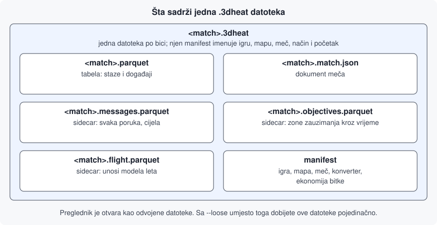
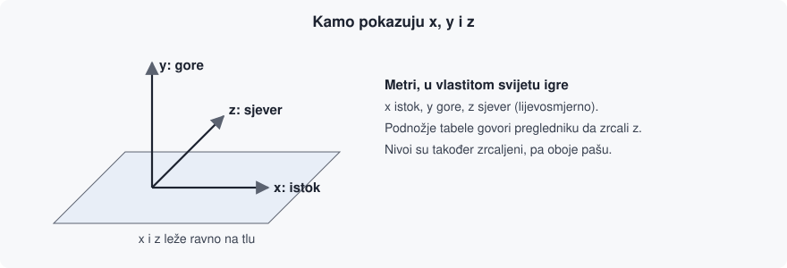

# Izlazne datoteke {#output-files}

Zadano je svaka bitka **jedna datoteka**, `out/<map>/<match>.3dheat`: tabela,
dokument meča i sidecar datoteke spakirani zajedno, s manifestom koji
imenuje igru, mapu, meč, način bitke, vrijeme početka i konverter (a ekonomiju
bitke pod `extensions["heat3d/economy"]`). Format je formatom preglednika:
[Jedna datoteka po meču (.3dheat)](https://holdi601.github.io/3DHeat/container.html).

Sa `--loose` iste datoteke se umjesto toga pišu jedna pored druge:

| Datoteka | Šta | Stranica |
|---|---|---|
| `<match>.parquet` | jedan red po uzorku ili događaju | [Tabela](table.md) |
| `<match>.match.json` | sve ostalo što replay kaže | [Dokument meča](match-document.md) |
| `<match>.messages.parquet` | svaka poruka, vrijednost komponente i paket, cijeli | [Sidecar datoteke](sidecars.md) |
| `<match>.objectives.parquet` | zone zauzimanja kroz vrijeme | [Sidecar datoteke](sidecars.md) |
| `<match>.flight.parquet` | svaki unos modela leta svakog aviona, cijeli | [Sidecar datoteke](sidecars.md) |

Ako pakiranje ne uspije, odvojene datoteke se zadržavaju i red to kaže.

## Imena {#names}

`<match>` je `<map>_<AB|RB|SB>_<mode>_<start, UTC>_<session id>`, kao na
slici: vidi [Koje datoteke čine jednu bitku](converting.md#which-files-are-one-battle).
`<map>` je vlastiti id mape u igri (`99_testmap` na slikama).

## Koordinate {#coordinates}

Metri, u vlastitom svijetu igre: x istok, y gore, z sjever. Podnožje tabele
govori pregledniku da zrcali z, a nivoi iz `heat3d-wt-level` pišu se
na isti način, pa replay i njegov nivo leže jedan na drugom.

---

Dio [3DHeata](https://github.com/Holdi601/3DHeat) ([dokumentacija](https://holdi601.github.io/3DHeat/)). Izvor: [3DHeat-Ext-WarThunder](https://github.com/Holdi601/3DHeat-Ext-WarThunder).
