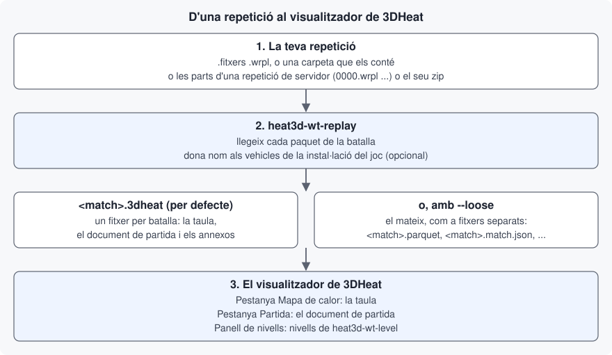

# Repeticions de War Thunder per a 3DHeat {#dheat-war-thunder-replays}

**Què és?** War Thunder pot gravar una batalla com a fitxer de repetició. Aquesta
eina converteix la gravació en un fitxer que pots veure des de dalt al
[visualitzador de 3DHeat](https://holdi601.github.io/3DHeat/), amb cada avió, tanc
i vaixell, cada míssil i bomba, i cada impacte al lloc on va passar. Una segona
ordre converteix els nivells de la teva instal·lació del joc en nivells 3D on
mostrar les batalles.

**Per què la faria servir?** Per fer un repàs en 3D d'una batalla; per fer mapes de
calor de on volen, condueixen, lluiten i moren tu i els altres en moltes
batalles; per veure on van impactar els trets en un vehicle; per veure què li va
costar una batalla i què va guanyar. La sortida és Parquet i JSON normals, de
manera que altres eines també la poden llegir.

**Exemple:** entra un fitxer `.wrpl` de repetició i en surt un fitxer
`<partida>.3dheat`:



## Inici ràpid {#quick-start}

No n'has fet mai servir la línia d'ordres? Llegeix primer [Abans de començar](before-you-start.md).

```bash
git clone https://github.com/Holdi601/3DHeat-Ext-WarThunder.git
cd 3DHeat-Ext-WarThunder
pip install -e .                                  # instal·la heat3d-wt-replay i heat3d-wt-level
heat3d-wt-replay "<War Thunder>/Replays" -o out
```

Hauries de veure una línia per batalla: `ok out/<mapa>/<partida>.3dheat`. Obre
aquest fitxer al visualitzador de 3DHeat.

## Aquesta documentació {#this-documentation}

| Pàgina | Què cobreix |
|---|---|
| [Abans de començar](before-you-start.md) | Python, un terminal i com és l'èxit |
| [Instal·lació](installing.md) | la instal·lació, els noms de la teva instal·lació, les actualitzacions |
| [Conversió de repeticions](converting.md) | `heat3d-wt-replay` pas a pas, cada opció, els missatges |
| [Fitxers de sortida](output-files.md) | el fitxer `.3dheat`, els fitxers `--loose`, els noms |
| [La taula](table.md) | cada columna i cada esdeveniment |
| [El document de partida](match-document.md) | cada clau de `<partida>.match.json` |
| [Annexos i completesa](sidecars.md) | què es guarda sencer a més de la taula, i els recomptes |
| [Nivells](levels.md) | `heat3d-wt-level`: nivells de la teva instal·lació com a `.glb` |
| [Com llegeix una repetició](how-it-reads.md) | què es llegeix, i com es va comprovar |
| [Aeronaus](aircraft.md), [Unitats terrestres i càmera](ground.md), [Impactes, trets i focs](hits.md) | els detalls que hi ha darrere de les columnes |
| [Economia](economy.md), [Objectius](objectives.md) | Lleons de plata i punts d'investigació; zones de captura, aeròdroms |
| [Condicions i llicència](terms.md) | les condicions de Gaijin, les fonts, les proves, la llicència |
| [Referència d'ordres](../cli-reference.md), [Llista de columnes](../columns.md) | generades a partir del codi |

## Part de 3DHeat {#part-of-3dheat}

Aquest convertidor és una de les eines de [3DHeat](https://github.com/Holdi601/3DHeat),
un visualitzador en 3D, en temps real, de telemetria i repeticions
([documentació](https://holdi601.github.io/3DHeat/)). El visualitzador obre el fitxer
`.3dheat`: la taula a la seva pestanya Mapa de calor, el document de partida a la
seva pestanya Partida ([Un fitxer per partida](https://holdi601.github.io/3DHeat/container.html)).
La regla que ha de complir tot convertidor: [Els convertidors ho guarden tot](https://holdi601.github.io/3DHeat/converters.html).

**Per què és una eina a part.** El format `.wrpl` no està documentat, i l'EULA de
Gaijin (3.2.2, 3.2.9) prohibeix la enginyeria inversa del joc i la mineria de
dades que no estan pensades per mostrar-se; no esmenta les repeticions, que el
mateix joc mostra al jugador. Perquè una pregunta de llicència només afecti
aquest convertidor, viu fora del Watcher de 3DHeat: el Watcher l'executa sobre les
repeticions noves quan està instal·lat, i funciona sense ell.

| Eina | Què fa | Font | Documentació |
|---|---|---|---|
| Visualitzador de 3DHeat | mostra les dades en 3D: mapes de calor, repeticions, anàlisi de curses | [3DHeat](https://github.com/Holdi601/3DHeat) | [web](https://holdi601.github.io/3DHeat/) |
| GameFiles | recorreguts i nivells extrets dels fitxers que distribueixen els jocs | [3DHeat-GameFiles](https://github.com/Holdi601/3DHeat-GameFiles) | [web](https://holdi601.github.io/3DHeat-GameFiles/) |
| GameCapture | telemetria de volta, i nivells reconstruïts a partir del vídeo de la partida | [3DHeat-GameCapture](https://github.com/Holdi601/3DHeat-GameCapture) | [web](https://holdi601.github.io/3DHeat-GameCapture/) |
| Exportador per a Unreal | un connector de l'Editor d'Unreal que exporta un nivell | [3DHeat-UnrealExporter](https://github.com/Holdi601/3DHeat-UnrealExporter) | [web](https://holdi601.github.io/3DHeat-UnrealExporter/) |
| CS2 | demos i mapes de Counter-Strike 2 | [3DHeat-CS2](https://github.com/Holdi601/3DHeat-CS2) | [web](https://holdi601.github.io/3DHeat-CS2/) |
| Watcher | registra el que publiquen els jocs mentre hi jugues | [3DHeat-Watcher](https://github.com/Holdi601/3DHeat-Watcher) | [web](https://holdi601.github.io/3DHeat-Watcher/) |
| Repeticions de War Thunder | repeticions `.wrpl` i nivells de War Thunder | [3DHeat-Ext-WarThunder](https://github.com/Holdi601/3DHeat-Ext-WarThunder) | [web](https://holdi601.github.io/3DHeat-Ext-WarThunder/) |
| Repeticions de World of Tanks | repeticions `.wotreplay` | [3DHeat-Ext-WoT](https://github.com/Holdi601/3DHeat-Ext-WoT) | [web](https://holdi601.github.io/3DHeat-Ext-WoT/) |
| Repeticions de World of Warships | repeticions `.wowsreplay` | [3DHeat-Ext-WoWs](https://github.com/Holdi601/3DHeat-Ext-WoWs) | [web](https://holdi601.github.io/3DHeat-Ext-WoWs/) |
| Demos de Squad | demos de servidor de Squad | [3DHeat-Ext-Squad](https://github.com/Holdi601/3DHeat-Ext-Squad) | [web](https://holdi601.github.io/3DHeat-Ext-Squad/) |
| Mapes de DCS | mapes del món de DCS com a nivells 3D | [3DHeat-Ext-DCS](https://github.com/Holdi601/3DHeat-Ext-DCS) | [web](https://holdi601.github.io/3DHeat-Ext-DCS/) |
| Mapes d'IL-2 | mapes d'IL-2 Great Battles com a nivells 3D | [3DHeat-Ext-IL2](https://github.com/Holdi601/3DHeat-Ext-IL2) | [web](https://holdi601.github.io/3DHeat-Ext-IL2/) |

---

Part de [3DHeat](https://github.com/Holdi601/3DHeat) ([documentació](https://holdi601.github.io/3DHeat/)). Font: [3DHeat-Ext-WarThunder](https://github.com/Holdi601/3DHeat-Ext-WarThunder).
