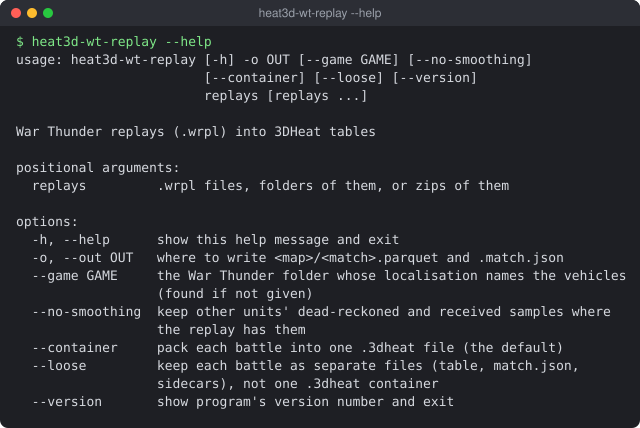

# Instal·lació {#installing}

No n'has fet mai servir la línia d'ordres? Llegeix primer
[Abans de començar](before-you-start.md). Cal Python 3.10 o posterior; pyarrow, numpy,
zstandard i Pillow s'instal·len amb ell.

## Pas a pas {#step-by-step}

1. Obtén el codi: `git clone https://github.com/Holdi601/3DHeat-Ext-WarThunder.git`,
   o descarrega un zip des de [Releases](https://github.com/Holdi601/3DHeat-Ext-WarThunder/releases)
   i descomprimeix-lo.
2. Obre un terminal en aquesta carpeta i escriu `pip install -e .`. Això instal·la
   dues ordres: `heat3d-wt-replay` (repeticions) i `heat3d-wt-level` (nivells).
3. Comprova-ho: `heat3d-wt-replay --version`. Hauries de veure
   `heat3d-wt-replay 0.2.0`. `heat3d-wt-replay --help` llista les opcions:

Sense instal·lar: `python -m heat3d_ext_warthunder ...` i
`python -m heat3d_ext_warthunder.levelcli ...` a la carpeta de l'eina.

## Noms de la teva instal·lació {#names-from-your-install}

Els vehicles, les armes i la munició reben els seus noms en anglès dels fitxers de
text del propi joc, llegits de la teva instal·lació durant la conversió. La
instal·lació es troba a través de Steam o de les carpetes per defecte del llançador;
`--game <carpeta>` o la variable d'entorn `HEAT3D_WT_GAME` indiquen on és, si no es
troba. El text del joc no és en aquest repositori; sense instal·lació els noms són
els identificadors dels vehicles (el convertidor ho indica amb una línia `note:`).

## Actualitzacions {#updates}

Cada inici consulta primer les versions de GitHub del projecte (com a molt una
petició cada unes quantes hores; mai no atura una conversió, estigui en línia o no).
Quan hi ha una versió nova, l'ordre pregunta abans d'instal·lar-la: un `git clone` s'actualitza amb `git pull --ff-only` (es nega si tens canvis locals), i una còpia
descarregada, des de l'arxiu de la versió. `HEAT3D_NO_UPDATE=1` desactiva la
consulta i l'actualització.

---

Part de [3DHeat](https://github.com/Holdi601/3DHeat) ([documentació](https://holdi601.github.io/3DHeat/)). Font: [3DHeat-Ext-WarThunder](https://github.com/Holdi601/3DHeat-Ext-WarThunder).
