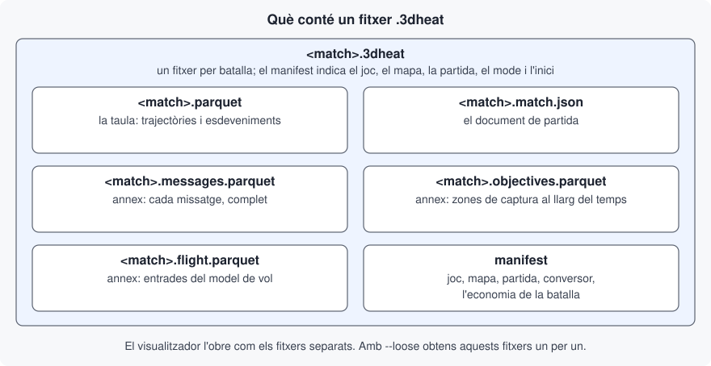
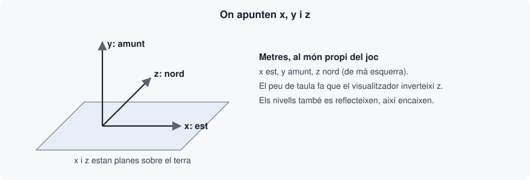

# Fitxers de sortida {#output-files}

Per defecte, cada batalla és **un fitxer**, `out/<mapa>/<partida>.3dheat`: la
taula, el document de partida i els annexos empaquetats junts, amb un manifest que
indica el joc, el mapa, la partida, el mode de batalla, l'hora d'inici i el
convertidor (i l'economia de la batalla sota `extensions["heat3d/economy"]`). El
format és el del visualitzador:
[Un fitxer per partida (.3dheat)](https://holdi601.github.io/3DHeat/container.html).

Amb `--loose` els mateixos fitxers s'escriuen un al costat de l'altre:

| Fitxer | Què és | Pàgina |
|---|---|---|
| `<partida>.parquet` | una fila per mostra o esdeveniment | [La taula](table.md) |
| `<partida>.match.json` | tot el altre que diu la repetició | [El document de partida](match-document.md) |
| `<partida>.messages.parquet` | cada missatge, valor de component i paquet, complet | [Annexos](sidecars.md) |
| `<partida>.objectives.parquet` | les zones de captura al llarg del temps | [Annexos](sidecars.md) |
| `<partida>.flight.parquet` | cada entrada del model de vol de cada avió, completa | [Annexos](sidecars.md) |

Si l'empaquetat falla, es mantenen els fitxers separats i la línia ho indica.

## Noms {#names}

`<partida>` és `<mapa>_<AB|RB|SB>_<mode>_<inici, UTC>_<id de sessió>`, com a la
imatge: vegeu [Quins fitxers són una batalla](converting.md#which-files-are-one-battle).
`<mapa>` és l'identificador del mapa dins del joc (`99_testmap` a les imatges).

## Coordenades {#coordinates}

Metres, al món propi del joc: x est, y amunt, z nord. El peu de la taula indica al
visualitzador que reflecteixi z, i els nivells de `heat3d-wt-level` s'escriuen de la
mateixa manera, de manera que una repetició i el seu nivell encaixen l'un sobre
l'altre.

---

Part de [3DHeat](https://github.com/Holdi601/3DHeat) ([documentació](https://holdi601.github.io/3DHeat/)). Font: [3DHeat-Ext-WarThunder](https://github.com/Holdi601/3DHeat-Ext-WarThunder).
