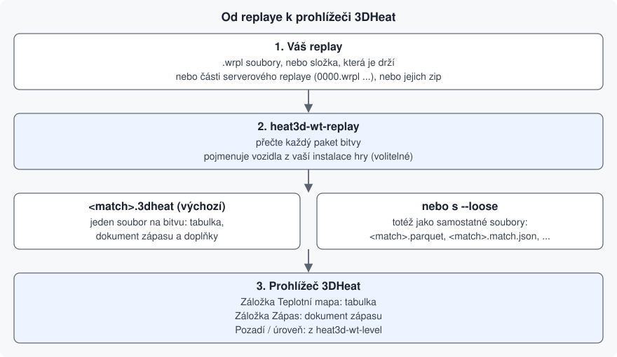

# 3DHeat replaye z War Thunder {#dheat-war-thunder-replays}

**Co to je?** War Thunder umí bitvu nahrát jako soubor replaye. Tento nástroj
promění nahrávku v soubor, který si můžete prohlédnout shora v
[prohlížeči 3DHeat](https://holdi601.github.io/3DHeat/): každé letadlo, tank
a loď, každou střelu a bombu a každý zásah tam, kde se stal. Druhý příkaz
převede úrovně z vaší vlastní instalace hry na 3D úrovně, na kterých se bitvy
zobrazí.

**Proč bych to používal?** Pro rozbor bitvy ve 3D; pro teplotní mapy toho, kde
vy i ostatní létáte, jezdíte, bojujete a umíráte, přes mnoho bitev; abyste viděli,
kam zasáhly zásahy na vozidle; abyste viděli, kolik bitva stála a co vynesla.
Výstup je prostý Parquet a JSON, takže ho přečtou i jiné nástroje.

**Příklad:** jeden replay `.wrpl` na vstupu, jeden soubor `<match>.3dheat` na výstupu:



## Rychlý start {#quick-start}

Nikdy jste nepracovali s příkazovým řádkem? Nejdříve si přečtěte [Než začnete](before-you-start.md).

```bash
git clone https://github.com/Holdi601/3DHeat-Ext-WarThunder.git
cd 3DHeat-Ext-WarThunder
pip install -e .                                  # nainstaluje heat3d-wt-replay a heat3d-wt-level
heat3d-wt-replay "<War Thunder>/Replays" -o out
```

Uvidíte jeden řádek na bitvu: `ok out/<map>/<match>.3dheat`. Otevřete ten soubor
v prohlížeči 3DHeat.

## Tato dokumentace {#this-documentation}

| Stránka | Co obsahuje |
|---|---|
| [Než začnete](before-you-start.md) | Python, terminál a jak vypadá úspěch |
| [Instalace](installing.md) | instalace, názvy z vaší instalace, aktualizace |
| [Převod replayů](converting.md) | `heat3d-wt-replay` krok za krokem, každá volba, hlášení |
| [Výstupní soubory](output-files.md) | soubor `.3dheat`, soubory `--loose`, názvy |
| [Tabulka](table.md) | každý sloupec a každá událost |
| [Dokument zápasu](match-document.md) | každý klíč souboru `<match>.match.json` |
| [Doplňky a úplnost](sidecars.md) | co se kromě tabulky uchovává celé, a počty |
| [Úrovně](levels.md) | `heat3d-wt-level`: úrovně z vaší instalace jako `.glb` |
| [Jak se replay čte](how-it-reads.md) | co se čte a jak to bylo ověřeno |
| [Letadla](aircraft.md), [Pozemní jednotky a kamera](ground.md), [Zásahy, palba a požáry](hits.md) | podrobnosti za sloupci |
| [Ekonomika](economy.md), [Cíle](objectives.md) | Stříbrné lvy a výzkumné body; zóny dobytí, letiště |
| [Podmínky a licence](terms.md) | co se čte, zdroje, testy, licence |
| [Přehled příkazů](../cli-reference.md), [Seznam sloupců](../columns.md) | generováno z kódu |

## Součást 3DHeat {#part-of-3dheat}

Tento převodník je jedním z nástrojů [3DHeat](https://github.com/Holdi601/3DHeat),
prohlížeče 3D telemetrie a replayů v reálném čase ([dokumentace](https://holdi601.github.io/3DHeat/)).
Prohlížeč otevře soubor `.3dheat`: tabulku na jeho záložce Teplotní mapa, dokument
zápasu na záložce Zápas ([Jeden soubor na zápas](https://holdi601.github.io/3DHeat/container.html)).
Co musí každý převodník zachovat: [Převodníky zachovávají vše](https://holdi601.github.io/3DHeat/converters.html).

Každá čtečka hry je samostatný malý projekt s vlastním licenčním souborem, vydáními a evidencí problémů, takže ji lze instalovat, aktualizovat, udržovat - nebo na žádost držitele práv stáhnout - samostatně, bez vlivu na prohlížeč a ostatní nástroje.
3DHeat Watcher spouští tento převodník nad novými replayi, když je nainstalovaný, a funguje i bez něj.

| Nástroj | Co dělá | Zdroj | Dokumentace |
|---|---|---|---|
| prohlížeč 3DHeat | ukazuje data ve 3D: teplotní mapy, replaye, analýzu závodu | [3DHeat](https://github.com/Holdi601/3DHeat) | [web](https://holdi601.github.io/3DHeat/) |
| GameFiles | tratě a úrovně z souborů, které hry obsahují | [3DHeat-GameFiles](https://github.com/Holdi601/3DHeat-GameFiles) | [web](https://holdi601.github.io/3DHeat-GameFiles/) |
| GameCapture | telemetrie z kol a úrovně rekonstruované z herního videa | [3DHeat-GameCapture](https://github.com/Holdi601/3DHeat-GameCapture) | [web](https://holdi601.github.io/3DHeat-GameCapture/) |
| Unreal Exporter | zásuvný modul Unreal Editoru, který exportuje úroveň | [3DHeat-UnrealExporter](https://github.com/Holdi601/3DHeat-UnrealExporter) | [web](https://holdi601.github.io/3DHeat-UnrealExporter/) |
| CS2 | dema a mapy Counter-Strike 2 | [3DHeat-CS2](https://github.com/Holdi601/3DHeat-CS2) | [web](https://holdi601.github.io/3DHeat-CS2/) |
| Watcher | zaznamenává, co hry zveřejňují, když hrajete | [3DHeat-Watcher](https://github.com/Holdi601/3DHeat-Watcher) | [web](https://holdi601.github.io/3DHeat-Watcher/) |
| replaye War Thunder | replaye `.wrpl` a úrovně War Thunder | [3DHeat-Ext-WarThunder](https://github.com/Holdi601/3DHeat-Ext-WarThunder) | [web](https://holdi601.github.io/3DHeat-Ext-WarThunder/) |
| replaye World of Tanks | replaye `.wotreplay` | [3DHeat-Ext-WoT](https://github.com/Holdi601/3DHeat-Ext-WoT) | [web](https://holdi601.github.io/3DHeat-Ext-WoT/) |
| replaye World of Warships | replaye `.wowsreplay` | [3DHeat-Ext-WoWs](https://github.com/Holdi601/3DHeat-Ext-WoWs) | [web](https://holdi601.github.io/3DHeat-Ext-WoWs/) |
| dema Squad | dema ze serverů Squad | [3DHeat-Ext-Squad](https://github.com/Holdi601/3DHeat-Ext-Squad) | [web](https://holdi601.github.io/3DHeat-Ext-Squad/) |
| mapy DCS | mapy DCS World jako 3D úrovně | [3DHeat-Ext-DCS](https://github.com/Holdi601/3DHeat-Ext-DCS) | [web](https://holdi601.github.io/3DHeat-Ext-DCS/) |
| mapy IL-2 | mapy IL-2 Great Battles jako 3D úrovně | [3DHeat-Ext-IL2](https://github.com/Holdi601/3DHeat-Ext-IL2) | [web](https://holdi601.github.io/3DHeat-Ext-IL2/) |

---

Součást [3DHeat](https://github.com/Holdi601/3DHeat) ([dokumentace](https://holdi601.github.io/3DHeat/)). Zdroj: [3DHeat-Ext-WarThunder](https://github.com/Holdi601/3DHeat-Ext-WarThunder).
