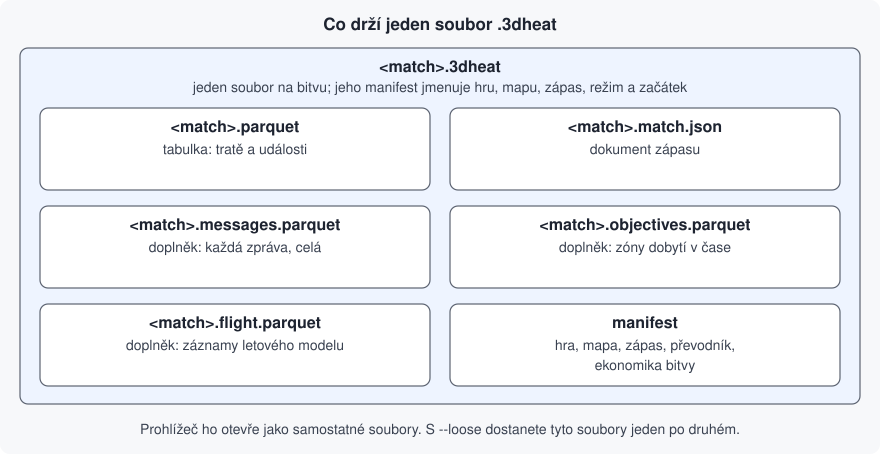
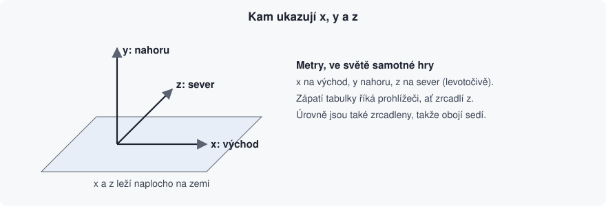

# Výstupní soubory {#output-files}

Ve výchozím nastavení je každá bitva **jeden soubor**, `out/<map>/<match>.3dheat`: tabulka, dokument zápasu
a doplňky zabalené dohromady, s manifestem, který jmenuje hru, mapu, zápas, režim bitvy, čas začátku a převodník
(a ekonomiku bitvy pod `extensions["heat3d/economy"]`). Formát je formát prohlížeče:
[Jeden soubor na zápas (.3dheat)](https://holdi601.github.io/3DHeat/container.html).

S `--loose` se stejné soubory zapíšou vedle sebe:

| Soubor | Co | Stránka |
|---|---|---|
| `<match>.parquet` | jeden řádek na vzorek nebo událost | [Tabulka](table.md) |
| `<match>.match.json` | vše ostatní, co replay říká | [Dokument zápasu](match-document.md) |
| `<match>.messages.parquet` | každá zpráva, hodnota komponenty a paket, celé | [Doplňky](sidecars.md) |
| `<match>.objectives.parquet` | zóny dobytí v čase | [Doplňky](sidecars.md) |
| `<match>.flight.parquet` | každý záznam letového modelu každého letadla, celý | [Doplňky](sidecars.md) |

Když zabalení selže, samostatné soubory se ponechají a řádek to řekne.

## Názvy {#names}

`<match>` je `<map>_<AB|RB|SB>_<mode>_<start, UTC>_<session id>`, jak na obrázku: viz
[Které soubory tvoří jednu bitvu](converting.md#which-files-are-one-battle).
`<map>` je vlastní id mapy ve hře (`99_testmap` na obrázcích).

## Souřadnice {#coordinates}

Metry, ve světě hry: x na východ, y nahoru, z na sever. Zápatí tabulky říká prohlížeči, ať zrcadlí z, a úrovně
z `heat3d-wt-level` se zapisují stejně, takže replay a jeho úroveň na sebe dosednou.

---

Součást [3DHeat](https://github.com/Holdi601/3DHeat) ([dokumentace](https://holdi601.github.io/3DHeat/)). Zdroj: [3DHeat-Ext-WarThunder](https://github.com/Holdi601/3DHeat-Ext-WarThunder).
