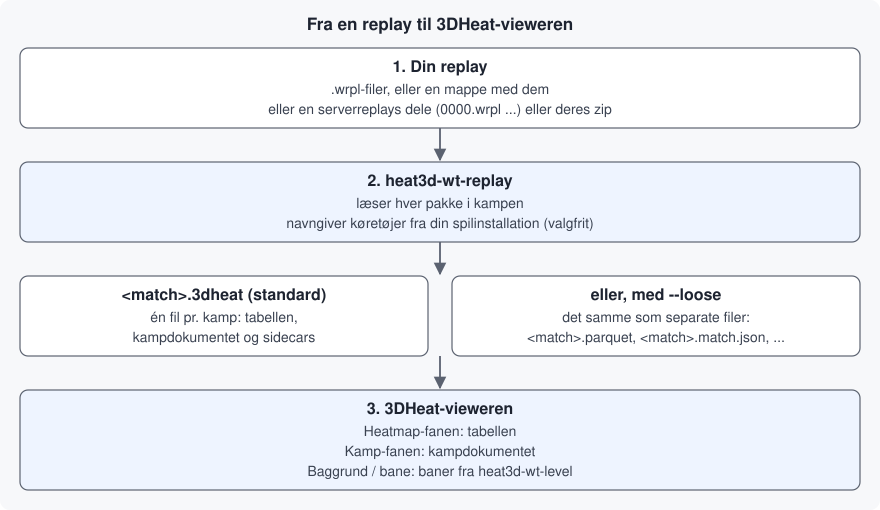

# 3DHeat War Thunder-replays {#dheat-war-thunder-replays}

**Hvad er det?** War Thunder kan optage en kamp som en replay-fil. Dette værktøj
laver optagelsen om til en fil, du kan se oppefra i
[3DHeat-vieweren](https://holdi601.github.io/3DHeat/), med hvert fly, hver tank
og hvert skib, hver missil og bombe, og hvert træf der hvor det skete. En anden
kommando laver banerne i din egen spilinstallation om til 3D-baner, som kampene
kan vises på.

**Hvorfor skulle jeg bruge det?** Til en gennemgang af en kamp i 3D; til
varmekort over, hvor du og andre flyver, kører, kæmper og dør over mange kampe;
for at se, hvor træffene ramte et køretøj; for at se, hvad en kamp kostede og
indbragte. Resultatet er almindelig Parquet og JSON, så andre værktøjer kan læse
det også.

**Eksempel:** én `.wrpl`-replay ind, én `<match>.3dheat`-fil ud:



## Hurtig start {#quick-start}

Ny til kommandolinjen? Læs [Før du går i gang](before-you-start.md) først.

```bash
git clone https://github.com/Holdi601/3DHeat-Ext-WarThunder.git
cd 3DHeat-Ext-WarThunder
pip install -e .                                  # installerer heat3d-wt-replay og heat3d-wt-level
heat3d-wt-replay "<War Thunder>/Replays" -o out
```

Du bør se én linje per kamp: `ok out/<map>/<match>.3dheat`. Åbn den fil i
3DHeat-vieweren.

## Denne dokumentation {#this-documentation}

| Side | Hvad den dækker |
|---|---|
| [Før du går i gang](before-you-start.md) | Python, en terminal, og hvordan succes ser ud |
| [Installation](installing.md) | installation, navne fra din installation, opdateringer |
| [Konvertering af replays](converting.md) | `heat3d-wt-replay` trin for trin, alle valg, meddelelser |
| [Outputfiler](output-files.md) | `.3dheat`-filen, `--loose`-filer, navne |
| [Tabellen](table.md) | hver kolonne og begivenhed |
| [Kampdokumentet](match-document.md) | hver nøgle i `<match>.match.json` |
| [Sidecars og fuldstændighed](sidecars.md) | hvad der gemmes helt ved siden af tabellen, og tællerne |
| [Baner](levels.md) | `heat3d-wt-level`: baner fra din installation som `.glb` |
| [Hvordan replayet læses](how-it-reads.md) | hvad der læses, og hvordan det er kontrolleret |
| [Fly](aircraft.md), [Landenheder og kamera](ground.md), [Træf, skud og brande](hits.md) | detaljerne bag kolonnerne |
| [Økonomi](economy.md), [Mål](objectives.md) | Silver Lions og forskningspoint; erobringszoner, flyvepladser |
| [Vilkår og licens](terms.md) | Gaijins vilkår, kilder, tests, licens |
| [Kommandoreference](../cli-reference.md), [Kolonneliste](../columns.md) | genereret ud fra koden |

## Del af 3DHeat {#part-of-3dheat}

Denne konverter er et af værktøjerne i [3DHeat](https://github.com/Holdi601/3DHeat),
en realtids-3D-viewer til telemetri og replays ([dokumentation](https://holdi601.github.io/3DHeat/)).
Vieweren åbner `.3dheat`-filen: tabellen på sin Heatmap-fane, kampdokumentet på
sin Kamp-fane ([En fil pr. kamp](https://holdi601.github.io/3DHeat/container.html)).
Hvad enhver konverter skal bevare: [Konvertere bevarer alt](https://holdi601.github.io/3DHeat/converters.html).

**Hvorfor er det et separat værktøj.** `.wrpl`-formatet er ikke dokumenteret, og
Gaijins EULA (3.2.2, 3.2.9) forbyder at reverse engineere spillet og at udvinde
data, der ikke er beregnet til visning; den nævner ikke replays, som spillet selv
viser spilleren. Så et licensspørgsmål kun rammer denne konverter, ligger den uden
for 3DHeat Watcher: Watcheren kører den på nye replays, når den er installeret, og
fungerer uden den.

| Værktøj | Hvad det gør | Kilde | Dokumentation |
|---|---|---|---|
| 3DHeat-viewer | viser data i 3D: varmekort, replays, løbsanalyse | [3DHeat](https://github.com/Holdi601/3DHeat) | [side](https://holdi601.github.io/3DHeat/) |
| GameFiles | baner og niveauer ud af de filer, spil udgiver | [3DHeat-GameFiles](https://github.com/Holdi601/3DHeat-GameFiles) | [side](https://holdi601.github.io/3DHeat-GameFiles/) |
| GameCapture | telemetri fra omgange, og niveauer genskabt ud fra spilvideo | [3DHeat-GameCapture](https://github.com/Holdi601/3DHeat-GameCapture) | [side](https://holdi601.github.io/3DHeat-GameCapture/) |
| Unreal Exporter | et plugin til Unreal Editor, der eksporterer et niveau | [3DHeat-UnrealExporter](https://github.com/Holdi601/3DHeat-UnrealExporter) | [side](https://holdi601.github.io/3DHeat-UnrealExporter/) |
| CS2 | Counter-Strike 2-demoer og baner | [3DHeat-CS2](https://github.com/Holdi601/3DHeat-CS2) | [side](https://holdi601.github.io/3DHeat-CS2/) |
| Watcher | optager det, spil udgiver, mens du spiller | [3DHeat-Watcher](https://github.com/Holdi601/3DHeat-Watcher) | [side](https://holdi601.github.io/3DHeat-Watcher/) |
| War Thunder-replays | `.wrpl`-replays og War Thunder-baner | [3DHeat-Ext-WarThunder](https://github.com/Holdi601/3DHeat-Ext-WarThunder) | [side](https://holdi601.github.io/3DHeat-Ext-WarThunder/) |
| World of Tanks-replays | `.wotreplay`-replays | [3DHeat-Ext-WoT](https://github.com/Holdi601/3DHeat-Ext-WoT) | [side](https://holdi601.github.io/3DHeat-Ext-WoT/) |
| World of Warships-replays | `.wowsreplay`-replays | [3DHeat-Ext-WoWs](https://github.com/Holdi601/3DHeat-Ext-WoWs) | [side](https://holdi601.github.io/3DHeat-Ext-WoWs/) |
| Squad-demoer | demoer fra Squad-servere | [3DHeat-Ext-Squad](https://github.com/Holdi601/3DHeat-Ext-Squad) | [side](https://holdi601.github.io/3DHeat-Ext-Squad/) |
| DCS-kort | DCS World-kort som 3D-baner | [3DHeat-Ext-DCS](https://github.com/Holdi601/3DHeat-Ext-DCS) | [side](https://holdi601.github.io/3DHeat-Ext-DCS/) |
| IL-2-kort | IL-2 Great Battles-kort som 3D-baner | [3DHeat-Ext-IL2](https://github.com/Holdi601/3DHeat-Ext-IL2) | [side](https://holdi601.github.io/3DHeat-Ext-IL2/) |

---

Del af [3DHeat](https://github.com/Holdi601/3DHeat) ([dokumentation](https://holdi601.github.io/3DHeat/)). Kilde: [3DHeat-Ext-WarThunder](https://github.com/Holdi601/3DHeat-Ext-WarThunder).
