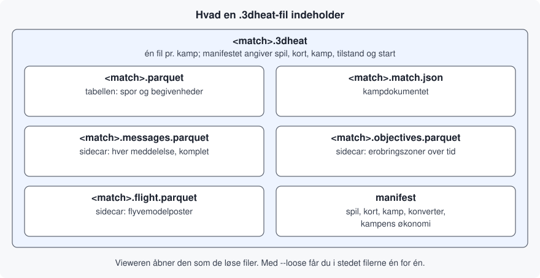
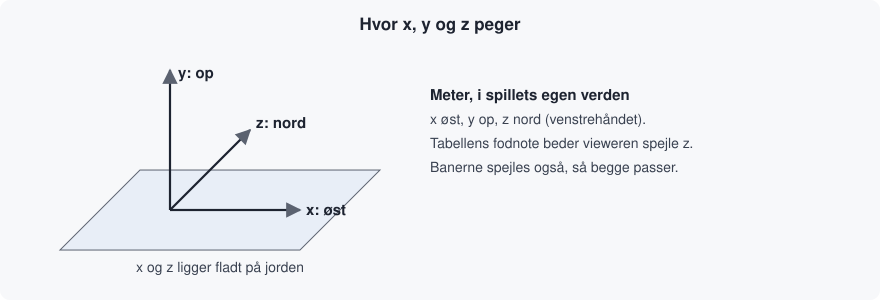

# Outputfiler {#output-files}

Som standard er hver kamp **én fil**, `out/<map>/<match>.3dheat`: tabellen, kampdokumentet
og sidecars pakket sammen, med et manifest, der angiver spil, kort, kamp,
kampens tilstand, starttidspunkt og konverter (og kampens økonomi under
`extensions["heat3d/economy"]`). Formatet er viewerens:
[Én fil pr. kamp (.3dheat)](https://holdi601.github.io/3DHeat/container.html).

Med `--loose` skrives de samme filer i stedet side om side:

| Fil | Indhold | Side |
|---|---|---|
| `<match>.parquet` | én række pr. sample eller begivenhed | [Tabellen](table.md) |
| `<match>.match.json` | alt det øvrige, replayet siger | [Kampdokumentet](match-document.md) |
| `<match>.messages.parquet` | hver besked, komponentværdi og pakke, komplet | [Sidecars](sidecars.md) |
| `<match>.objectives.parquet` | erobringszonerne over tid | [Sidecars](sidecars.md) |
| `<match>.flight.parquet` | hver flyvemodel-post for hvert fly, komplet | [Sidecars](sidecars.md) |

Hvis pakningen fejler, beholdes de løse filer, og linjen siger det.

## Navne {#names}

`<match>` er `<map>_<AB|RB|SB>_<mode>_<start, UTC>_<session id>`, som på billedet:
se [Hvilke filer er én kamp](converting.md#which-files-are-one-battle).
`<map>` er spillets eget id for kortet (`99_testmap` på billederne).

## Koordinater {#coordinates}

Meter, i spillets egen verden: x øst, y op, z nord. Tabellens fodnote fortæller
vieweren at spejle z, og baner fra `heat3d-wt-level` skrives på samme måde, så et
replay og dets bane ligger oven på hinanden.

---

Del af [3DHeat](https://github.com/Holdi601/3DHeat) ([dokumentation](https://holdi601.github.io/3DHeat/)). Kilde: [3DHeat-Ext-WarThunder](https://github.com/Holdi601/3DHeat-Ext-WarThunder).
