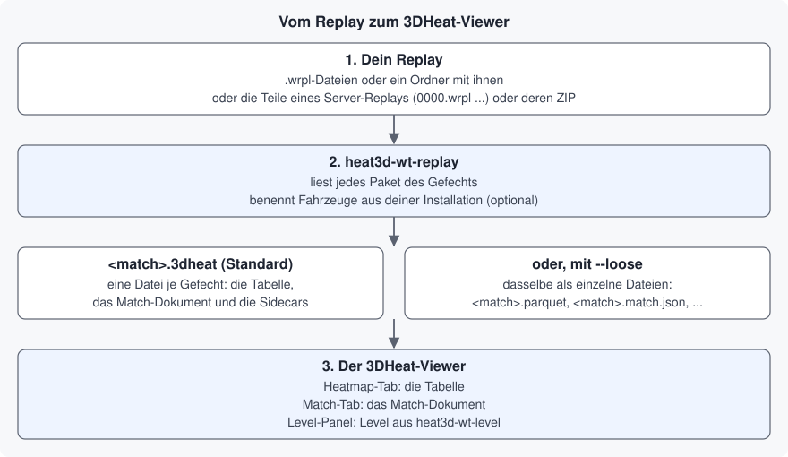

# 3DHeat-War-Thunder-Replays {#dheat-war-thunder-replays}

**Was ist das?** War Thunder kann ein Gefecht als Replay-Datei aufzeichnen. Dieses
Werkzeug macht aus der Aufnahme eine Datei, die du in dem
[3DHeat-Viewer](https://holdi601.github.io/3DHeat/) von oben ansehen kannst, mit jedem
Flugzeug, Panzer und Schiff, jeder Lenkwaffe und Bombe und jedem Treffer an der Stelle,
an der er passierte. Ein zweiter Befehl macht aus den Leveln deiner eigenen
Spielinstallation 3D-Level, auf denen du die Gefechte zeigen kannst.

**Wozu braucht man das?** Für eine 3D-Nachbesprechung eines Gefechts; für Heatmaps,
wo du und andere über viele Gefechte hinweg fliegen, fahren, kämpfen und sterben; um zu
sehen, wo Treffer ein Fahrzeug getroffen haben; um zu sehen, was ein Gefecht gekostet
und eingebracht hat. Die Ausgabe ist einfaches Parquet und JSON, sodass auch andere
Werkzeuge sie lesen können.

**Beispiel:** Ein `.wrpl`-Replay hinein, eine Datei `<match>.3dheat` heraus:



## Schnellstart {#quick-start}

Neu auf der Kommandozeile? Lies zuerst [Bevor du anfängst](before-you-start.md).

```bash
git clone https://github.com/Holdi601/3DHeat-Ext-WarThunder.git
cd 3DHeat-Ext-WarThunder
pip install -e .                                  # installiert heat3d-wt-replay und heat3d-wt-level
heat3d-wt-replay "<War Thunder>/Replays" -o out
```

Du solltest pro Gefecht eine Zeile sehen: `ok out/<map>/<match>.3dheat`. Öffne diese
Datei im 3DHeat-Viewer.

## Diese Dokumentation {#this-documentation}

| Seite | Was sie behandelt |
|---|---|
| [Bevor du anfängst](before-you-start.md) | Python, ein Terminal und wie Erfolg aussieht |
| [Installation](installing.md) | Installation, Namen aus deiner Installation, Aktualisierungen |
| [Replays umwandeln](converting.md) | `heat3d-wt-replay` Schritt für Schritt, jede Option, Meldungen |
| [Ausgabedateien](output-files.md) | die Datei `.3dheat`, die `--loose`-Dateien, Namen |
| [Die Tabelle](table.md) | jede Spalte und jedes Ereignis |
| [Das Match-Dokument](match-document.md) | jeder Schlüssel von `<match>.match.json` |
| [Begleitdateien und Vollständigkeit](sidecars.md) | was außer der Tabelle vollständig aufbewahrt wird, und die Zählungen |
| [Level](levels.md) | `heat3d-wt-level`: Level aus deiner Installation als `.glb` |
| [So liest es ein Replay](how-it-reads.md) | was gelesen wird und wie es geprüft wurde |
| [Flugzeuge](aircraft.md), [Bodeneinheiten und Kamera](ground.md), [Treffer, Beschuss und Brände](hits.md) | die Einzelheiten hinter den Spalten |
| [Wirtschaft](economy.md), [Ziele](objectives.md) | Silberlöwen und Forschungspunkte; Eroberungszonen, Flugplätze |
| [Begriffe und Lizenz](terms.md) | was gelesen wird, Quellen, Tests, Lizenz |
| [Befehlsreferenz](../cli-reference.md), [Spaltenliste](../columns.md) | aus dem Code erzeugt |

## Teil von 3DHeat {#part-of-3dheat}

Dieser Umwandler ist eines der Werkzeuge von [3DHeat](https://github.com/Holdi601/3DHeat),
eines Viewers für 3D-Telemetrie und Replays in Echtzeit ([Dokumentation](https://holdi601.github.io/3DHeat/)).
Der Viewer öffnet die Datei `.3dheat`: die Tabelle im Heatmap-Tab, das Match-Dokument
im Match-Tab ([Eine Datei pro Match](https://holdi601.github.io/3DHeat/container.html)).
Was jeder Umwandler behalten muss: [Umwandler behalten alles](https://holdi601.github.io/3DHeat/converters.html).

Jeder Spiel-Leser ist ein eigenes kleines Projekt mit eigener Lizenzdatei, eigenen Releases und eigenem Issue-Tracker. So lässt er sich für sich allein installieren, aktualisieren, pflegen - oder auf Wunsch eines Rechteinhabers zurückziehen -, ohne den Viewer oder die anderen Werkzeuge zu berühren.
Der 3DHeat-Watcher startet diesen Umwandler bei neuen Replays, wenn er installiert ist, und arbeitet auch ohne ihn.

| Werkzeug | Was es tut | Quelle | Dokumentation |
|---|---|---|---|
| 3DHeat-Viewer | zeigt die Daten in 3D: Heatmaps, Replays, Rennanalyse | [3DHeat](https://github.com/Holdi601/3DHeat) | [Seite](https://holdi601.github.io/3DHeat/) |
| GameFiles | Strecken und Level aus den Dateien, die Spiele mitliefern | [3DHeat-GameFiles](https://github.com/Holdi601/3DHeat-GameFiles) | [Seite](https://holdi601.github.io/3DHeat-GameFiles/) |
| GameCapture | Rundentelemetrie und Level, die aus Spielvideos nachgebaut werden | [3DHeat-GameCapture](https://github.com/Holdi601/3DHeat-GameCapture) | [Seite](https://holdi601.github.io/3DHeat-GameCapture/) |
| Unreal Exporter | ein Plugin für den Unreal Editor, das ein Level exportiert | [3DHeat-UnrealExporter](https://github.com/Holdi601/3DHeat-UnrealExporter) | [Seite](https://holdi601.github.io/3DHeat-UnrealExporter/) |
| CS2 | Demos und Karten von Counter-Strike 2 | [3DHeat-CS2](https://github.com/Holdi601/3DHeat-CS2) | [Seite](https://holdi601.github.io/3DHeat-CS2/) |
| Watcher | nimmt auf, was Spiele veröffentlichen, während du spielst | [3DHeat-Watcher](https://github.com/Holdi601/3DHeat-Watcher) | [Seite](https://holdi601.github.io/3DHeat-Watcher/) |
| War-Thunder-Replays | `.wrpl`-Replays und Level von War Thunder | [3DHeat-Ext-WarThunder](https://github.com/Holdi601/3DHeat-Ext-WarThunder) | [Seite](https://holdi601.github.io/3DHeat-Ext-WarThunder/) |
| World-of-Tanks-Replays | `.wotreplay`-Replays | [3DHeat-Ext-WoT](https://github.com/Holdi601/3DHeat-Ext-WoT) | [Seite](https://holdi601.github.io/3DHeat-Ext-WoT/) |
| World-of-Warships-Replays | `.wowsreplay`-Replays | [3DHeat-Ext-WoWs](https://github.com/Holdi601/3DHeat-Ext-WoWs) | [Seite](https://holdi601.github.io/3DHeat-Ext-WoWs/) |
| Squad-Demos | Demos von Squad-Servern | [3DHeat-Ext-Squad](https://github.com/Holdi601/3DHeat-Ext-Squad) | [Seite](https://holdi601.github.io/3DHeat-Ext-Squad/) |
| DCS-Karten | Karten von DCS World als 3D-Level | [3DHeat-Ext-DCS](https://github.com/Holdi601/3DHeat-Ext-DCS) | [Seite](https://holdi601.github.io/3DHeat-Ext-DCS/) |
| IL-2-Karten | Karten von IL-2 Great Battles als 3D-Level | [3DHeat-Ext-IL2](https://github.com/Holdi601/3DHeat-Ext-IL2) | [Seite](https://holdi601.github.io/3DHeat-Ext-IL2/) |
| Dota-2-Karte | die Dota-2-Karte aus deiner eigenen Installation als 3D-Level | [3DHeat-Ext-Dota](https://github.com/Holdi601/3DHeat-Ext-Dota) | [Seite](https://holdi601.github.io/3DHeat-Ext-Dota/) |
| Dota-2-Replays | Dota-2-Replays | [3DHeat-Ext-DotaReplay](https://github.com/Holdi601/3DHeat-Ext-DotaReplay) | [Seite](https://holdi601.github.io/3DHeat-Ext-DotaReplay/) |
| Riot-Replays | Replays von League of Legends und VALORANT (was sie unverschlüsselt enthalten) | [3DHeat-Ext-Riot](https://github.com/Holdi601/3DHeat-Ext-Riot) | [Seite](https://holdi601.github.io/3DHeat-Ext-Riot/) |
| Forza-Karten | Strecken, Rennen und Autos aus Forza aus deiner eigenen Installation | [3DHeat-Ext-Forza](https://github.com/Holdi601/3DHeat-Ext-Forza) | [Seite](https://holdi601.github.io/3DHeat-Ext-Forza/) |
| Battlefield-Karten | Battlefield-Level (Frostbite) als 3D-Level | [3DHeat-Ext-Battlefield](https://github.com/Holdi601/3DHeat-Ext-Battlefield) | [Seite](https://holdi601.github.io/3DHeat-Ext-Battlefield/) |
| BeamNG-Karten | Strecken von BeamNG.drive | [3DHeat-Ext-BeamNG](https://github.com/Holdi601/3DHeat-Ext-BeamNG) | [Seite](https://holdi601.github.io/3DHeat-Ext-BeamNG/) |
| AC-Rally-Karten | Etappen von Assetto Corsa Rally als Strecken | [3DHeat-Ext-ACRally](https://github.com/Holdi601/3DHeat-Ext-ACRally) | [Seite](https://holdi601.github.io/3DHeat-Ext-ACRally/) |
| Reforger-Karten | Welten von Arma Reforger (Enfusion) als 3D-Level | [3DHeat-Ext-Reforger](https://github.com/Holdi601/3DHeat-Ext-Reforger) | [Seite](https://holdi601.github.io/3DHeat-Ext-Reforger/) |
| R6-Replays | Replays von Rainbow-Six-Siege-Matches | [3DHeat-Ext-R6](https://github.com/Holdi601/3DHeat-Ext-R6) | [Seite](https://holdi601.github.io/3DHeat-Ext-R6/) |

---

Teil von [3DHeat](https://github.com/Holdi601/3DHeat) ([Dokumentation](https://holdi601.github.io/3DHeat/)). Quelle: [3DHeat-Ext-WarThunder](https://github.com/Holdi601/3DHeat-Ext-WarThunder).
