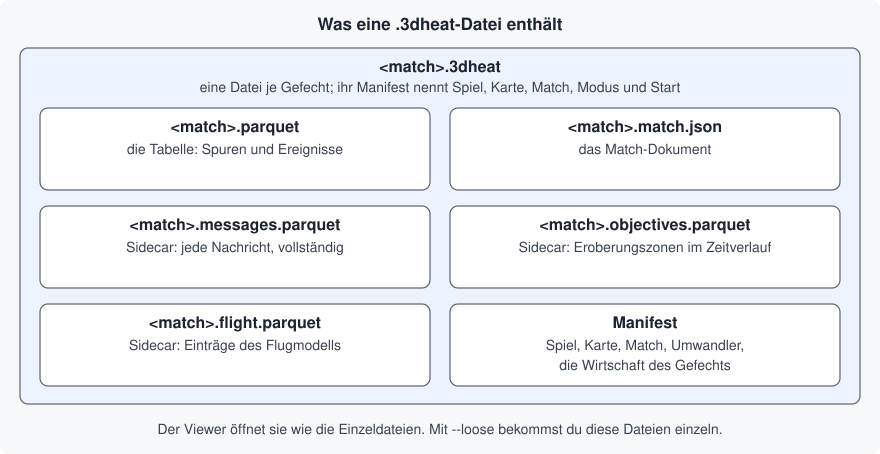
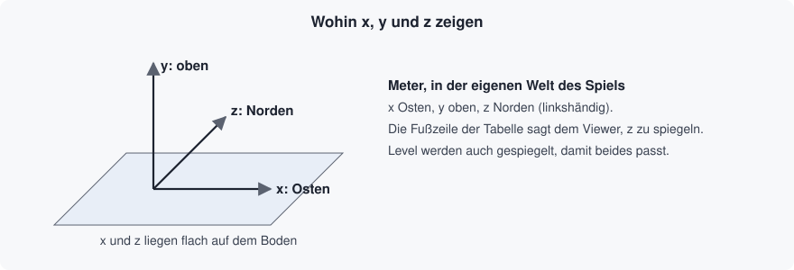

# Ausgabedateien {#output-files}

Standardmäßig wird jedes Gefecht zu **einer Datei**, `out/<map>/<match>.3dheat`: die
Tabelle, das Match-Dokument und die Sidecars, zusammen gepackt, mit einem Manifest, das
Spiel, Karte, Match, Gefechtsmodus, Startzeit und Umwandler nennt (und die Wirtschaft des
Gefechts unter `extensions["heat3d/economy"]`). Das Format ist das des Viewers:
[Eine Datei pro Match (.3dheat)](https://holdi601.github.io/3DHeat/container.html).

Mit `--loose` werden dieselben Dateien stattdessen einzeln nebeneinander geschrieben:

| Datei | Was | Seite |
|---|---|---|
| `<match>.parquet` | eine Zeile je Messwert oder Ereignis | [Die Tabelle](table.md) |
| `<match>.match.json` | alles andere, was das Replay sagt | [Das Match-Dokument](match-document.md) |
| `<match>.messages.parquet` | jede Nachricht, jeder Komponentenwert und jedes Paket, vollständig | [Sidecars](sidecars.md) |
| `<match>.objectives.parquet` | die Eroberungszonen im Zeitverlauf | [Sidecars](sidecars.md) |
| `<match>.flight.parquet` | jeder Flugeintrag jedes Flugzeugs, vollständig | [Sidecars](sidecars.md) |

Schlägt das Packen fehl, bleiben die einzelnen Dateien erhalten, und die Zeile sagt es.

## Namen {#names}

`<match>` ist `<map>_<AB|RB|SB>_<mode>_<start, UTC>_<session id>`, wie im Bild:
siehe [Welche Dateien ein Gefecht ergeben](converting.md#which-files-are-one-battle).
`<map>` ist die eigene Kennung des Spiels für die Karte (`99_testmap` in den Bildern).

## Koordinaten {#coordinates}

Meter, in der eigenen Welt des Spiels: x Osten, y oben, z Norden. Die Fußzeile der Tabelle
sagt dem Viewer, dass er z spiegeln soll, und Level aus `heat3d-wt-level` werden genauso
geschrieben, sodass ein Replay und sein Level übereinanderliegen.

---

Teil von [3DHeat](https://github.com/Holdi601/3DHeat) ([Dokumentation](https://holdi601.github.io/3DHeat/)). Quelle: [3DHeat-Ext-WarThunder](https://github.com/Holdi601/3DHeat-Ext-WarThunder).
