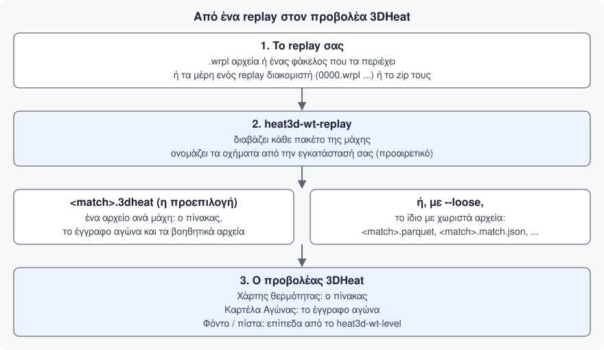

# 3DHeat War Thunder replays {#dheat-war-thunder-replays}

**Τι είναι;** Το War Thunder μπορεί να καταγράψει μια μάχη ως αρχείο replay. Αυτό το εργαλείο
μετατρέπει την καταγραφή σε αρχείο που μπορείτε να δείτε από ψηλά στον
[προβολέα 3DHeat](https://holdi601.github.io/3DHeat/), με κάθε αεροπλάνο, τανκ
και πλοίο, κάθε πύραυλο και βόμβα, και κάθε χτύπημα εκεί που έγινε. Μια δεύτερη
εντολή μετατρέπει τα επίπεδα της δικής σας εγκατάστασης του παιχνιδιού σε 3D
επίπεδα, πάνω στα οποία δείχνετε τις μάχες.

**Γιατί να το χρησιμοποιήσω;** Για να ξαναδείτε μια μάχη σε 3D· για χάρτες
θερμότητας του σημείου όπου πετούν, οδηγούν, πολεμούν και πεθαίνουν εσείς και
άλλοι, σε πολλές μάχες· για να δείτε πού έπεσαν τα χτυπήματα πάνω σε ένα όχημα·
για να δείτε τι κόστισε και τι απέφερε μια μάχη. Το αποτέλεσμα είναι απλά αρχεία
Parquet και JSON, ώστε να μπορούν να το διαβάσουν και άλλα εργαλεία.

**Παράδειγμα:** ένα `.wrpl` replay μέσα, ένα `<match>.3dheat` αρχείο έξω:



## Γρήγορη εκκίνηση {#quick-start}

Είστε νέος στη γραμμή εντολών; Διαβάστε πρώτα το [Πριν ξεκινήσετε](before-you-start.md).

```bash
git clone https://github.com/Holdi601/3DHeat-Ext-WarThunder.git
cd 3DHeat-Ext-WarThunder
pip install -e .                                  # installs heat3d-wt-replay and heat3d-wt-level
heat3d-wt-replay "<War Thunder>/Replays" -o out
```

Θα δείτε μία γραμμή για κάθε μάχη: `ok out/<map>/<match>.3dheat`. Ανοίξτε αυτό το
αρχείο στον προβολέα 3DHeat.

## Αυτή η τεκμηρίωση {#this-documentation}

| Σελίδα | Τι καλύπτει |
|---|---|
| [Πριν ξεκινήσετε](before-you-start.md) | Python, ένα τερματικό, και πώς είναι η επιτυχία |
| [Εγκατάσταση](installing.md) | εγκατάσταση, ονόματα από την εγκατάστασή σας, ενημερώσεις |
| [Μετατροπή replay](converting.md) | το `heat3d-wt-replay` βήμα προς βήμα, κάθε επιλογή, μηνύματα |
| [Αρχεία εξόδου](output-files.md) | το αρχείο `.3dheat`, τα αρχεία `--loose`, τα ονόματα |
| [Ο πίνακας](table.md) | κάθε στήλη και κάθε γεγονός |
| [Το έγγραφο αγώνα](match-document.md) | κάθε κλειδί του `<match>.match.json` |
| [Βοηθητικά αρχεία και πληρότητα](sidecars.md) | τι κρατιέται ολόκληρο εκτός του πίνακα, και τα πλήθη |
| [Επίπεδα](levels.md) | `heat3d-wt-level`: επίπεδα από την εγκατάστασή σας ως `.glb` |
| [Πώς διαβάζει ένα replay](how-it-reads.md) | τι διαβάζεται, και πώς ελέγχθηκε |
| [Αεροπλάνα](aircraft.md), [Χερσαίες μονάδες και κάμερα](ground.md), [Χτυπήματα, πυροβολισμοί και φωτιές](hits.md) | οι λεπτομέρειες πίσω από τις στήλες |
| [Οικονομία](economy.md), [Στόχοι](objectives.md) | Silver Lions και πόντοι έρευνας· ζώνες κατάληψης, αεροδρόμια |
| [Όροι και άδεια](terms.md) | οι όροι της Gaijin, πηγές, δοκιμές, άδεια |
| [Αναφορά εντολών](../cli-reference.md), [Λίστα στηλών](../columns.md) | παράγονται από τον κώδικα |

## Μέρος του 3DHeat {#part-of-3dheat}

Αυτός ο μετατροπέας είναι ένα από τα εργαλεία του [3DHeat](https://github.com/Holdi601/3DHeat),
ενός προβολέα τηλεμετρίας και replay σε 3D σε πραγματικό χρόνο ([τεκμηρίωση](https://holdi601.github.io/3DHeat/)).
Ο προβολέας ανοίγει το αρχείο `.3dheat`: τον πίνακα στην καρτέλα Χάρτης θερμότητας,
το έγγραφο αγώνα στην καρτέλα Αγώνας ([Ένα αρχείο ανά αγώνα](https://holdi601.github.io/3DHeat/container.html)).
Τι πρέπει να κρατά κάθε μετατροπέας: [Οι μετατροπείς κρατούν τα πάντα](https://holdi601.github.io/3DHeat/converters.html).

**Γιατί είναι ξεχωριστό εργαλείο.** Η μορφή `.wrpl` δεν είναι τεκμηριωμένη, και
η EULA της Gaijin (3.2.2, 3.2.9) απαγορεύει την αντίστροφη μηχανική του παιχνιδιού
και την εξόρυξη δεδομένων που δεν προορίζονται για προβολή· δεν αναφέρει τα replays,
τα οποία το ίδιο το παιχνίδι δείχνει στον παίκτη. Ώστε μια ερώτηση άδειας να αγγίζει
μόνο αυτόν τον μετατροπέα, βρίσκεται έξω από τον 3DHeat Watcher: ο Watcher τον τρέχει σε
νέα replays όταν είναι εγκατεστημένος, και λειτουργεί χωρίς αυτόν.

| Εργαλείο | Τι κάνει | Πηγή | Τεκμηρίωση |
|---|---|---|---|
| Προβολέας 3DHeat | δείχνει τα δεδομένα σε 3D: χάρτες θερμότητας, replays, ανάλυση αγώνα | [3DHeat](https://github.com/Holdi601/3DHeat) | [σελίδα](https://holdi601.github.io/3DHeat/) |
| GameFiles | διαδρομές και επίπεδα από τα αρχεία που στέλνουν τα παιχνίδια | [3DHeat-GameFiles](https://github.com/Holdi601/3DHeat-GameFiles) | [σελίδα](https://holdi601.github.io/3DHeat-GameFiles/) |
| GameCapture | τηλεμετρία γύρων, και επίπεδα ξαναχτισμένα από βίντεο παιχνιδιού | [3DHeat-GameCapture](https://github.com/Holdi601/3DHeat-GameCapture) | [σελίδα](https://holdi601.github.io/3DHeat-GameCapture/) |
| Unreal Exporter | ένα πρόσθετο του Unreal Editor που εξάγει ένα επίπεδο | [3DHeat-UnrealExporter](https://github.com/Holdi601/3DHeat-UnrealExporter) | [σελίδα](https://holdi601.github.io/3DHeat-UnrealExporter/) |
| CS2 | demos και χάρτες του Counter-Strike 2 | [3DHeat-CS2](https://github.com/Holdi601/3DHeat-CS2) | [σελίδα](https://holdi601.github.io/3DHeat-CS2/) |
| Watcher | καταγράφει όσα δημοσιεύουν τα παιχνίδια όσο παίζετε | [3DHeat-Watcher](https://github.com/Holdi601/3DHeat-Watcher) | [σελίδα](https://holdi601.github.io/3DHeat-Watcher/) |
| Replays War Thunder | αρχεία `.wrpl` και επίπεδα του War Thunder | [3DHeat-Ext-WarThunder](https://github.com/Holdi601/3DHeat-Ext-WarThunder) | [σελίδα](https://holdi601.github.io/3DHeat-Ext-WarThunder/) |
| Replays World of Tanks | αρχεία `.wotreplay` | [3DHeat-Ext-WoT](https://github.com/Holdi601/3DHeat-Ext-WoT) | [σελίδα](https://holdi601.github.io/3DHeat-Ext-WoT/) |
| Replays World of Warships | αρχεία `.wowsreplay` | [3DHeat-Ext-WoWs](https://github.com/Holdi601/3DHeat-Ext-WoWs) | [σελίδα](https://holdi601.github.io/3DHeat-Ext-WoWs/) |
| Demos του Squad | demos διακομιστών του Squad | [3DHeat-Ext-Squad](https://github.com/Holdi601/3DHeat-Ext-Squad) | [σελίδα](https://holdi601.github.io/3DHeat-Ext-Squad/) |
| Χάρτες DCS | χάρτες του DCS World ως 3D επίπεδα | [3DHeat-Ext-DCS](https://github.com/Holdi601/3DHeat-Ext-DCS) | [σελίδα](https://holdi601.github.io/3DHeat-Ext-DCS/) |
| Χάρτες IL-2 | χάρτες του IL-2 Great Battles ως 3D επίπεδα | [3DHeat-Ext-IL2](https://github.com/Holdi601/3DHeat-Ext-IL2) | [σελίδα](https://holdi601.github.io/3DHeat-Ext-IL2/) |

---

Μέρος του [3DHeat](https://github.com/Holdi601/3DHeat) ([τεκμηρίωση](https://holdi601.github.io/3DHeat/)). Πηγή: [3DHeat-Ext-WarThunder](https://github.com/Holdi601/3DHeat-Ext-WarThunder).
