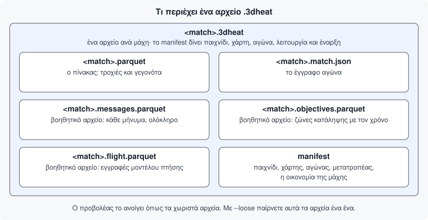
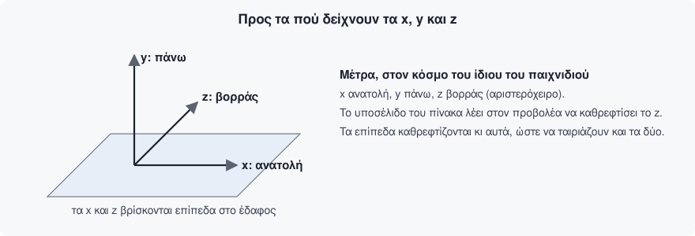

# Αρχεία εξόδου {#output-files}

Κάθε μάχη είναι, από προεπιλογή, **ένα αρχείο**, `out/<map>/<match>.3dheat`: ο
πίνακας, το έγγραφο αγώνα και τα βοηθητικά αρχεία μαζί σε ένα πακέτο, με ένα manifest
που ονομάζει το παιχνίδι, τον χάρτη, τον αγώνα, τη λειτουργία της μάχης, την ώρα
έναρξης και τον μετατροπέα (και την οικονομία της μάχης κάτω από το
`extensions["heat3d/economy"]`). Η μορφή είναι του προβολέα:
[Ένα αρχείο ανά αγώνα (.3dheat)](https://holdi601.github.io/3DHeat/container.html).

Με `--loose` γράφονται τα ίδια αρχεία δίπλα δίπλα:

| Αρχείο | Τι περιέχει | Σελίδα |
|---|---|---|
| `<match>.parquet` | μία γραμμή ανά δείγμα ή γεγονός | [Ο πίνακας](table.md) |
| `<match>.match.json` | όλα τα υπόλοιπα που λέει το replay | [Το έγγραφο αγώνα](match-document.md) |
| `<match>.messages.parquet` | κάθε μήνυμα, τιμή στοιχείου και πακέτο, ολόκληρα | [Βοηθητικά αρχεία](sidecars.md) |
| `<match>.objectives.parquet` | οι ζώνες κατάληψης με τον χρόνο | [Βοηθητικά αρχεία](sidecars.md) |
| `<match>.flight.parquet` | κάθε εγγραφή μοντέλου πτήσης κάθε αεροσκάφους, ολόκληρη | [Βοηθητικά αρχεία](sidecars.md) |

Αν το πακετάρισμα αποτύχει, τα χωριστά αρχεία διατηρούνται και η γραμμή το λέει.

## Ονόματα {#names}

Το `<match>` είναι `<map>_<AB|RB|SB>_<mode>_<start, UTC>_<session id>`, όπως στην
εικόνα: βλ. [Ποια αρχεία είναι μία μάχη](converting.md#which-files-are-one-battle).
Το `<map>` είναι το δικό του αναγνωριστικό του χάρτη στο παιχνίδι (`99_testmap` στις
εικόνες).

## Συντεταγμένες {#coordinates}

Μέτρα, στον κόσμο του ίδιου του παιχνιδιού: x ανατολή, y πάνω, z βορράς. Το
υποσέλιδο του πίνακα λέει στον προβολέα να καθρεφτίσει το z, και τα επίπεδα από το
`heat3d-wt-level` γράφονται με τον ίδιο τρόπο, ώστε ένα replay και το επίπεδό του να
πέφτουν το ένα πάνω στο άλλο.

---

Μέρος του [3DHeat](https://github.com/Holdi601/3DHeat) ([τεκμηρίωση](https://holdi601.github.io/3DHeat/)). Πηγή: [3DHeat-Ext-WarThunder](https://github.com/Holdi601/3DHeat-Ext-WarThunder).
