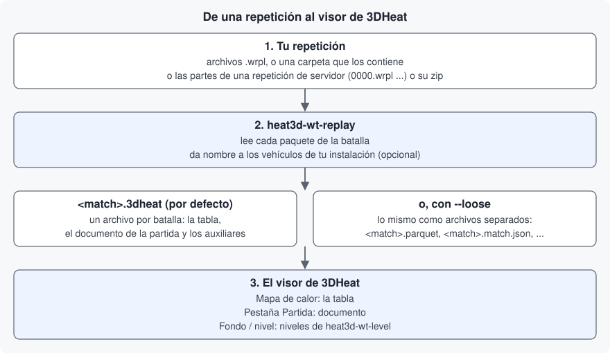

# Repeticiones de War Thunder de 3DHeat {#dheat-war-thunder-replays}

**¿Qué es?** War Thunder puede grabar una batalla como archivo de repetición. Esta
herramienta convierte la grabación en un archivo que puedes ver desde arriba en el
[visor de 3DHeat](https://holdi601.github.io/3DHeat/), con cada avión, tanque
y barco, cada misil y bomba, y cada impacto donde ocurrió. Un segundo
comando convierte los mapas de tu propia instalación del juego en niveles 3D
donde mostrar las batallas.

**¿Para qué lo usaría?** Para repasar una batalla en 3D; para mapas de calor de
dónde vuelan, conducen, combaten y mueren tú y otros en muchas batallas; para ver
dónde acertaron los impactos en un vehículo; para ver cuánto costó y cuánto
ganó una batalla. La salida son archivos Parquet y JSON sencillos, así que otras
herramientas también pueden leerlos.

**Ejemplo:** entra una repetición `.wrpl` y sale un archivo `<partida>.3dheat`:



## Inicio rápido {#quick-start}

¿Es tu primera vez con la línea de comandos? Lee primero [Antes de empezar](before-you-start.md).

```bash
git clone https://github.com/Holdi601/3DHeat-Ext-WarThunder.git
cd 3DHeat-Ext-WarThunder
pip install -e .                                  # instala heat3d-wt-replay y heat3d-wt-level
heat3d-wt-replay "<War Thunder>/Replays" -o out
```

Deberías ver una línea por batalla: `ok out/<mapa>/<partida>.3dheat`. Abre ese
archivo en el visor de 3DHeat.

## Esta documentación {#this-documentation}

| Página | Qué contiene |
|---|---|
| [Antes de empezar](before-you-start.md) | Python, una terminal y cómo es un resultado correcto |
| [Instalación](installing.md) | instalar, nombres de tu instalación, actualizaciones |
| [Convertir repeticiones](converting.md) | `heat3d-wt-replay` paso a paso, cada opción, mensajes |
| [Archivos de salida](output-files.md) | el archivo `.3dheat`, archivos `--loose`, nombres |
| [La tabla](table.md) | cada columna y cada evento |
| [El documento de la partida](match-document.md) | cada clave de `<partida>.match.json` |
| [Archivos auxiliares y completitud](sidecars.md) | qué se guarda completo además de la tabla, y los recuentos |
| [Niveles](levels.md) | `heat3d-wt-level`: niveles de tu instalación como `.glb` |
| [Cómo lee una repetición](how-it-reads.md) | qué se lee y cómo se comprobó |
| [Aviones](aircraft.md), [Unidades terrestres y cámara](ground.md), [Impactos, disparos e incendios](hits.md) | los detalles tras las columnas |
| [Economía](economy.md), [Objetivos](objectives.md) | Leones de Plata y puntos de investigación; zonas de captura, aeródromos |
| [Términos y licencia](terms.md) | condiciones de Gaijin, fuentes, pruebas, licencia |
| [Referencia de comandos](../cli-reference.md), [Lista de columnas](../columns.md) | generadas a partir del código |

## Parte de 3DHeat {#part-of-3dheat}

Este convertidor es una de las herramientas de [3DHeat](https://github.com/Holdi601/3DHeat),
un visor de telemetría y repeticiones 3D en tiempo real ([documentación](https://holdi601.github.io/3DHeat/)).
El visor abre el archivo `.3dheat`: la tabla en su pestaña Mapa de calor, el
documento de la partida en su pestaña Partida ([Un archivo por partida](https://holdi601.github.io/3DHeat/container.html)).
Lo que todo convertidor debe conservar: [Los convertidores lo conservan todo](https://holdi601.github.io/3DHeat/converters.html).

**Por qué es una herramienta aparte.** El formato `.wrpl` no está documentado, y
el EULA de Gaijin (3.2.2, 3.2.9) prohíbe la ingeniería inversa del juego y la
extracción de datos que no están pensados para mostrarse; no menciona las
repeticiones, que el propio juego muestra al jugador. Para que una duda de
licencia afecte solo a este convertidor, vive fuera del Watcher de 3DHeat: el
Watcher lo ejecuta sobre las repeticiones nuevas cuando está instalado, y
funciona sin él.

| Herramienta | Qué hace | Código | Documentación |
|---|---|---|---|
| Visor de 3DHeat | muestra los datos en 3D: mapas de calor, repeticiones, análisis de carrera | [3DHeat](https://github.com/Holdi601/3DHeat) | [sitio](https://holdi601.github.io/3DHeat/) |
| GameFiles | recorridos y niveles de los archivos que traen los juegos | [3DHeat-GameFiles](https://github.com/Holdi601/3DHeat-GameFiles) | [sitio](https://holdi601.github.io/3DHeat-GameFiles/) |
| GameCapture | telemetría de vueltas, y niveles reconstruidos a partir de vídeo de juego | [3DHeat-GameCapture](https://github.com/Holdi601/3DHeat-GameCapture) | [sitio](https://holdi601.github.io/3DHeat-GameCapture/) |
| Unreal Exporter | un complemento del editor de Unreal que exporta un nivel | [3DHeat-UnrealExporter](https://github.com/Holdi601/3DHeat-UnrealExporter) | [sitio](https://holdi601.github.io/3DHeat-UnrealExporter/) |
| CS2 | demos y mapas de Counter-Strike 2 | [3DHeat-CS2](https://github.com/Holdi601/3DHeat-CS2) | [sitio](https://holdi601.github.io/3DHeat-CS2/) |
| Watcher | registra lo que publican los juegos mientras juegas | [3DHeat-Watcher](https://github.com/Holdi601/3DHeat-Watcher) | [sitio](https://holdi601.github.io/3DHeat-Watcher/) |
| Repeticiones de War Thunder | repeticiones `.wrpl` y niveles de War Thunder | [3DHeat-Ext-WarThunder](https://github.com/Holdi601/3DHeat-Ext-WarThunder) | [sitio](https://holdi601.github.io/3DHeat-Ext-WarThunder/) |
| Repeticiones de World of Tanks | repeticiones `.wotreplay` | [3DHeat-Ext-WoT](https://github.com/Holdi601/3DHeat-Ext-WoT) | [sitio](https://holdi601.github.io/3DHeat-Ext-WoT/) |
| Repeticiones de World of Warships | repeticiones `.wowsreplay` | [3DHeat-Ext-WoWs](https://github.com/Holdi601/3DHeat-Ext-WoWs) | [sitio](https://holdi601.github.io/3DHeat-Ext-WoWs/) |
| Demos de Squad | demos de servidor de Squad | [3DHeat-Ext-Squad](https://github.com/Holdi601/3DHeat-Ext-Squad) | [sitio](https://holdi601.github.io/3DHeat-Ext-Squad/) |
| Mapas de DCS | mapas del mundo de DCS como niveles 3D | [3DHeat-Ext-DCS](https://github.com/Holdi601/3DHeat-Ext-DCS) | [sitio](https://holdi601.github.io/3DHeat-Ext-DCS/) |
| Mapas de IL-2 | mapas de IL-2 Great Battles como niveles 3D | [3DHeat-Ext-IL2](https://github.com/Holdi601/3DHeat-Ext-IL2) | [sitio](https://holdi601.github.io/3DHeat-Ext-IL2/) |

---

Parte de [3DHeat](https://github.com/Holdi601/3DHeat) ([documentación](https://holdi601.github.io/3DHeat/)). Código fuente: [3DHeat-Ext-WarThunder](https://github.com/Holdi601/3DHeat-Ext-WarThunder).
