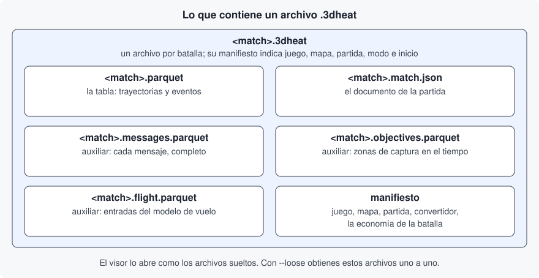
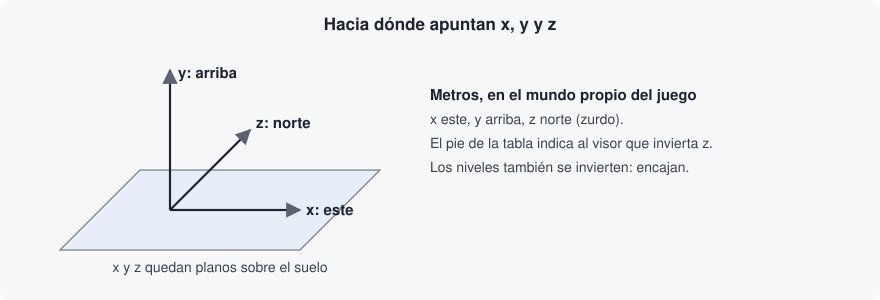

# Archivos de salida {#output-files}

Por defecto cada batalla es **un solo archivo**, `out/<mapa>/<partida>.3dheat`: la
tabla, el documento de la partida y los archivos auxiliares empaquetados juntos, con un
manifiesto que indica el juego, el mapa, la partida, el modo de batalla, la hora de inicio y el
convertidor (y la economía de la batalla bajo `extensions["heat3d/economy"]`). El formato es el
del visor: [Un archivo por partida (.3dheat)](https://holdi601.github.io/3DHeat/container.html).

Con `--loose` se escriben los mismos archivos uno al lado del otro:

| Archivo | Qué contiene | Página |
|---|---|---|
| `<partida>.parquet` | una fila por muestra o evento | [La tabla](table.md) |
| `<partida>.match.json` | todo lo demás que dice la repetición | [El documento de la partida](match-document.md) |
| `<partida>.messages.parquet` | cada mensaje, valor de componente y paquete, completos | [Archivos auxiliares](sidecars.md) |
| `<partida>.objectives.parquet` | las zonas de captura a lo largo del tiempo | [Archivos auxiliares](sidecars.md) |
| `<partida>.flight.parquet` | cada entrada del modelo de vuelo de cada avión, completas | [Archivos auxiliares](sidecars.md) |

Si el empaquetado falla, se conservan los archivos sueltos y la línea lo indica.

## Nombres {#names}

`<partida>` es `<mapa>_<AB|RB|SB>_<modo>_<inicio, UTC>_<id de sesión>`, como en la
imagen: véase [Qué archivos son una batalla](converting.md#which-files-are-one-battle).
`<mapa>` es el identificador del mapa dentro del juego (`99_testmap` en las imágenes).

## Coordenadas {#coordinates}

En metros, en el mundo propio del juego: x hacia el este, y hacia arriba, z hacia el norte. El
pie de la tabla indica al visor que invierta z, y los niveles de `heat3d-wt-level` se
escriben de la misma forma, así que una repetición y su nivel coinciden.

---

Parte de [3DHeat](https://github.com/Holdi601/3DHeat) ([documentación](https://holdi601.github.io/3DHeat/)). Código fuente: [3DHeat-Ext-WarThunder](https://github.com/Holdi601/3DHeat-Ext-WarThunder).
