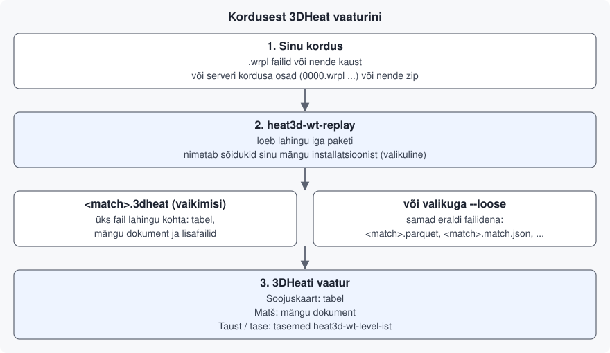

# 3DHeat War Thunderi kordused {#dheat-war-thunder-replays}

**Mis see on?** War Thunder võib lahingu salvestada kordusfailina. See tööriist
muudab salvestuse failiks, mida saab vaadata ülevalt
[3DHeat vaaturis](https://holdi601.github.io/3DHeat/): iga lennuk, tank ja laev,
iga rakett ja pomm ning iga tabamus seal, kus see juhtus. Teine käsk muudab
sinu mängu installatsiooni tasemed 3D-tasemeteks, millel lahinguid näidata.

**Miks ma seda kasutaksin?** Lahingu 3D-ülevaateks; soojuskaartideks, mis näitavad,
kuhu sina ja teised lendate, sõidate, võitlete ja surete paljude lahingute
jooksul; et näha, kuhu tabamused tankile põrkusid; et näha, mis lahing maksis ja
mida tõi. Väljund on tavaline Parquet ja JSON, nii et ka teised tööriistad saavad
seda lugeda.

**Näide:** üks `.wrpl` kordus sisse, üks `<match>.3dheat` fail välja:



## Kiirstart {#quick-start}

Uus käsurea kasutamisel? Loe esmalt [Enne alustamist](before-you-start.md).

```bash
git clone https://github.com/Holdi601/3DHeat-Ext-WarThunder.git
cd 3DHeat-Ext-WarThunder
pip install -e .                                  # installs heat3d-wt-replay and heat3d-wt-level
heat3d-wt-replay "<War Thunder>/Replays" -o out
```

Iga lahingu kohta näed ühte rida: `ok out/<map>/<match>.3dheat`. Ava see fail
3DHeat vaaturis.

## See dokumentatsioon {#this-documentation}

| Leht | Mida see katab |
|---|---|
| [Enne alustamist](before-you-start.md) | Python, terminal ja mis on edu |
| [Paigaldamine](installing.md) | paigaldus, nimed sinu installatsioonist, uuendused |
| [Kordustete konverteerimine](converting.md) | `heat3d-wt-replay` samm-sammult, iga valik ja teated |
| [Väljundfailid](output-files.md) | `.3dheat` fail, `--loose` failid, nimed |
| [Tabel](table.md) | iga veerg ja sündmus |
| [Mängu dokument](match-document.md) | iga võti failis `<match>.match.json` |
| [Lisafailid ja täielikkus](sidecars.md) | mida hoitakse tabeli kõrval tervena, ja arvud |
| [Tasemed](levels.md) | `heat3d-wt-level`: installatsiooni tasemed `.glb` failidena |
| [Kuidas tööriist kordust loeb](how-it-reads.md) | mida loetakse ja kuidas kontrolliti |
| [Lennukid](aircraft.md), [Maapealsed üksused ja kaamera](ground.md), [Tabamused, tulistamine ja tulekahjud](hits.md) | detailid veergude taga |
| [Majandus](economy.md), [Eesmärgid](objectives.md) | Silver Lions ja uurimispunktid; vallutussoonid, lennuväljad |
| [Tingimused ja litsents](terms.md) | Gaijini tingimused, allikad, testid, litsents |
| [Käskude viide](../cli-reference.md), [Veergude loend](../columns.md) | koodist genereeritud |

## Osa 3DHeatist {#part-of-3dheat}

See konverter on üks [3DHeati](https://github.com/Holdi601/3DHeat) tööriistadest,
reaalajalisest 3D-telemeetria ja kordusvaaturist ([dokumentatsioon](https://holdi601.github.io/3DHeat/)).
Vaatur avab `.3dheat` faili: tabeli vahekaardil **Soojuskaart** ja mängu dokumendi
vahekaardil **Matš** ([Üks fail mängu kohta](https://holdi601.github.io/3DHeat/container.html)).
Mida iga konverter peab säilitama: [Konverterid hoiavad kõike](https://holdi601.github.io/3DHeat/converters.html).

**Miks see on eraldi tööriist.** `.wrpl` formaat ei ole dokumenteeritud ja Gaijini
EULA (3.2.2, 3.2.9) keelab mängu pöördprojekteerimise ning andmete kogumise, mis
ei ole mõeldud avalikuks näitamiseks; kordusi see nimetab ei ole, need näitab
mängija endale mäng ise. Et litsentsiküsimus puudutaks ainult seda konverterit,
elab see 3DHeat Watcherist väljaspool: Watcher käivitab selle uutel kordustel,
kui see on paigaldatud, ja töötab ka ilma selleta.

| Tööriist | Mida see teeb | Lähtekood | Dokumentatsioon |
|---|---|---|---|
| 3DHeat vaatur | näitab andmeid 3D-s: soojuskaardid, kordused, sõiduanalüüs | [3DHeat](https://github.com/Holdi601/3DHeat) | [sait](https://holdi601.github.io/3DHeat/) |
| GameFiles | rajad ja tasemed mängude laevaga kaasasolevatest failidest | [3DHeat-GameFiles](https://github.com/Holdi601/3DHeat-GameFiles) | [sait](https://holdi601.github.io/3DHeat-GameFiles/) |
| GameCapture | ringide telemeetria ja mängu videost taastatud tasemed | [3DHeat-GameCapture](https://github.com/Holdi601/3DHeat-GameCapture) | [sait](https://holdi601.github.io/3DHeat-GameCapture/) |
| Unreal Exporter | Unreal Editori plugin, mis eksportib taseme | [3DHeat-UnrealExporter](https://github.com/Holdi601/3DHeat-UnrealExporter) | [sait](https://holdi601.github.io/3DHeat-UnrealExporter/) |
| CS2 | Counter-Strike 2 demod ja kaardid | [3DHeat-CS2](https://github.com/Holdi601/3DHeat-CS2) | [sait](https://holdi601.github.io/3DHeat-CS2/) |
| Watcher | salvestab, mida mängud avaldavad, kui sa mängid | [3DHeat-Watcher](https://github.com/Holdi601/3DHeat-Watcher) | [sait](https://holdi601.github.io/3DHeat-Watcher/) |
| War Thunderi kordused | `.wrpl` kordused ja War Thunderi tasemed | [3DHeat-Ext-WarThunder](https://github.com/Holdi601/3DHeat-Ext-WarThunder) | [sait](https://holdi601.github.io/3DHeat-Ext-WarThunder/) |
| World of Tanksi kordused | `.wotreplay` kordused | [3DHeat-Ext-WoT](https://github.com/Holdi601/3DHeat-Ext-WoT) | [sait](https://holdi601.github.io/3DHeat-Ext-WoT/) |
| World of Warshipsi kordused | `.wowsreplay` kordused | [3DHeat-Ext-WoWs](https://github.com/Holdi601/3DHeat-Ext-WoWs) | [sait](https://holdi601.github.io/3DHeat-Ext-WoWs/) |
| Squadi demod | Squadi serveri demod | [3DHeat-Ext-Squad](https://github.com/Holdi601/3DHeat-Ext-Squad) | [sait](https://holdi601.github.io/3DHeat-Ext-Squad/) |
| DCS kaardid | DCS Worldi kaardid 3D-tasemetena | [3DHeat-Ext-DCS](https://github.com/Holdi601/3DHeat-Ext-DCS) | [sait](https://holdi601.github.io/3DHeat-Ext-DCS/) |
| IL-2 kaardid | IL-2 Great Battlesi kaardid 3D-tasemetena | [3DHeat-Ext-IL2](https://github.com/Holdi601/3DHeat-Ext-IL2) | [sait](https://holdi601.github.io/3DHeat-Ext-IL2/) |

---

Osa [3DHeatist](https://github.com/Holdi601/3DHeat) ([dokumentatsioon](https://holdi601.github.io/3DHeat/)). Lähtekood: [3DHeat-Ext-WarThunder](https://github.com/Holdi601/3DHeat-Ext-WarThunder).
