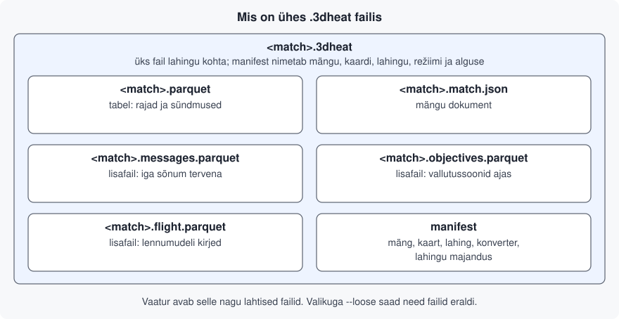
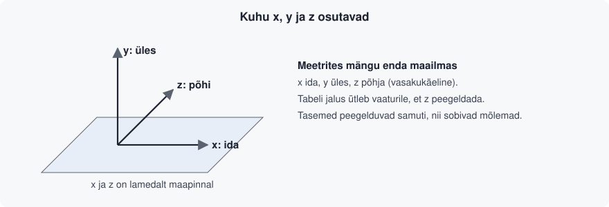

# Väljundfailid {#output-files}

Vaikimisi on iga lahing **üks fail**, `out/<map>/<match>.3dheat`: tabel, mängu
dokument ja lisafailid koos pakitud, koos manifestiga, mis nimetab mängu, kaardi,
mängu, lahingurežiimi, algusaja ja konverter (ning lahingu majanduse jaotises
`extensions["heat3d/economy"]`). Formaat on vaaturi oma:
[Üks fail mängu kohta (.3dheat)](https://holdi601.github.io/3DHeat/container.html).

Valikuga `--loose` kirjutatakse samad failid hoopis kõrvuti:

| Fail | Mis see on | Leht |
|---|---|---|
| `<match>.parquet` | üks rida igale näidisele või sündmusele | [Tabel](table.md) |
| `<match>.match.json` | kõik muu, mida kordus ütleb | [Mängu dokument](match-document.md) |
| `<match>.messages.parquet` | iga sõnum, komponendi väärtus ja pakett tervena | [Lisafailid](sidecars.md) |
| `<match>.objectives.parquet` | vallutussoonid ajas | [Lisafailid](sidecars.md) |
| `<match>.flight.parquet` | iga lennuki iga lennumudeli kirje tervena | [Lisafailid](sidecars.md) |

Kui pakkimine ebaõnnestub, jäetakse lahtised failid alles ja rida ütleb seda.

## Nimed {#names}

`<match>` on `<map>_<AB|RB|SB>_<mode>_<start, UTC>_<session id>`, nagu pildil: vt
[Mis failid on üks lahing](converting.md#which-files-are-one-battle).
`<map>` on mängu enda kaardi ID (`99_testmap` piltidel).

## Koordinaadid {#coordinates}

Meetrites, mängu enda maailmas: x ida, y üles, z põhja. Tabeli jaluse järgi peegeldab
vaatur z-telge, ja tasemed käsust `heat3d-wt-level` kirjutatakse samamoodi, nii et
kordus ja tema tase langevad üksteisele peale.

---

Osa [3DHeatist](https://github.com/Holdi601/3DHeat) ([dokumentatsioon](https://holdi601.github.io/3DHeat/)). Lähtekood: [3DHeat-Ext-WarThunder](https://github.com/Holdi601/3DHeat-Ext-WarThunder).
