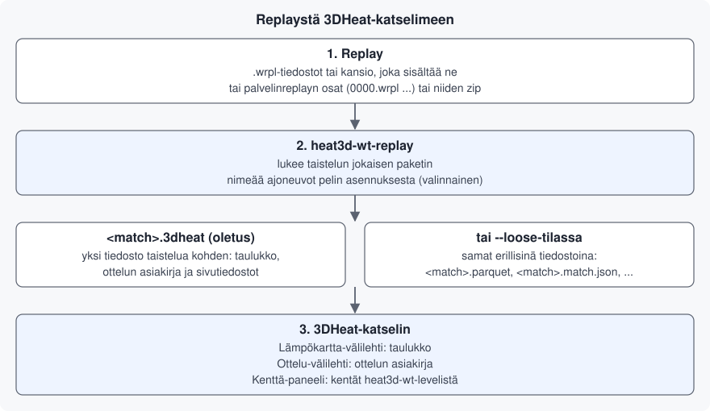

# 3DHeat War Thunder -replayt {#dheat-war-thunder-replays}

**Mitä tämä on?** War Thunder voi tallentaa taistelun replayksi. Tämä työkalu
muuttaa tallenteen tiedostoksi, jonka voit katsoa ylhäältä
[3DHeat-katsojassa](https://holdi601.github.io/3DHeat/): jokaisen lentokoneen,
panssarivaunun ja laivan, jokaisen ohjuksen ja pommin sekä jokaisen osuman
paikkaan. Toinen komento muuttaa oman pelisi asennuksen kentät 3D-kentiksi,
joilla taistelut näytetään.

**Miksi käyttäisin sitä?** Taistelun jälkianalyysiin 3D:ssä; lämpökarttoihin
siitä, missä sinä ja muut lensitte, ajoitte, taistelitte ja kuolitte monen
taistelun aikana; nähdäksesi, mihin osumat osuivat ajoneuvoon; nähdäksesi,
mitä taistelu maksoi ja tuotti. Tulos on tavallista Parquet- ja JSON-muotoa,
joten muut työkalut voivat lukea sen myös.

**Esimerkki:** yksi `.wrpl`-replay sisään, yksi `<match>.3dheat`-tiedosto ulos:



## Pikaohje {#quick-start}

Uusi komentoriviltä? Lue ensin [Ennen aloittamista](before-you-start.md).

```bash
git clone https://github.com/Holdi601/3DHeat-Ext-WarThunder.git
cd 3DHeat-Ext-WarThunder
pip install -e .                                  # asentaa heat3d-wt-replay- ja heat3d-wt-level-komennot
heat3d-wt-replay "<War Thunder>/Replays" -o out
```

Näet yhden rivin taistelua kohden: `ok out/<map>/<match>.3dheat`. Avaa tämä
tiedosto 3DHeat-katsojassa.

## Tämä dokumentaatio {#this-documentation}

| Sivu | Mitä se kattaa |
|---|---|
| [Ennen aloittamista](before-you-start.md) | Python, pääte ja mitä onnistuminen tarkoittaa |
| [Asennus](installing.md) | asennus, nimet asennuksestasi, päivitykset |
| [Replayjen muuntaminen](converting.md) | `heat3d-wt-replay` vaihe vaiheelta, kaikki valinnat, viestit |
| [Tulostiedostot](output-files.md) | `.3dheat`-tiedosto, `--loose`-tiedostot, nimet |
| [Taulukko](table.md) | jokainen sarake ja tapahtuma |
| [Ottelun asiakirja](match-document.md) | jokainen avain tiedostossa `<match>.match.json` |
| [Sivutiedostot ja täydellisyys](sidecars.md) | mitä säilytetään kokonaisena taulukon lisäksi, ja laskurit |
| [Kentät](levels.md) | `heat3d-wt-level`: asennuksesi kentät `.glb`-muodossa |
| [Miten replay luetaan](how-it-reads.md) | mitä luetaan ja miten se tarkistettiin |
| [Lentokoneet](aircraft.md), [Maayksiköt ja kamera](ground.md), [Osumat, tulitus ja palot](hits.md) | sarakkeiden taustalla olevat yksityiskohdat |
| [Talous](economy.md), [Tavoitteet](objectives.md) | Silver Lions ja tutkimuspisteet; valloitusalueet, lentokentät |
| [Ehdot ja lisenssi](terms.md) | mitä luetaan, lähteet, testit, lisenssi |
| [Komentoviite](../cli-reference.md), [Sarakeluettelo](../columns.md) | luotu koodista |

## Osa 3DHeatiä {#part-of-3dheat}

Tämä muunnin on yksi [3DHeatin](https://github.com/Holdi601/3DHeat) työkaluista,
reaaliaikainen 3D-telemetria- ja replaykatselin ([dokumentaatio](https://holdi601.github.io/3DHeat/)).
Katselin avaa `.3dheat`-tiedoston: taulukon sen Lämpökartta-välilehdellä ja
ottelun asiakirjan Ottelu-välilehdellä ([Yksi tiedosto ottelua kohden](https://holdi601.github.io/3DHeat/container.html)).
Mitä jokaisen muuntimen on säilytettävä: [Muuntimet säilyttävät kaiken](https://holdi601.github.io/3DHeat/converters.html).

Jokainen pelinlukija on oma pieni projektinsa, jolla on oma lisenssitiedosto, omat julkaisut ja oma vikaseuranta, joten sen voi asentaa, päivittää, ylläpitää - tai vetää pois oikeudenhaltijan pyynnöstä - erikseen ilman, että se vaikuttaa katseluohjelmaan tai muihin työkaluihin.
3DHeat Watcher ajaa tämän muuntimen uusille replayille, kun se on asennettu, ja toimii myös ilman sitä.

| Työkalu | Mitä se tekee | Lähde | Dokumentaatio |
|---|---|---|---|
| 3DHeat-katselin | näyttää datan 3D:nä: lämpökartat, replayt, kilpa-analyysi | [3DHeat](https://github.com/Holdi601/3DHeat) | [sivusto](https://holdi601.github.io/3DHeat/) |
| GameFiles | radat ja kentät pelien mukana tulevista tiedostoista | [3DHeat-GameFiles](https://github.com/Holdi601/3DHeat-GameFiles) | [sivusto](https://holdi601.github.io/3DHeat-GameFiles/) |
| GameCapture | kierrosten telemetria ja kentät pelivideosta rakennettuina | [3DHeat-GameCapture](https://github.com/Holdi601/3DHeat-GameCapture) | [sivusto](https://holdi601.github.io/3DHeat-GameCapture/) |
| Unreal Exporter | Unreal Editor -lisäosa, joka vie kentän | [3DHeat-UnrealExporter](https://github.com/Holdi601/3DHeat-UnrealExporter) | [sivusto](https://holdi601.github.io/3DHeat-UnrealExporter/) |
| CS2 | Counter-Strike 2 -demot ja kartat | [3DHeat-CS2](https://github.com/Holdi601/3DHeat-CS2) | [sivusto](https://holdi601.github.io/3DHeat-CS2/) |
| Watcher | tallentaa sen, mitä pelit julkaisevat pelatessasi | [3DHeat-Watcher](https://github.com/Holdi601/3DHeat-Watcher) | [sivusto](https://holdi601.github.io/3DHeat-Watcher/) |
| War Thunder -replayt | `.wrpl`-replayt ja War Thunderin kentät | [3DHeat-Ext-WarThunder](https://github.com/Holdi601/3DHeat-Ext-WarThunder) | [sivusto](https://holdi601.github.io/3DHeat-Ext-WarThunder/) |
| World of Tanks -replayt | `.wotreplay`-replayt | [3DHeat-Ext-WoT](https://github.com/Holdi601/3DHeat-Ext-WoT) | [sivusto](https://holdi601.github.io/3DHeat-Ext-WoT/) |
| World of Warships -replayt | `.wowsreplay`-replayt | [3DHeat-Ext-WoWs](https://github.com/Holdi601/3DHeat-Ext-WoWs) | [sivusto](https://holdi601.github.io/3DHeat-Ext-WoWs/) |
| Squad-demot | Squad-palvelimen demot | [3DHeat-Ext-Squad](https://github.com/Holdi601/3DHeat-Ext-Squad) | [sivusto](https://holdi601.github.io/3DHeat-Ext-Squad/) |
| DCS-kartat | DCS Worldin kartat 3D-kentinä | [3DHeat-Ext-DCS](https://github.com/Holdi601/3DHeat-Ext-DCS) | [sivusto](https://holdi601.github.io/3DHeat-Ext-DCS/) |
| IL-2-kartat | IL-2 Great Battles -kartat 3D-kentinä | [3DHeat-Ext-IL2](https://github.com/Holdi601/3DHeat-Ext-IL2) | [sivusto](https://holdi601.github.io/3DHeat-Ext-IL2/) |

---

Osa [3DHeatiä](https://github.com/Holdi601/3DHeat) ([dokumentaatio](https://holdi601.github.io/3DHeat/)). Lähde: [3DHeat-Ext-WarThunder](https://github.com/Holdi601/3DHeat-Ext-WarThunder).
