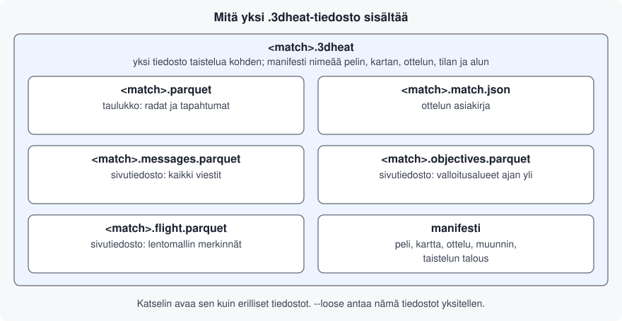
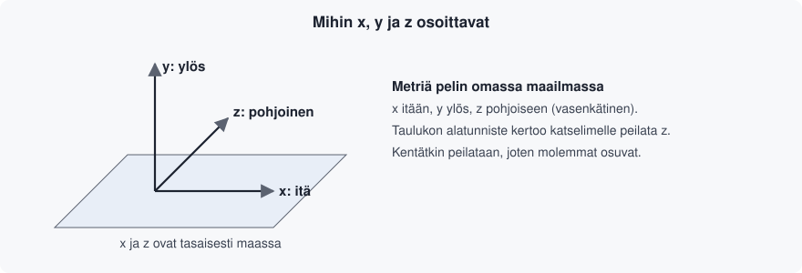

# Tulostiedostot {#output-files}

Oletuksena jokainen taistelu on **yksi tiedosto**, `out/<map>/<match>.3dheat`:
taulukko, ottelun asiakirja ja sivutiedostot pakattuna yhteen, ja manifesti, joka
nimeää pelin, kartan, ottelun, taistelutilan, aloitusajan ja muuntimen (sekä
taistelun talouden kohdassa `extensions["heat3d/economy"]`). Muoto on katselimen:
[Yksi tiedosto ottelua kohden (.3dheat)](https://holdi601.github.io/3DHeat/container.html).

`--loose`-tilassa samat tiedostot kirjoitetaan rinnakkain erillisinä:

| Tiedosto | Mitä se sisältää | Sivu |
|---|---|---|
| `<match>.parquet` | yksi rivi näytettä tai tapahtumaa kohden | [Taulukko](table.md) |
| `<match>.match.json` | kaikki muu, mitä replay kertoo | [Ottelun asiakirja](match-document.md) |
| `<match>.messages.parquet` | jokainen viesti, komponentin arvo ja paketti kokonaisena | [Sivutiedostot](sidecars.md) |
| `<match>.objectives.parquet` | valloitusalueet ajan yli | [Sivutiedostot](sidecars.md) |
| `<match>.flight.parquet` | jokainen lentomallin merkintä jokaisesta lentokoneesta kokonaisena | [Sivutiedostot](sidecars.md) |

Jos pakkaaminen epäonnistuu, erilliset tiedostot säilytetään ja rivi kertoo siitä.

## Nimet {#names}

`<match>` on `<map>_<AB|RB|SB>_<mode>_<start, UTC>_<session id>`, kuten kuvassa:
katso [Mitkä tiedostot ovat yksi taistelu](converting.md#which-files-are-one-battle).
`<map>` on kartan pelin oma tunnus (`99_testmap` kuvissa).

## Koordinaatit {#coordinates}

Metrejä pelin omassa maailmassa: x itään, y ylös, z pohjoiseen. Taulukon alatunniste
kertoo katselimelle, että z peilataan, ja `heat3d-wt-level`-kentät kirjoitetaan
samalla tavalla, joten replay ja sen kenttä osuvat päällekkäin.

---

Osa [3DHeatiä](https://github.com/Holdi601/3DHeat) ([dokumentaatio](https://holdi601.github.io/3DHeat/)). Lähde: [3DHeat-Ext-WarThunder](https://github.com/Holdi601/3DHeat-Ext-WarThunder).
