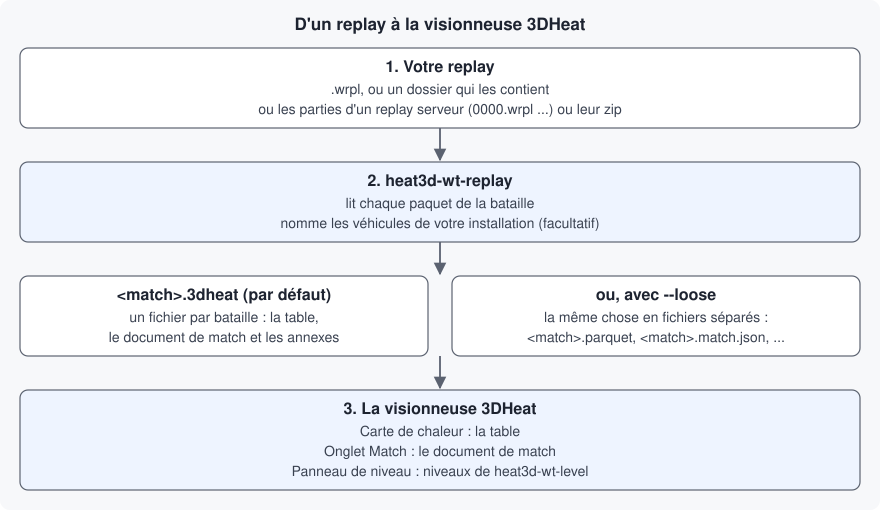

# Replays War Thunder pour 3DHeat {#dheat-war-thunder-replays}

**Qu'est-ce que c'est ?** War Thunder peut enregistrer une bataille sous forme de fichier
replay. Cet outil transforme cet enregistrement en un fichier que vous pouvez regarder d'en
haut dans la [visionneuse 3DHeat](https://holdi601.github.io/3DHeat/), avec chaque avion,
char et navire, chaque missile et bombe, et chaque impact à l'endroit où il s'est produit.
Une seconde commande transforme les cartes de votre propre installation du jeu en niveaux
3D, sur lesquels les batailles sont montrées.

**Pourquoi l'utiliser ?** Pour faire le bilan d'une bataille en 3D ; pour des cartes de
chaleur de l'endroit où vous et d'autres volez, roulez, combattez et mourez, sur de
nombreuses batailles ; pour voir où les impacts ont touché un véhicule ; pour voir ce
qu'une bataille a coûté et rapporté. Le résultat est du Parquet et du JSON simples, que
d'autres outils peuvent lire aussi.

**Exemple :** un replay `.wrpl` en entrée, un fichier `<match>.3dheat` en sortie :



## Démarrage rapide {#quick-start}

Vous ne connaissez pas la ligne de commande ? Lisez d'abord [Avant de commencer](before-you-start.md).

```bash
git clone https://github.com/Holdi601/3DHeat-Ext-WarThunder.git
cd 3DHeat-Ext-WarThunder
pip install -e .                                  # installe heat3d-wt-replay et heat3d-wt-level
heat3d-wt-replay "<War Thunder>/Replays" -o out
```

Vous devez voir une ligne par bataille : `ok out/<map>/<match>.3dheat`. Ouvrez ce fichier
dans la visionneuse 3DHeat.

## Cette documentation {#this-documentation}

| Page | Ce qu'elle couvre |
|---|---|
| [Avant de commencer](before-you-start.md) | Python, un terminal, et à quoi ressemble la réussite |
| [Installation](installing.md) | installation, noms tirés de votre installation, mises à jour |
| [Convertir les replays](converting.md) | `heat3d-wt-replay` pas à pas, chaque option, messages |
| [Fichiers de sortie](output-files.md) | le fichier `.3dheat`, les fichiers `--loose`, les noms |
| [La table](table.md) | chaque colonne et chaque événement |
| [Le document de match](match-document.md) | chaque clé de `<match>.match.json` |
| [Fichiers annexes et complétude](sidecars.md) | ce qui est conservé en entier à côté de la table, et les compteurs |
| [Niveaux](levels.md) | `heat3d-wt-level` : des niveaux de votre installation en `.glb` |
| [Comment le replay est lu](how-it-reads.md) | ce qui est lu, et comment cela a été vérifié |
| [Avions](aircraft.md), [Unités au sol et caméra](ground.md), [Impacts, tirs et incendies](hits.md) | les détails derrière les colonnes |
| [Économie](economy.md), [Objectifs](objectives.md) | Lions d'argent et points de recherche ; zones de capture, aérodromes |
| [Termes et licence](terms.md) | les conditions de Gaijin, les sources, les tests, la licence |
| [Référence des commandes](../cli-reference.md), [Liste des colonnes](../columns.md) | générées à partir du code |

## Une partie de 3DHeat {#part-of-3dheat}

Ce convertisseur est l'un des outils de [3DHeat](https://github.com/Holdi601/3DHeat),
une visionneuse 3D de télémétrie et de replays en temps réel ([documentation](https://holdi601.github.io/3DHeat/)).
La visionneuse ouvre le fichier `.3dheat` : la table dans son onglet Carte de chaleur, le
document de match dans son onglet Match ([Un fichier par match](https://holdi601.github.io/3DHeat/container.html)).
Ce que chaque convertisseur doit conserver : [Les convertisseurs gardent tout](https://holdi601.github.io/3DHeat/converters.html).

**Pourquoi c'est un outil à part.** Le format `.wrpl` n'est pas documenté, et l'EULA de
Gaijin (3.2.2, 3.2.9) interdit la rétro-ingénierie du jeu et l'extraction de données non
destinées à être affichées ; il ne mentionne pas les replays, que le jeu lui-même montre au
joueur. Pour qu'une question de licence ne touche que ce convertisseur, il vit en dehors du
Watcher de 3DHeat : le Watcher le lance sur les nouveaux replays quand il est installé, et
fonctionne sans lui.

| Outil | Ce qu'il fait | Source | Documentation |
|---|---|---|---|
| Visionneuse 3DHeat | affiche les données en 3D : cartes de chaleur, replays, analyse de course | [3DHeat](https://github.com/Holdi601/3DHeat) | [site](https://holdi601.github.io/3DHeat/) |
| GameFiles | parcours et niveaux tirés des fichiers livrés avec les jeux | [3DHeat-GameFiles](https://github.com/Holdi601/3DHeat-GameFiles) | [site](https://holdi601.github.io/3DHeat-GameFiles/) |
| GameCapture | télémétrie de tour, et niveaux reconstruits à partir de vidéos de jeu | [3DHeat-GameCapture](https://github.com/Holdi601/3DHeat-GameCapture) | [site](https://holdi601.github.io/3DHeat-GameCapture/) |
| Unreal Exporter | un plugin de l'éditeur Unreal qui exporte un niveau | [3DHeat-UnrealExporter](https://github.com/Holdi601/3DHeat-UnrealExporter) | [site](https://holdi601.github.io/3DHeat-UnrealExporter/) |
| CS2 | démos et cartes de Counter-Strike 2 | [3DHeat-CS2](https://github.com/Holdi601/3DHeat-CS2) | [site](https://holdi601.github.io/3DHeat-CS2/) |
| Watcher | enregistre ce que les jeux publient pendant que vous jouez | [3DHeat-Watcher](https://github.com/Holdi601/3DHeat-Watcher) | [site](https://holdi601.github.io/3DHeat-Watcher/) |
| Replays War Thunder | replays `.wrpl` et niveaux de War Thunder | [3DHeat-Ext-WarThunder](https://github.com/Holdi601/3DHeat-Ext-WarThunder) | [site](https://holdi601.github.io/3DHeat-Ext-WarThunder/) |
| Replays World of Tanks | replays `.wotreplay` | [3DHeat-Ext-WoT](https://github.com/Holdi601/3DHeat-Ext-WoT) | [site](https://holdi601.github.io/3DHeat-Ext-WoT/) |
| Replays World of Warships | replays `.wowsreplay` | [3DHeat-Ext-WoWs](https://github.com/Holdi601/3DHeat-Ext-WoWs) | [site](https://holdi601.github.io/3DHeat-Ext-WoWs/) |
| Démos Squad | démos de serveur Squad | [3DHeat-Ext-Squad](https://github.com/Holdi601/3DHeat-Ext-Squad) | [site](https://holdi601.github.io/3DHeat-Ext-Squad/) |
| Cartes DCS | cartes de DCS World en niveaux 3D | [3DHeat-Ext-DCS](https://github.com/Holdi601/3DHeat-Ext-DCS) | [site](https://holdi601.github.io/3DHeat-Ext-DCS/) |
| Cartes IL-2 | cartes d'IL-2 Great Battles en niveaux 3D | [3DHeat-Ext-IL2](https://github.com/Holdi601/3DHeat-Ext-IL2) | [site](https://holdi601.github.io/3DHeat-Ext-IL2/) |

---

Une partie de [3DHeat](https://github.com/Holdi601/3DHeat) ([documentation](https://holdi601.github.io/3DHeat/)). Source : [3DHeat-Ext-WarThunder](https://github.com/Holdi601/3DHeat-Ext-WarThunder).
