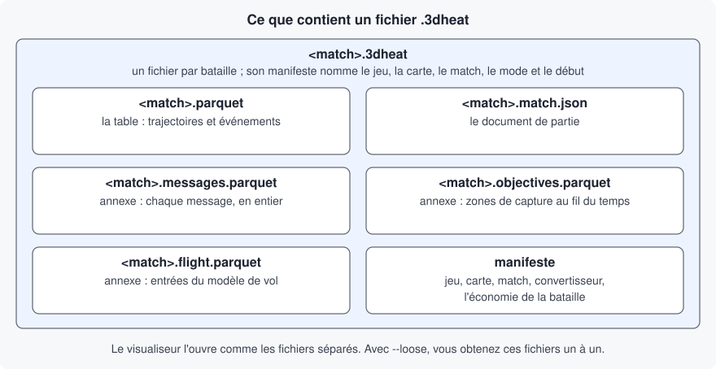
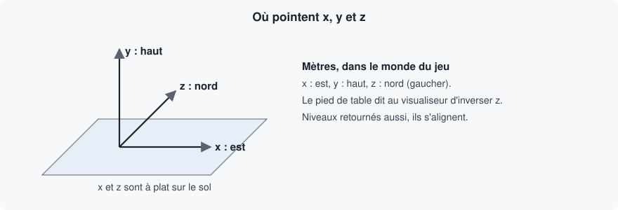

# Fichiers de sortie {#output-files}

Par défaut, chaque bataille est **un seul fichier**, `out/<map>/<match>.3dheat` : la table, le
document de match et les fichiers annexes regroupés ensemble, avec un manifeste qui nomme le jeu,
la carte, le match, le mode de bataille, l'heure de début et le convertisseur (et l'économie de la
bataille sous `extensions["heat3d/economy"]`). Le format est celui de la visionneuse :
[Un fichier par match (.3dheat)](https://holdi601.github.io/3DHeat/container.html).

Avec `--loose`, les mêmes fichiers sont écrits côte à côte :

| Fichier | Contenu | Page |
|---|---|---|
| `<match>.parquet` | une ligne par échantillon ou événement | [La table](table.md) |
| `<match>.match.json` | tout le reste de ce que dit le replay | [Le document de match](match-document.md) |
| `<match>.messages.parquet` | chaque message, valeur de composant et paquet, en entier | [Fichiers annexes](sidecars.md) |
| `<match>.objectives.parquet` | les zones de capture au fil du temps | [Fichiers annexes](sidecars.md) |
| `<match>.flight.parquet` | chaque entrée du modèle de vol de chaque avion, en entier | [Fichiers annexes](sidecars.md) |

Si le regroupement échoue, les fichiers séparés sont conservés et la ligne l'indique.

## Noms {#names}

`<match>` est `<map>_<AB|RB|SB>_<mode>_<start, UTC>_<session id>`, comme sur l'image : voir
[Quels fichiers forment une bataille](converting.md#which-files-are-one-battle).
`<map>` est l'identifiant de la carte dans le jeu (`99_testmap` sur les images).

## Coordonnées {#coordinates}

En mètres, dans le monde propre au jeu : x vers l'est, y vers le haut, z vers le nord. Le pied de la table
indique à la visionneuse d'inverser z, et les niveaux de `heat3d-wt-level` sont écrits de la même
façon : un replay et son niveau se superposent.

---

Une partie de [3DHeat](https://github.com/Holdi601/3DHeat) ([documentation](https://holdi601.github.io/3DHeat/)). Source : [3DHeat-Ext-WarThunder](https://github.com/Holdi601/3DHeat-Ext-WarThunder).
