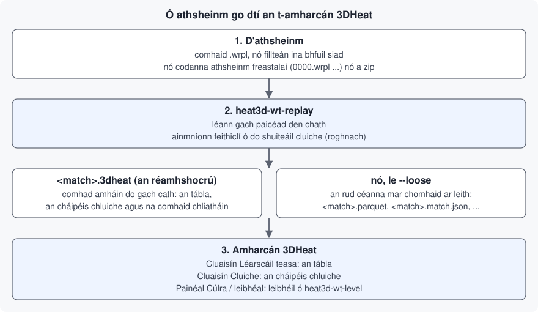

# Athsheinmeanna 3DHeat War Thunder {#dheat-war-thunder-replays}

**Céard é?** Is féidir le War Thunder cath a thaifeadadh mar chomhad athsheinm. Tiontaíonn an uirlis seo an taifead ina chomhad ar féidir leat féachaint air ó thuas i [bhfaire 3DHeat](https://holdi601.github.io/3DHeat/), le gach eitleán, tanc agus long, gach diúracán agus buama, agus gach buille san áit ar tharla sé. Tiontaíonn dara ordú leibhéil do shuiteála cluiche féin ina leibhéil 3T inar féidir na cathanna a thaispeáint.

**Cén fáth a n-úsáidfinn é?** Chun cath a phlé i 3T tar éis é; le haghaidh léarscáileanna teasa den áit a n-eitlíonn, a dtiomáineann, a gcathaíonn agus a bhfaigheann tú féin agus daoine eile bás thar go leor cathanna; chun a fheiceáil cá ndeachaigh buillí ar fheithicil; chun a fheiceáil cad a chosain agus a thuill cath. Is Parquet agus JSON simplí an t-aschur, mar sin is féidir le huirlisí eile é a léamh freisin.

**Sampla:** athsheinm `.wrpl` amháin isteach, comhad `<match>.3dheat` amháin amach:



## Tús tapa {#quick-start}

Nua leis an líne ordaithe? Léigh [Sula dtosaíonn tú](before-you-start.md) ar dtús.

```bash
git clone https://github.com/Holdi601/3DHeat-Ext-WarThunder.git
cd 3DHeat-Ext-WarThunder
pip install -e .                                  # installs heat3d-wt-replay and heat3d-wt-level
heat3d-wt-replay "<War Thunder>/Replays" -o out
```

Ba cheart duit líne amháin a fheiceáil do gach cath: `ok out/<map>/<match>.3dheat`. Oscail an comhad sin i bhfaire 3DHeat.

## An doiciméadúchán seo {#this-documentation}

| Leathanach | Cad a chlúdaíonn sé |
|---|---|
| [Sula dtosaíonn tú](before-you-start.md) | Python, teirminéal, agus cén chuma atá ar rath |
| [Suiteáil](installing.md) | suiteáil, ainmneacha ó do shuiteáil, nuashonruithe |
| [Athsheinmeanna a thiontú](converting.md) | `heat3d-wt-replay` céim ar chéim, gach rogha, teachtaireachtaí |
| [Comhaid aschuir](output-files.md) | an comhad `.3dheat`, comhaid `--loose`, ainmneacha |
| [An tábla](table.md) | gach colún agus imeacht |
| [An cháipéis chluiche](match-document.md) | gach eochair de `<match>.match.json` |
| [Comhaid chliatháin agus iomláine](sidecars.md) | cad a choimeádtar iomlán seachas an tábla, agus na comhaireamh |
| [Leibhéil](levels.md) | `heat3d-wt-level`: leibhéil ó do shuiteáil mar `.glb` |
| [Conas a léann sé athsheinm](how-it-reads.md) | cad a léitear, agus conas a seiceáladh é |
| [Aerárthaí](aircraft.md), [Aonaid talún agus ceamara](ground.md), [Buillí, tine ghunnaí agus tinte](hits.md) | na sonraí taobh thiar de na colúin |
| [Geilleagar](economy.md), [Cuspóirí](objectives.md) | Silver Lions agus pointí taighde; criosanna gabhála, aerpháirceanna |
| [Téarmaí agus ceadúnas](terms.md) | téarmaí Gaijin, foinsí, tástálacha, ceadúnas |
| [Tagairt orduithe](../cli-reference.md), [Liosta colún](../columns.md) | ginte ón gcód |

## Cuid de 3DHeat {#part-of-3dheat}

Is ceann d'uirlisí [3DHeat](https://github.com/Holdi601/3DHeat) an tiontaire seo, faire telemetrie agus athsheinm 3T fíor-ama ([doiciméadúchán](https://holdi601.github.io/3DHeat/)). Osclaíonn an fhaire an comhad `.3dheat`: an tábla ina cluaisín Léarscáil teasa, an cháipéis chluiche ina cluaisín Cluiche ([Comhad amháin an cluiche](https://holdi601.github.io/3DHeat/container.html)). An rud a chaithfidh gach tiontaire a choimeád: [Coimeádann tiontairí gach rud](https://holdi601.github.io/3DHeat/converters.html).

**Cén fáth a bhfuil sé ina uirlis ar leith.** Níl formáid `.wrpl` doiciméadaithe, agus toirmisceann EULA Gaijin (3.2.2, 3.2.9) innealtóireacht inbhéartach ar an gcluiche agus sonraí nár ceapadh a thaispeáint a mhianadóireacht; ní ainmníonn sé athsheinmeanna, a thaispeánann an cluiche féin don imreoir. Ionas nach ndéanann ceist cheadúnais teagmháil ach leis an tiontaire seo, tá sé lasmuigh de 3DHeat Watcher: ritheann an Watcher é ar athsheinmeanna nua nuair atá sé suiteáilte, agus oibríonn sé gan é.

| Uirlis | Cad a dhéanann sí | Foinse | Doiciméadúchán |
|---|---|---|---|
| Faire 3DHeat | taispeánann sí na sonraí i 3T: léarscáileanna teasa, athsheinmeanna, anailís rása | [3DHeat](https://github.com/Holdi601/3DHeat) | [suíomh](https://holdi601.github.io/3DHeat/) |
| GameFiles | cúrsaí agus leibhéil as comhaid a seoltar le cluichí | [3DHeat-GameFiles](https://github.com/Holdi601/3DHeat-GameFiles) | [suíomh](https://holdi601.github.io/3DHeat-GameFiles/) |
| GameCapture | telemetria lap, agus leibhéil atógtha ó fhístéip chluiche | [3DHeat-GameCapture](https://github.com/Holdi601/3DHeat-GameCapture) | [suíomh](https://holdi601.github.io/3DHeat-GameCapture/) |
| Unreal Exporter | breiseán d'Unreal Editor a onnmhairíonn leibhéal | [3DHeat-UnrealExporter](https://github.com/Holdi601/3DHeat-UnrealExporter) | [suíomh](https://holdi601.github.io/3DHeat-UnrealExporter/) |
| CS2 | taispeántais agus léarscáileanna Counter-Strike 2 | [3DHeat-CS2](https://github.com/Holdi601/3DHeat-CS2) | [suíomh](https://holdi601.github.io/3DHeat-CS2/) |
| Watcher | taifeadann sé an méid a fhoilsíonn cluichí agus tú ag imirt | [3DHeat-Watcher](https://github.com/Holdi601/3DHeat-Watcher) | [suíomh](https://holdi601.github.io/3DHeat-Watcher/) |
| Athsheinmeanna War Thunder | athsheinmeanna `.wrpl` agus leibhéil War Thunder | [3DHeat-Ext-WarThunder](https://github.com/Holdi601/3DHeat-Ext-WarThunder) | [suíomh](https://holdi601.github.io/3DHeat-Ext-WarThunder/) |
| Athsheinmeanna World of Tanks | athsheinmeanna `.wotreplay` | [3DHeat-Ext-WoT](https://github.com/Holdi601/3DHeat-Ext-WoT) | [suíomh](https://holdi601.github.io/3DHeat-Ext-WoT/) |
| Athsheinmeanna World of Warships | athsheinmeanna `.wowsreplay` | [3DHeat-Ext-WoWs](https://github.com/Holdi601/3DHeat-Ext-WoWs) | [suíomh](https://holdi601.github.io/3DHeat-Ext-WoWs/) |
| Taispeántais Squad | taispeántais freastalaí Squad | [3DHeat-Ext-Squad](https://github.com/Holdi601/3DHeat-Ext-Squad) | [suíomh](https://holdi601.github.io/3DHeat-Ext-Squad/) |
| Léarscáileanna DCS | léarscáileanna DCS World mar leibhéil 3T | [3DHeat-Ext-DCS](https://github.com/Holdi601/3DHeat-Ext-DCS) | [suíomh](https://holdi601.github.io/3DHeat-Ext-DCS/) |
| Léarscáileanna IL-2 | léarscáileanna IL-2 Great Battles mar leibhéil 3T | [3DHeat-Ext-IL2](https://github.com/Holdi601/3DHeat-Ext-IL2) | [suíomh](https://holdi601.github.io/3DHeat-Ext-IL2/) |

---

Cuid de [3DHeat](https://github.com/Holdi601/3DHeat) ([doiciméadúchán](https://holdi601.github.io/3DHeat/)). Foinse: [3DHeat-Ext-WarThunder](https://github.com/Holdi601/3DHeat-Ext-WarThunder).
