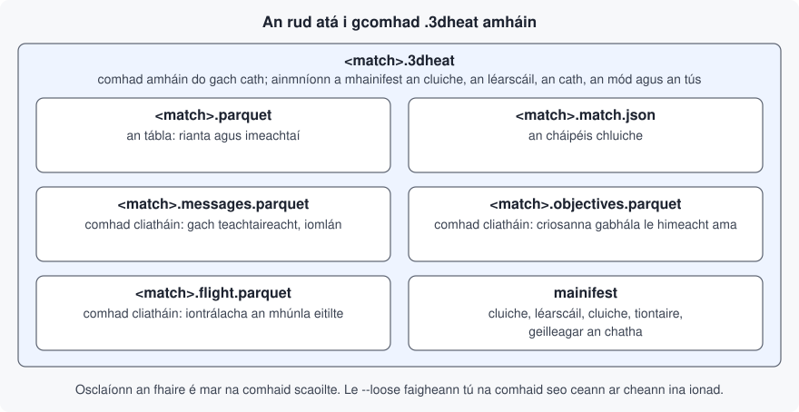
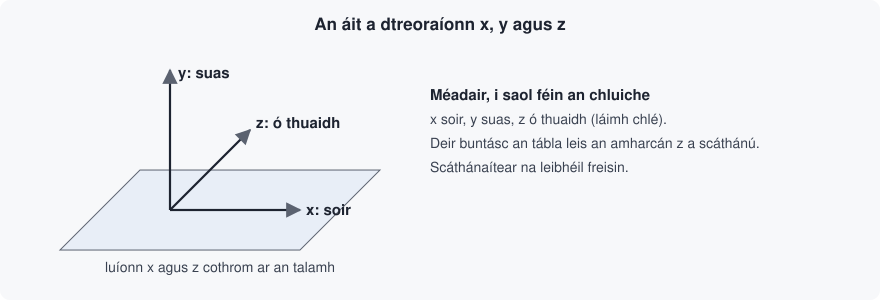

# Comhaid aschuir {#output-files}

Go réamhshocraithe is **comhad amháin** é gach cath, `out/<map>/<match>.3dheat`: an tábla, an cháipéis chluiche agus na comhaid chliatháin pacáilte le chéile, le mainifest a ainmníonn an cluiche, an léarscáil, an cluiche, mód an chatha, an t-am tosaigh agus an tiontaire (agus geilleagar an chatha faoi `extensions["heat3d/economy"]`). Is é formáid na faire é: [Comhad amháin an cluiche (.3dheat)](https://holdi601.github.io/3DHeat/container.html).

Le `--loose` scríobhtar na comhaid chéanna taobh le taobh ina ionad:

| Comhad | Cad é | Leathanach |
|---|---|---|
| `<match>.parquet` | sraith amháin do gach sampla nó imeacht | [An tábla](table.md) |
| `<match>.match.json` | gach rud eile a deir an athsheinm | [An cháipéis chluiche](match-document.md) |
| `<match>.messages.parquet` | gach teachtaireacht, luach comhpháirte agus paicéad, iomlán | [Comhaid chliatháin](sidecars.md) |
| `<match>.objectives.parquet` | na criosanna gabhála le himeacht ama | [Comhaid chliatháin](sidecars.md) |
| `<match>.flight.parquet` | gach iontráil den mhúnla eitilte de gach aerárthach, iomlán | [Comhaid chliatháin](sidecars.md) |

Má theipeann ar phacáil, coinnítear na comhaid scaoilte agus deir an líne é.

## Ainmneacha {#names}

Is é `<match>` `<map>_<AB|RB|SB>_<mode>_<start, UTC>_<session id>`, mar atá sa phictiúr: féach [Cad iad na comhaid atá ina gcath amháin](converting.md#which-files-are-one-battle). Is é `<map>` id féin an chluiche den léarscáil (`99_testmap` sna pictiúir).

## Comhordanáidí {#coordinates}

Méadair, i saol féin an chluiche: x soir, y suas, z ó thuaidh. Deir buntásc an tábla leis an bhfaire z a scáthánú, agus scríobhtar leibhéil ó `heat3d-wt-level` ar an mbealach céanna, mar sin luíonn athsheinm agus a leibhéal ar a chéile.

---

Cuid de [3DHeat](https://github.com/Holdi601/3DHeat) ([doiciméadúchán](https://holdi601.github.io/3DHeat/)). Foinse: [3DHeat-Ext-WarThunder](https://github.com/Holdi601/3DHeat-Ext-WarThunder).
