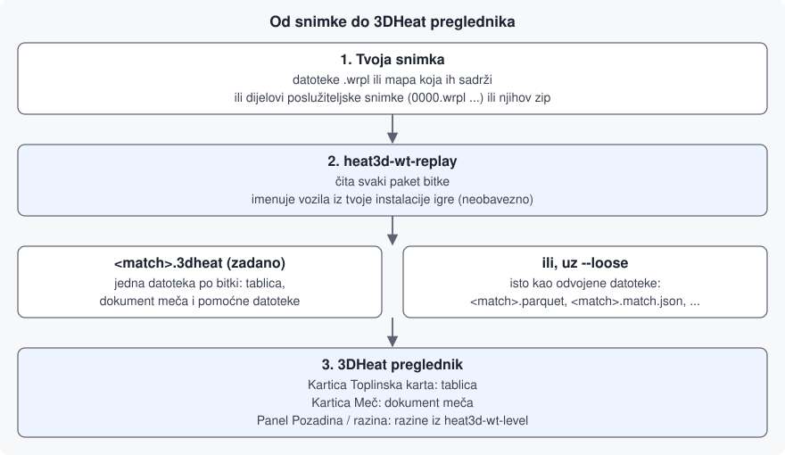

# 3DHeat snimke War Thundera {#dheat-war-thunder-replays}

**Što je to?** War Thunder može snimiti bitku kao datoteku snimke. Ovaj alat pretvara
snimku u datoteku koju možeš gledati odozgo u
[3DHeat pregledniku](https://holdi601.github.io/3DHeat/), sa svakim avionom, tenkom
i brodom, svakom raketom i bombom te svakim pogotkom na mjestu gdje se dogodio. Druga naredba
pretvara razine iz tvoje instalacije igre u 3D razine na kojima se bitke prikazuju.

**Zašto bih ga koristio?** Za pregled bitke u 3D; za toplinske karte gdje ti i drugi leteći,
vozite, borite se i ginete kroz mnogo bitki; za prikaz gdje su pogoci pali na vozilo; za prikaz
što je bitka koštala i donijela. Rezultat su obični Parquet i JSON, pa ga drugi alati također mogu
čitati.

**Primjer:** jedna `.wrpl` snimka na ulazu, jedna datoteka `<match>.3dheat` na izlazu:



## Brzi početak {#quick-start}

Nikad nisi koristio naredbeni redak? Prvo pročitaj [Prije početka](before-you-start.md).

```bash
git clone https://github.com/Holdi601/3DHeat-Ext-WarThunder.git
cd 3DHeat-Ext-WarThunder
pip install -e .                                  # instalira heat3d-wt-replay i heat3d-wt-level
heat3d-wt-replay "<War Thunder>/Replays" -o out
```

Trebao bi vidjeti jedan redak po bitki: `ok out/<map>/<match>.3dheat`. Otvori tu
datoteku u 3DHeat pregledniku.

## Ova dokumentacija {#this-documentation}

| Stranica | Što obuhvaća |
|---|---|
| [Prije početka](before-you-start.md) | Python, terminal i kako izgleda uspjeh |
| [Instalacija](installing.md) | instalacija, nazivi iz tvoje instalacije, ažuriranja |
| [Pretvaranje snimki](converting.md) | `heat3d-wt-replay` korak po korak, svaka opcija, poruke |
| [Izlazne datoteke](output-files.md) | datoteka `.3dheat`, datoteke `--loose`, nazivi |
| [Tablica](table.md) | svaki stupac i događaj |
| [Dokument meča](match-document.md) | svaki ključ u `<match>.match.json` |
| [Pomoćne datoteke i potpunost](sidecars.md) | što se čuva cijelo uz tablicu, i brojevi |
| [Razine](levels.md) | `heat3d-wt-level`: razine iz tvoje instalacije kao `.glb` |
| [Kako se snimka čita](how-it-reads.md) | što se čita i kako je provjereno |
| [Zrakoplovi](aircraft.md), [Kopnene jedinice i kamera](ground.md), [Pogoci, paljba i požari](hits.md) | pojedinosti iza stupaca |
| [Ekonomija](economy.md), [Ciljevi](objectives.md) | Silver Lions i bodovi za istraživanje; zone zauzimanja, aerodromi |
| [Pojmovi i licenca](terms.md) | Gaijinovi uvjeti, izvori, testovi, licenca |
| [Referenca naredbi](../cli-reference.md), [Popis stupaca](../columns.md) | generirano iz koda |

## Dio 3DHeata {#part-of-3dheat}

Ovaj pretvarač je jedan od alata [3DHeata](https://github.com/Holdi601/3DHeat),
aplikacije za 3D prikaz telemetrije i snimki u stvarnom vremenu ([dokumentacija](https://holdi601.github.io/3DHeat/)).
Preglednik otvara datoteku `.3dheat`: tablicu na kartici Toplinska karta, dokument meča na
kartici Meč ([Jedna datoteka za meč](https://holdi601.github.io/3DHeat/container.html)).
Što svaki pretvarač mora zadržati: [Pretvarači zadržavaju sve](https://holdi601.github.io/3DHeat/converters.html).

**Zašto je to zaseban alat.** Format `.wrpl` nije dokumentiran, a Gaijinova licenca
(3.2.2, 3.2.9) zabranjuje reverzno inženjerstvo igre i rudarenje podataka koji nisu namijenjeni
prikazu; ne spominje snimke, koje sama igra prikazuje igraču. Kako bi se pravno pitanje
odnosilo samo na ovaj pretvarač, on je izvan 3DHeat Watchera: Watcher ga pokreće nad novim
snimkama kad je instaliran, a radi i bez njega.

| Alat | Što radi | Izvor | Dokumentacija |
|---|---|---|---|
| 3DHeat preglednik | prikazuje podatke u 3D: toplinske karte, snimke, analiza utrka | [3DHeat](https://github.com/Holdi601/3DHeat) | [web](https://holdi601.github.io/3DHeat/) |
| GameFiles | staze i razine iz datoteka koje igre isporučuju | [3DHeat-GameFiles](https://github.com/Holdi601/3DHeat-GameFiles) | [web](https://holdi601.github.io/3DHeat-GameFiles/) |
| GameCapture | telemetrija krugova i razine rekonstruirane iz videa igre | [3DHeat-GameCapture](https://github.com/Holdi601/3DHeat-GameCapture) | [web](https://holdi601.github.io/3DHeat-GameCapture/) |
| Unreal Exporter | dodatak za Unreal Editor koji izvozi razinu | [3DHeat-UnrealExporter](https://github.com/Holdi601/3DHeat-UnrealExporter) | [web](https://holdi601.github.io/3DHeat-UnrealExporter/) |
| CS2 | Counter-Strike 2 demo snimke i mape | [3DHeat-CS2](https://github.com/Holdi601/3DHeat-CS2) | [web](https://holdi601.github.io/3DHeat-CS2/) |
| Watcher | bilježi što igre objavljuju dok igraš | [3DHeat-Watcher](https://github.com/Holdi601/3DHeat-Watcher) | [web](https://holdi601.github.io/3DHeat-Watcher/) |
| Snimke War Thundera | `.wrpl` snimke i razine War Thundera | [3DHeat-Ext-WarThunder](https://github.com/Holdi601/3DHeat-Ext-WarThunder) | [web](https://holdi601.github.io/3DHeat-Ext-WarThunder/) |
| Snimke World of Tanks | `.wotreplay` snimke | [3DHeat-Ext-WoT](https://github.com/Holdi601/3DHeat-Ext-WoT) | [web](https://holdi601.github.io/3DHeat-Ext-WoT/) |
| Snimke World of Warships | `.wowsreplay` snimke | [3DHeat-Ext-WoWs](https://github.com/Holdi601/3DHeat-Ext-WoWs) | [web](https://holdi601.github.io/3DHeat-Ext-WoWs/) |
| Squad demo | demo snimke Squad poslužitelja | [3DHeat-Ext-Squad](https://github.com/Holdi601/3DHeat-Ext-Squad) | [web](https://holdi601.github.io/3DHeat-Ext-Squad/) |
| DCS mape | karte DCS Worlda kao 3D razine | [3DHeat-Ext-DCS](https://github.com/Holdi601/3DHeat-Ext-DCS) | [web](https://holdi601.github.io/3DHeat-Ext-DCS/) |
| IL-2 mape | karte IL-2 Great Battlesa kao 3D razine | [3DHeat-Ext-IL2](https://github.com/Holdi601/3DHeat-Ext-IL2) | [web](https://holdi601.github.io/3DHeat-Ext-IL2/) |

---

Dio [3DHeata](https://github.com/Holdi601/3DHeat) ([dokumentacija](https://holdi601.github.io/3DHeat/)). Izvor: [3DHeat-Ext-WarThunder](https://github.com/Holdi601/3DHeat-Ext-WarThunder).
