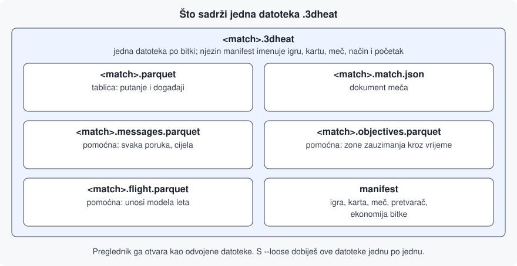
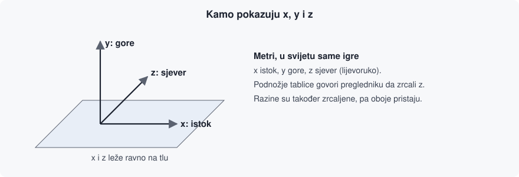

# Izlazne datoteke {#output-files}

Zadano je da je svaka bitka **jedna datoteka**, `out/<map>/<match>.3dheat`: tablica, dokument meča i
pomoćne datoteke spakirane zajedno, s manifestom koji navodi igru, kartu, meč, način bitke, vrijeme
početka i pretvarač (te ekonomiju bitke pod `extensions["heat3d/economy"]`). Format je preglednikov:
[Jedna datoteka za meč (.3dheat)](https://holdi601.github.io/3DHeat/container.html).

S `--loose` iste se datoteke umjesto toga pišu jedna pored druge:

| Datoteka | Sadržaj | Stranica |
|---|---|---|
| `<match>.parquet` | jedan redak po uzorku ili događaju | [Tablica](table.md) |
| `<match>.match.json` | sve ostalo što snimka kaže | [Dokument meča](match-document.md) |
| `<match>.messages.parquet` | svaka poruka, vrijednost komponente i paket, cijeli | [Pomoćne datoteke](sidecars.md) |
| `<match>.objectives.parquet` | zone zauzimanja kroz vrijeme | [Pomoćne datoteke](sidecars.md) |
| `<match>.flight.parquet` | svaki unos modela leta svakog zrakoplova, cijeli | [Pomoćne datoteke](sidecars.md) |

Ako pakiranje ne uspije, odvojene datoteke se zadržavaju i redak to kaže.

## Nazivi {#names}

`<match>` je `<map>_<AB|RB|SB>_<mode>_<start, UTC>_<session id>`, kao na slici: vidi
[Koje datoteke čine jednu bitku](converting.md#which-files-are-one-battle).
`<map>` je igrin vlastiti identifikator karte (`99_testmap` na slikama).

## Koordinate {#coordinates}

Metri, u vlastitom svijetu igre: x istok, y gore, z sjever. Podnožje tablice govori
pregledniku da zrcali z, a razine iz `heat3d-wt-level` zapisuju se na isti način, pa snimka i
njezina razina leže jedna na drugoj.

---

Dio [3DHeata](https://github.com/Holdi601/3DHeat) ([dokumentacija](https://holdi601.github.io/3DHeat/)). Izvor: [3DHeat-Ext-WarThunder](https://github.com/Holdi601/3DHeat-Ext-WarThunder).
