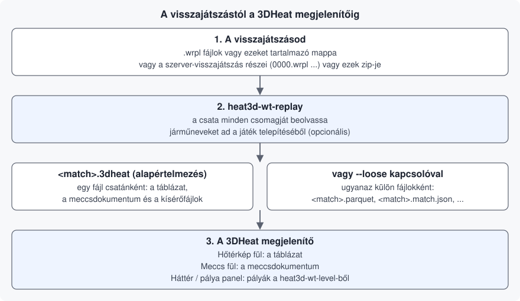

# 3DHeat War Thunder visszajátszások {#dheat-war-thunder-replays}

**Mi ez?** A War Thunder a csatákat visszajátszás-fájlként rögzíti. Ez az eszköz a felvételt
olyan fájllá alakítja, amelyet felülről nézhetsz meg a
[3DHeat megjelenítőben](https://holdi601.github.io/3DHeat/), minden géppel, tankkal és hajóval,
minden rakétával és bombával, és minden találattal ott, ahol történt. Egy második parancs a
saját játéktelepítésed pályáit 3D-s pályákká alakítja, amelyeken a csatákat megmutathatod.

**Mire jó?** Egy csata 3D-s utólagos elemzésére; hőtérképekhez, hogy lássuk, hol repülsz,
hajtasz, harcolsz és halsz meg te és mások sok csatában; annak megnézéséhez, hol értek
célba a találatok egy járművön; és annak megnézéséhez, mibe került és mit hozott egy csata.
A kimenet sima Parquet és JSON, így más eszközök is olvashatják.

**Példa:** egy `.wrpl` visszajátszás be, egy `<match>.3dheat` fájl ki:



## Gyors kezdés {#quick-start}

Új vagy a parancssorban? Olvasd el először a [Mielőtt elkezded](before-you-start.md) oldalt.

```bash
git clone https://github.com/Holdi601/3DHeat-Ext-WarThunder.git
cd 3DHeat-Ext-WarThunder
pip install -e .                                  # installs heat3d-wt-replay and heat3d-wt-level
heat3d-wt-replay "<War Thunder>/Replays" -o out
```

Csatánként egy sort kell látnod: `ok out/<map>/<match>.3dheat`. Nyisd meg ezt a fájlt a
3DHeat megjelenítőben.

## Ez a dokumentáció {#this-documentation}

| Oldal | Mit fed le |
|---|---|
| [Mielőtt elkezded](before-you-start.md) | Python, terminál, és mi jelzi a sikert |
| [Telepítés](installing.md) | telepítés, nevek a telepítésedből, frissítések |
| [Visszajátszások konvertálása](converting.md) | `heat3d-wt-replay` lépésről lépésre, minden kapcsoló, üzenetek |
| [Kimeneti fájlok](output-files.md) | a `.3dheat` fájl, a `--loose` fájlok, a nevek |
| [A táblázat](table.md) | minden oszlop és esemény |
| [A meccsdokumentum](match-document.md) | a `<match>.match.json` minden kulcsa |
| [Kísérőfájlok és teljesség](sidecars.md) | a táblázaton kívül egészben megtartott adatok, és a számlálók |
| [Pályák](levels.md) | `heat3d-wt-level`: a telepítésedből származó pályák `.glb` formátumban |
| [Hogyan olvassa a visszajátszást](how-it-reads.md) | mi van beolvasva, és hogyan ellenőriztük |
| [Repülőgépek](aircraft.md), [Földi egységek és kamera](ground.md), [Találatok, lövések és tüzek](hits.md) | az oszlopok mögötti részletek |
| [Gazdaság](economy.md), [Célok](objectives.md) | ezüstoroszlánok és kutatási pontok; elfoglalható zónák, repülőterek |
| [Feltételek és licenc](terms.md) | a Gaijin feltételei, források, tesztek, licenc |
| [Parancsreferencia](../cli-reference.md), [Oszloplista](../columns.md) | a kódból generálva |

## A 3DHeat része {#part-of-3dheat}

Ez a konverter a [3DHeat](https://github.com/Holdi601/3DHeat) eszközei egyike, egy valós
idejű 3D telemetria- és visszajátszás-megjelenítő ([dokumentáció](https://holdi601.github.io/3DHeat/)).
A megjelenítő megnyitja a `.3dheat` fájlt: a táblázatot a Hőtérkép fülön, a meccsdokumentumot a
Meccs fülön ([Egy fájl egy meccshez](https://holdi601.github.io/3DHeat/container.html)).
Amit minden konverternek meg kell őriznie: [A konverterek mindent megtartanak](https://holdi601.github.io/3DHeat/converters.html).

**Miért külön eszköz.** A `.wrpl` formátum nincs dokumentálva, a Gaijin felhasználási feltételei
(3.2.2, 3.2.9) pedig tiltják a játék visszafejtését és olyan adatok kinyerését, amelyeket nem
szánnak megjelenítésre; a visszajátszásokat nem nevezik meg, a játék maga mutatja meg a
játékosnak. Hogy egy licenckérdés csak ezt a konvertert érintse, az a 3DHeat Watcheren kívül
van: a Watcher telepítve futtatja új visszajátszásokon, de működik nélküle is.

| Eszköz | Mit csinál | Forrás | Dokumentáció |
|---|---|---|---|
| 3DHeat megjelenítő | 3D-ben mutatja az adatokat: hőtérképek, visszajátszások, versenyelemzés | [3DHeat](https://github.com/Holdi601/3DHeat) | [oldal](https://holdi601.github.io/3DHeat/) |
| GameFiles | pályák és versenypályák a játékok fájljaiból | [3DHeat-GameFiles](https://github.com/Holdi601/3DHeat-GameFiles) | [oldal](https://holdi601.github.io/3DHeat-GameFiles/) |
| GameCapture | körtelemetria, és játékvideóból újjáépített pályák | [3DHeat-GameCapture](https://github.com/Holdi601/3DHeat-GameCapture) | [oldal](https://holdi601.github.io/3DHeat-GameCapture/) |
| Unreal Exporter | egy Unreal Editor-bővítmény, amely egy pályát exportál | [3DHeat-UnrealExporter](https://github.com/Holdi601/3DHeat-UnrealExporter) | [oldal](https://holdi601.github.io/3DHeat-UnrealExporter/) |
| CS2 | Counter-Strike 2 demók és pályák | [3DHeat-CS2](https://github.com/Holdi601/3DHeat-CS2) | [oldal](https://holdi601.github.io/3DHeat-CS2/) |
| Watcher | rögzíti, amit a játékok közzétesznek, amíg játszol | [3DHeat-Watcher](https://github.com/Holdi601/3DHeat-Watcher) | [oldal](https://holdi601.github.io/3DHeat-Watcher/) |
| War Thunder visszajátszások | `.wrpl` visszajátszások és War Thunder pályák | [3DHeat-Ext-WarThunder](https://github.com/Holdi601/3DHeat-Ext-WarThunder) | [oldal](https://holdi601.github.io/3DHeat-Ext-WarThunder/) |
| World of Tanks visszajátszások | `.wotreplay` visszajátszások | [3DHeat-Ext-WoT](https://github.com/Holdi601/3DHeat-Ext-WoT) | [oldal](https://holdi601.github.io/3DHeat-Ext-WoT/) |
| World of Warships visszajátszások | `.wowsreplay` visszajátszások | [3DHeat-Ext-WoWs](https://github.com/Holdi601/3DHeat-Ext-WoWs) | [oldal](https://holdi601.github.io/3DHeat-Ext-WoWs/) |
| Squad demók | Squad szerver-demók | [3DHeat-Ext-Squad](https://github.com/Holdi601/3DHeat-Ext-Squad) | [oldal](https://holdi601.github.io/3DHeat-Ext-Squad/) |
| DCS térképek | DCS World térképek 3D-s pályaként | [3DHeat-Ext-DCS](https://github.com/Holdi601/3DHeat-Ext-DCS) | [oldal](https://holdi601.github.io/3DHeat-Ext-DCS/) |
| IL-2 térképek | IL-2 Great Battles térképek 3D-s pályaként | [3DHeat-Ext-IL2](https://github.com/Holdi601/3DHeat-Ext-IL2) | [oldal](https://holdi601.github.io/3DHeat-Ext-IL2/) |

---

A [3DHeat](https://github.com/Holdi601/3DHeat) ([dokumentáció](https://holdi601.github.io/3DHeat/)) része. Forrás: [3DHeat-Ext-WarThunder](https://github.com/Holdi601/3DHeat-Ext-WarThunder).
