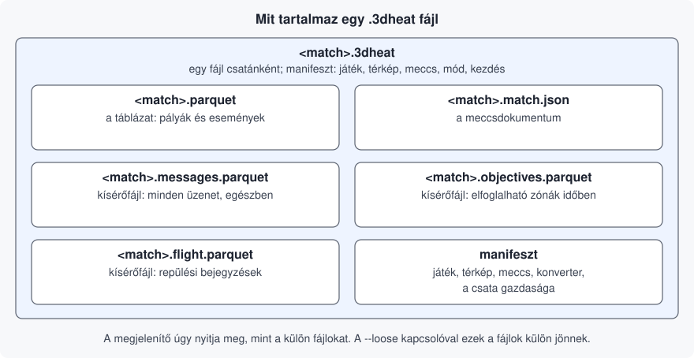
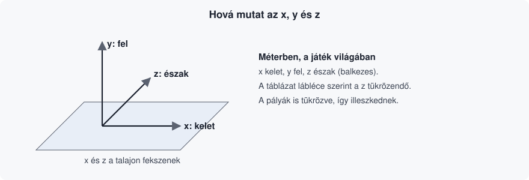

# Kimeneti fájlok {#output-files}

Alapértelmezés szerint minden csata **egy fájl**: `out/<map>/<match>.3dheat`. Ebben van a
táblázat, a meccsdokumentum és a kísérőfájlok egy csomagban, egy manifesttel, amely megnevezi a
játékot, a térképet, a meccset, a csatamódot, a kezdési időt és a konvertert (a csata gazdaságát
pedig a `extensions["heat3d/economy"]` alatt). A formátum a nézegetőé:
[Egy fájl egy meccshez (.3dheat)](https://holdi601.github.io/3DHeat/container.html).

A `--loose` kapcsolóval ugyanezek a fájlok külön, egymás mellett íródnak ki:

| Fájl | Mi | Oldal |
|---|---|---|
| `<match>.parquet` | egy sor mintánként vagy eseményenként | [A táblázat](table.md) |
| `<match>.match.json` | minden más, amit a visszajátszás elmond | [A meccsdokumentum](match-document.md) |
| `<match>.messages.parquet` | minden üzenet, komponensérték és csomag, egészben | [Kísérőfájlok](sidecars.md) |
| `<match>.objectives.parquet` | az elfoglalható zónák időbeli alakulása | [Kísérőfájlok](sidecars.md) |
| `<match>.flight.parquet` | minden repülőgép minden repülési modell-bejegyzése, egészben | [Kísérőfájlok](sidecars.md) |

Ha a csomagolás nem sikerül, a külön fájlok megmaradnak, és a sor ezt jelzi.

## Nevek {#names}

A `<match>` a `<map>_<AB|RB|SB>_<mode>_<start, UTC>_<session id>`, ahogy a képen látszik: lásd
[Mely fájlok egy csata](converting.md#which-files-are-one-battle).
A `<map>` a térkép játékbeli azonosítója (a képeken a `99_testmap`).

## Koordináták {#coordinates}

Méterben, a játék saját világában: x kelet, y fel, z észak. A táblázat láblécében szereplő
utasítás megmondja a nézegetőnek, hogy tükrözze a z-t, és a `heat3d-wt-level` pályái is ugyanígy
íródnak, így a visszajátszás és a pályája egymásra esik.

---

A [3DHeat](https://github.com/Holdi601/3DHeat) ([dokumentáció](https://holdi601.github.io/3DHeat/)) része. Forrás: [3DHeat-Ext-WarThunder](https://github.com/Holdi601/3DHeat-Ext-WarThunder).
