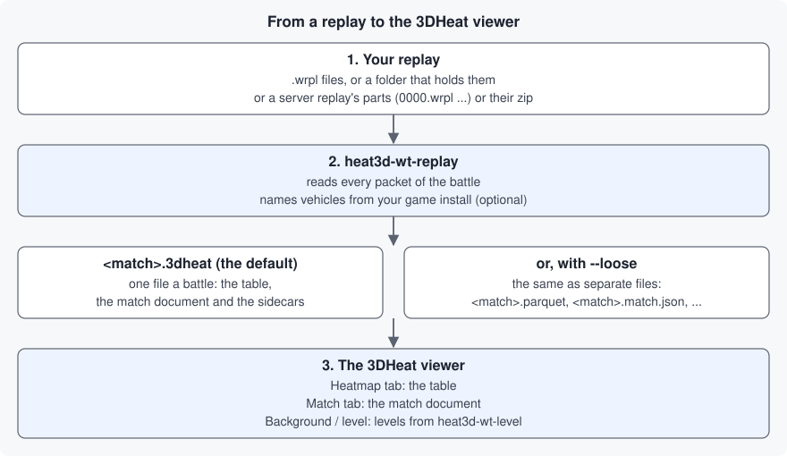

# 3DHeat War Thunder replay converter

War Thunder replays (`.wrpl`) into the table the 3DHeat viewer opens: every
aircraft's, tank's, ship's and AI unit's track with its vehicle, team and
player, the missiles, rockets, bombs and torpedoes in flight, and the kills,
hits, destroyed modules and launches where they happened. A match document
beside it holds everything else the replay says: the mission settings and
sky, every unit and weapon the replay created, the mission's zones and
airfields, explosions, awards, the recording player's instruments, the scoreboard over time, the chat
and the whole results block.

**What it is useful for:** a debrief of a battle in 3D with every unit's
track, weapon flight and hit where it happened; heatmaps of where you and
others fly, drive, fight and die over many battles; hit analysis in the
victim's own frame; what a battle cost and earned. The output is plain
Parquet and JSON inside one `.3dheat` file a battle, so other tools can read
it too. A second command turns the levels of your own install into 3D levels
for the viewer, to show the battles on.



## Quick start

```bash
git clone https://github.com/Holdi601/3DHeat-Ext-WarThunder.git
cd 3DHeat-Ext-WarThunder
pip install -e .                               # installs heat3d-wt-replay and heat3d-wt-level
heat3d-wt-replay "<War Thunder>/Replays" -o out
```

Then open `out/<map>/<match>.3dheat` in the [3DHeat viewer](https://holdi601.github.io/3DHeat/).

## Part of 3DHeat

This converter is one of the tools of [3DHeat](https://github.com/Holdi601/3DHeat), a realtime 3D
telemetry and replay viewer for very large positional datasets
([documentation](https://holdi601.github.io/3DHeat/)). Its output opens in the viewer as it is: the table
in the Heatmap tab, the match document in the Match tab. How the viewer packs
a match's files into one `.3dheat` file is described in
[One file a match](https://holdi601.github.io/3DHeat/container.html); what every converter must keep in
[Converters keep everything](https://holdi601.github.io/3DHeat/converters.html).

- Source and issues: [3DHeat-Ext-WarThunder](https://github.com/Holdi601/3DHeat-Ext-WarThunder)
- This site: [https://holdi601.github.io/3DHeat-Ext-WarThunder/](https://holdi601.github.io/3DHeat-Ext-WarThunder/)

## This documentation

| Page | What it covers |
|---|---|
| [Installing](installing.md) | requirements, install, names from your install, updates |
| [Converting replays](converting.md) | `heat3d-wt-replay` step by step, every option |
| [Output files](output-files.md) | the `.3dheat` file, `--loose` files, names |
| [The table](table.md) | every column and event |
| [The match document](match-document.md) | `<match>.match.json` |
| [Sidecars](sidecars.md) | messages, objectives and flight entries kept whole |
| [How it reads a replay](how-it-reads.md) | what is read and how well it is known |
| [Aircraft](aircraft.md) | cockpit, flight entries, dead reckoning, attitude |
| [Ground units and camera](ground.md) | turrets, the camera, ends of tracks, battle mode |
| [Hits, gunfire and fires](hits.md) | shots, hit outcomes, ammunition, vehicle fires |
| [Economy](economy.md) | Silver Lions and research points, who won |
| [Objectives](objectives.md) | capture zones, airfields, scene units |
| [Levels](levels.md) | `heat3d-wt-level`: levels from your install as `.glb` |
| [Terms and sources](terms.md) | Gaijin's terms, sources, tests, licence |

## Why it is apart

The `.wrpl` format is undocumented, and Gaijin's EULA (3.2.2, 3.2.9) forbids
reverse engineering the game and mining data not meant to be shown; nothing
there names replays, which the game itself shows the player. The user decided
to read them. So that a licence question or a takedown touches only this
converter, it lives outside the 3DHeat Watcher: the watcher runs this command
on new replays when it is installed, imports nothing of it, and works without
it.

---

Part of [3DHeat](https://github.com/Holdi601/3DHeat) ([documentation](https://holdi601.github.io/3DHeat/)). Source: [3DHeat-Ext-WarThunder](https://github.com/Holdi601/3DHeat-Ext-WarThunder).
