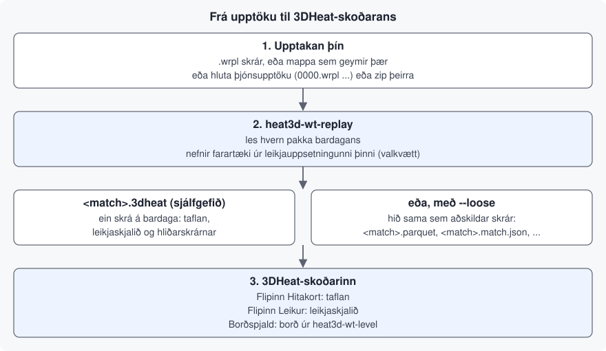

# 3DHeat War Thunder upptökur {#dheat-war-thunder-replays}

**Hvað er þetta?** War Thunder getur vistað bardaga sem upptökuskrá (replay).
Þetta verkfæri breytir upptökunni í skrá sem þú getur horft á að ofan í
[3DHeat-skoðaranum](https://holdi601.github.io/3DHeat/), með hverri flugvél,
skriðdreka og skipi, hverri eldflaug og sprengju og hverju höggi á þeim stað
sem það varð. Önnur skipun breytir borðum úr þinni eigin leikjauppsetningu í
3D-borð til að sýna bardagana á.

**Hvers vegna ætti ég að nota það?** Til að fara yfir bardaga í 3D; til að
gera hitakort af því hvar þú og aðrir fljúgið, akið, berjist og fallið í
mörgum bardögum; til að sjá hvar högg lentu á farartæki; til að sjá hvað
bardagi kostaði og gaf af sér. Úttakið er venjulegt Parquet og JSON, svo önnur
verkfæri geta líka lesið það.

**Dæmi:** ein `.wrpl` upptaka inn, ein `<match>.3dheat` skrá út:



## Fljótleg byrjun {#quick-start}

Hefurðu aldrei notað skipanalínu? Lestu fyrst [Áður en þú byrjar](before-you-start.md).

```bash
git clone https://github.com/Holdi601/3DHeat-Ext-WarThunder.git
cd 3DHeat-Ext-WarThunder
pip install -e .                                  # installs heat3d-wt-replay and heat3d-wt-level
heat3d-wt-replay "<War Thunder>/Replays" -o out
```

Þú ættir að sjá eina línu fyrir hvern bardaga: `ok out/<map>/<match>.3dheat`.
Opnaðu þá skrá í 3DHeat-skoðaranum.

## Þessi skjölun {#this-documentation}

| Síða | Hvað hún fjallar um |
|---|---|
| [Áður en þú byrjar](before-you-start.md) | Python, skipanalínu og hvernig árangur lítur út |
| [Uppsetning](installing.md) | uppsetning, nöfn úr þinni uppsetningu, uppfærslur |
| [Upptökum breytt](converting.md) | `heat3d-wt-replay` skref fyrir skref, allir valkostir, skilaboð |
| [Úttaksskrár](output-files.md) | `.3dheat` skráin, `--loose` skrár, nöfn |
| [Taflan](table.md) | hver dálkur og hver atburður |
| [Leikjaskjalið](match-document.md) | hver lykill í `<match>.match.json` |
| [Hliðarskrár og heilleiki](sidecars.md) | hvað er varðveitt í heild fyrir utan töfluna, og talningarnar |
| [Borð](levels.md) | `heat3d-wt-level`: borð úr þinni uppsetningu sem `.glb` |
| [Hvernig upptaka er lesin](how-it-reads.md) | hvað er lesið og hvernig það var sannreynt |
| [Flugvélar](aircraft.md), [Landfarartæki og myndavél](ground.md), [Högg, skothríð og eldar](hits.md) | smáatriðin á bak við dálkana |
| [Hagkerfi](economy.md), [Markmið](objectives.md) | Silver Lions og rannsóknarstig; handtökusvæði, flugvellir |
| [Skilmálar og leyfi](terms.md) | skilmálar Gaijin, heimildir, prófanir, leyfi |
| [Skipanayfirlit](../cli-reference.md), [Dálkalisti](../columns.md) | búið til úr kóðanum |

## Hluti af 3DHeat {#part-of-3dheat}

Þessi umbreytir er eitt af verkfærum [3DHeat](https://github.com/Holdi601/3DHeat),
rauntíma 3D-skoðara fyrir mælingar og upptökur ([skjölun](https://holdi601.github.io/3DHeat/)).
Skoðarinn opnar `.3dheat` skrána: töfluna í flipanum Hitakort, leikjaskjalið
í flipanum Leikur ([Ein skrá á leik](https://holdi601.github.io/3DHeat/container.html)).
Það sem hver umbreytir verður að varðveita: [Umbreytar varðveita allt](https://holdi601.github.io/3DHeat/converters.html).

**Hvers vegna þetta er sérstakt verkfæri.** Sniðið `.wrpl` er óskjalfest og
EULA Gaijin (3.2.2, 3.2.9) bannar að rekja leikinn með bakvirkni og að vinna
gögn sem ekki eru ætluð til sýnis; það nefnir ekki upptökur, sem leikurinn
sjálfur sýnir spilaranum. Til þess að leyfisspurning snerti aðeins þennan
breyti er hann utan 3DHeat Watcher: Watcher keyrir hann á nýjum upptökum þegar
hann er uppsettur og virkar án hans.

| Verkfæri | Hvað það gerir | Frumkóði | Skjölun |
|---|---|---|---|
| 3DHeat-skoðari | sýnir gögnin í 3D: hitakort, upptökur, kappakstursgreiningu | [3DHeat](https://github.com/Holdi601/3DHeat) | [vefur](https://holdi601.github.io/3DHeat/) |
| GameFiles | brautir og borð úr skrám sem leikir fylgja með | [3DHeat-GameFiles](https://github.com/Holdi601/3DHeat-GameFiles) | [vefur](https://holdi601.github.io/3DHeat-GameFiles/) |
| GameCapture | hringmælingar og borð endurbyggð úr leikmyndbandi | [3DHeat-GameCapture](https://github.com/Holdi601/3DHeat-GameCapture) | [vefur](https://holdi601.github.io/3DHeat-GameCapture/) |
| Unreal Exporter | Unreal Editor viðbót sem flytur út borð | [3DHeat-UnrealExporter](https://github.com/Holdi601/3DHeat-UnrealExporter) | [vefur](https://holdi601.github.io/3DHeat-UnrealExporter/) |
| CS2 | Counter-Strike 2 upptökur og kort | [3DHeat-CS2](https://github.com/Holdi601/3DHeat-CS2) | [vefur](https://holdi601.github.io/3DHeat-CS2/) |
| Watcher | skráir það sem leikir birta meðan þú spilar | [3DHeat-Watcher](https://github.com/Holdi601/3DHeat-Watcher) | [vefur](https://holdi601.github.io/3DHeat-Watcher/) |
| War Thunder upptökur | `.wrpl` upptökur og War Thunder borð | [3DHeat-Ext-WarThunder](https://github.com/Holdi601/3DHeat-Ext-WarThunder) | [vefur](https://holdi601.github.io/3DHeat-Ext-WarThunder/) |
| World of Tanks upptökur | `.wotreplay` upptökur | [3DHeat-Ext-WoT](https://github.com/Holdi601/3DHeat-Ext-WoT) | [vefur](https://holdi601.github.io/3DHeat-Ext-WoT/) |
| World of Warships upptökur | `.wowsreplay` upptökur | [3DHeat-Ext-WoWs](https://github.com/Holdi601/3DHeat-Ext-WoWs) | [vefur](https://holdi601.github.io/3DHeat-Ext-WoWs/) |
| Squad upptökur | Squad þjónustuupptökur | [3DHeat-Ext-Squad](https://github.com/Holdi601/3DHeat-Ext-Squad) | [vefur](https://holdi601.github.io/3DHeat-Ext-Squad/) |
| DCS kort | DCS World kort sem 3D-borð | [3DHeat-Ext-DCS](https://github.com/Holdi601/3DHeat-Ext-DCS) | [vefur](https://holdi601.github.io/3DHeat-Ext-DCS/) |
| IL-2 kort | IL-2 Great Battles kort sem 3D-borð | [3DHeat-Ext-IL2](https://github.com/Holdi601/3DHeat-Ext-IL2) | [vefur](https://holdi601.github.io/3DHeat-Ext-IL2/) |

---

Hluti af [3DHeat](https://github.com/Holdi601/3DHeat) ([skjölun](https://holdi601.github.io/3DHeat/)). Frumkóði: [3DHeat-Ext-WarThunder](https://github.com/Holdi601/3DHeat-Ext-WarThunder).
