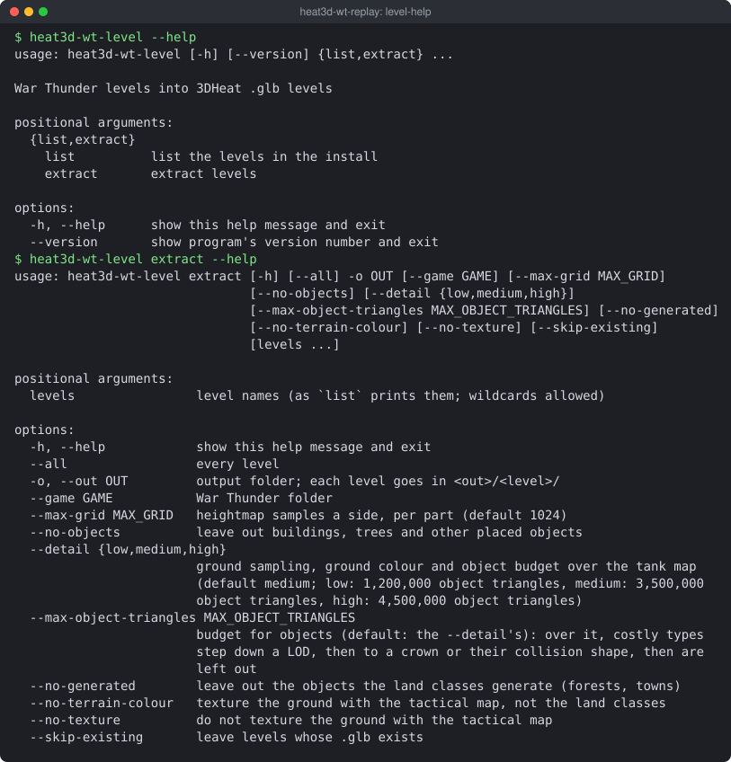

# Borð (heat3d-wt-level) {#levels-heat3d-wt-level}

`heat3d-wt-level` breytir borðum þinnar eigin War Thunder uppsetningar í
`.glb` borð fyrir skoðarann, í sama ramma og töflur upptakanna.

## Skref fyrir skref {#step-by-step}

1. Taktu saman borð uppsetningarinnar: `heat3d-wt-level list`. Hún prentar eina
   línu fyrir hvert borð: nafn þess, landslag þess og kort þess, svo fjöldann. Til
   dæmis (uppdiktað borð):

   ```text
   99_testmap    heightmap 2048x2048 @ 2 m, land mesh    maps: 99_testmap_map, 99_testmap_tankmap
   1 levels in C:\Games\War Thunder
   ```
2. Dragðu út eitt, nokkur (algildisstafir leyfðir) eða öll:

   ```bash
   heat3d-wt-level extract <level> -o levels
   heat3d-wt-level extract --all -o levels
   heat3d-wt-level extract <level> -o levels --detail high
   ```

3. Hladdu `levels/<level>/<level>.glb` í spjaldið Bakgrunnur / borð í skoðaranum, undir
   bardögum þess korts.

Borðin sem þú skrifar haldast á tölvunni þinni: birtu þau aldrei (sjá
[Skilmálar og leyfi](terms.md)).

## Valkostir {#options}



| Skipun / valkostur | Gerir |
|---|---|
| `list [--game FOLDER]` | hvert borð í uppsetningunni |
| `extract <levels...>` / `--all` | borðin sem eru nefnd (eins og `list` prentar þau; algildisstafir leyfðir), eða hvert borð |
| `-o`, `--out` | úttaksmappa; hvert borð fer í `<out>/<level>/` |
| `--game FOLDER` | War Thunder mappan (sjálfgefið: fundin í gegnum Steam eða ræsiforritið; einnig `HEAT3D_WT_GAME`) |
| `--detail low/medium/high` | sýnataka lands, landlitur og hlutakostnaðarhámark yfir skriðdrekakortinu (sjálfgefið `medium`) |
| `--max-object-triangles N` | hlutakostnaðarhámarkið (sjálfgefið: það sem smáatriðastigið gefur) |
| `--max-grid N` | sýni hæðarkorts á hlið, á hluta (sjálfgefið 1024) |
| `--no-objects` | sleppa byggingum, trjám og öðrum settum hlutum |
| `--no-generated` | sleppa hlutunum sem landflokkarnir búa til (skógar, bæir) |
| `--no-terrain-colour` | setja áferð á landið með taktíska kortinu, ekki landflokkunum |
| `--no-texture` | hafa landið án áferðar |
| `--skip-existing` | sleppa borðum þar sem `.glb` er til |

## Hvað er skrifað {#what-is-written}

Hvert borð verður `<out>/<level>/<level>.glb`, `<level>.json` (hvað var lesið,
sjávarmál, kortaferhyrningarnir, fjöldi þríhyrninga, tímamælingar) og taktísk
kort borðsins sem `<level>_map.png` (loftkortið) og `<level>_tankmap.png`;
landkort fá líka `<level>_terrain.png`, eigin liti landsins yfir
skriðdrekakortinu. glb er skrifað í `<level>.glb.part` og endurnefnt þegar því er lokið;
meðan borð er skrifað er `<out>/<level>/.<level>.lock` haldið, svo tvær
útdráttaraðgerðir skrifa aldrei sama borð (sú seinni prentar `busy <level>`).
Uppsetningin finnst í gegnum Steam eða sjálfgefnar möppur ræsiforritsins;
`--game <folder>` eða `HEAT3D_WT_GAME` segja til um hvar hún er annars.

| Hluti | Hvað það er |
|---|---|
| `ground:<level>` | landslagshæðarkortið (`HM2`) sem net; á landkortum miðja skriðdrekakortsins (helmingur breiddar þess) á skrefi `--detail`, litað með landflokkunum, landmerkjum og vegum (`<level>_terrain.png`; taktíska kortið þar sem það er ekki hægt); á kortum án skriðdrekakorts (loftkort) allt hæðarkortið á einu skrefi (2048 sýni á hlið á `high`, annars 1024), litað með landflokkunum yfir svæði loftkortsins (4096 pixlar á hlið, um 32 m á pixil yfir 131 km; taktíska kortið þar sem það er ekki hægt); á borðum án hæðarkorts, landmöskvinn |
| `ground:<level> tank map` | afgangur skriðdrekakortsins, einu skrefi grófari |
| `ground:<level> heightmap surroundings` | afgangur hæðarkortsins, enn grófari |
| `ground:<level> land mesh` | árekstrarþríhyrningar landmöskvans þar sem hæðarkortið nær ekki (umhverfi skriðdrekakorts, út á tugi kílómetra); á borðum án hæðarkorts er það landið, litað eins og að ofan |
| `ground:<level> outside the map` | land sem myndin nær ekki yfir, án áferðar |
| `water:<level>` | einn flatur ferhyrningur á `water_level` borðsins yfir allt landslagið: leikurinn teiknar vatn sem eitt plan, og lágt land undir því er sjávar-, vatns- eða árbotn |
| `water:<level> rivers` | á borðum með vatnshæðarkorti (`WHM`), hallandi vatnsyfirborðið yfir frumunum sem það nær yfir |
| `structure:<level> buildings` | hver settur hlutur sem er ekki planta: hús, rústir, veggir, girðingar, brýr, teinar, klettar, leikmunir. Þeir föstu (`RIGz`) og, yfir skriðdrekakortinu, þeir sem landflokkarnir búa til (bæjarblokkir, steinar). Hver er teiknaður með birtingarmöskva sínum (veggir, þök, gluggaop, bjálkar), á því LOD sem þríhyrningahámarkið leyfir, litaður eftir efni með meðaltali dreifilitaáferðar sinnar |
| `structure:<level> trees` | tré og runnar, föst og búin til (skógar, limgerði): birtingarmöskvi þeirra þar sem hámarkið leyfir, annars stofn og króna (keila fyrir barrtré) í eigin laufalit trésins, yfir raunverulegri stærð trésins |

Hlutir án birtingarmöskva falla aftur á árekstrarlögun sína; tré án hans á
krónu. Hnútalitir (`COLOR_0`) geyma sRGB-kóðuð gildi, sem er hvernig 3DHeat-skoðarinn les þá.

**Hnit** eru metrar leiksins með z speglað: glb (x, y, z) = leikur
(x, y, -z). Heimur leiksins er örvhentur (x austur, y upp, z norður); glTF er
rétthent. `heat3d-wt-replay` heldur z leiksins og segir skoðaranum að
spegla það, svo upptaka og borð korts hennar lenda hvort ofan á öðru án
nokkurs staðsetningarskrefs. JSON gefur ferhyrning hvers taktísks korts í metrum leiksins
og horn þess í rými glb, til að hlaða PNG sem kortamynd.

**Smáatriði.** `--detail low|medium|high` (sjálfgefið medium) stillir, yfir skriðdrekakortinu:

| | miðja skriðdrekakortsins | afgangur skriðdrekakortsins | landlitur | hlutahámark | flestir þríhyrningar á hlut | búnar til plöntur geymdar |
|---|---|---|---|---|---|---|
| low | hvert 4. sýni | hvert 8. | 4 m á pixil | 1,2 M | 1.500 | tré 35 %, runnar 20 % |
| medium | hvert 2. | hvert 4. | 2 m | 3,5 M | 4.000 | tré 70 %, runnar 50 % |
| high | hvert sýni (2 m á flestum landkortum) | hvert 2. | 1 m (í mesta lagi 4096 pixlar á hlið) | 4,5 M | 12.000 | allar |

Hringirnir tveir á skriðdrekakortinu eru haldnir við 0,3 M (low), 1 M (medium) og 3,7 M (high)
þríhyrninga: á kortum þar sem hæðarkortið er fínna en 2 m tvöfaldast skrefin
(ytri hringurinn fyrst) þar til þau passa, svo þau enda líka á um 2 m.

Landkort á `high` endar á um 8 milljón þríhyrningum (3,5 M af landi,
4,5 M af hlutum) og 250 MB; á `medium` um 4,5 M. LOD hlutanna eru
þau sem leikurinn sjálfur myndi teikna úr einni sjónfjarlægð, þau stystu
sem heildin passar í hámarkið: litlir leikmunir falla í gróf LOD fyrst og stórar
byggingar síðast, eftir sviðunum sem framleiðendur þeirra gáfu hverju LOD (`lodDistance`
í JSON); það sem það skref sparar umfram hámarkið fer aftur til stærstu
hlutanna. Grófur landlitur (loftkort) meðaltalar flísalagða áferð hvers landflokks niður í pixilstærðina fyrst, svo
flísarnar víxlmyndist ekki í moiré. Ef jafnvel grófustu LOD passa ekki verða trén sem spara mest
að krónum, og síðan eru minnstu tegundirnar felldar niður (`leftOut`); enginn hlutur er
teiknaður sem kassi (árekstrarlögun, ef einhver, er eigin lögun hlutarins).
Búnir til hlutir eru þynntir á ákveðinn hátt eftir tegund (`density`), þeir sömu
í hverri keyrslu. `--max-object-triangles` yfirskrifar hámarkið,
`--max-grid` (sjálfgefið 1024) takmarkar grófari hluta hæðarkortsins, `--no-objects`
sleppir hlutum, `--no-generated` þeim sem eru búnir til, `--no-terrain-colour`
setur áferð á landið með taktíska kortinu, `--no-texture` skilur það eftir án áferðar.

`parts.objects` í JSON telur upp eintök (föst og búin til, eftir tegund og
landflokki), hversu mörg voru teiknuð á hvaða LOD (`drawnAs`), þríhyrningana, LOD-fjarlægðina
og sekúndurnar; `parts.heightmap.rings` skref og þríhyrninga hvers landhrings; `parts.terrainColour` landflokkana og liti þeirra, vegi
og landmerki; `trianglesTotal`, `glbBytes` og `secondsBy` heildirnar.

## Hvað er lesið, og hversu vel {#what-is-read-and-how-well}

| Hluti | Staða |
|---|---|
| Borðsbinary (`levels/<level>.bin`, `DBLD` 3x64): blokkatafla | hvert borð athugað |
| Hæðarkort (`HM2`, útgáfur 0-2; útgáfa 2 eru 8 bita gildi í blokkum, Oodle eða zstd bútar) | hvert borð þar sem hæðarkortið er útgáfa 2 með Oodle bútum; athugað með auga gegn taktískum kortum þeirra (ár, dalir, strendur og bæir stemma) |
| Árekstrar landmöskva (`lmap`, `LTdump` landgeislarekjari hans) | lesið þar sem borð hefur einn (Oodle-pakkað). Það er árekstrarflötur leiksins, ekki birti möskvinn, svo það er grófara þar sem landið er flatt |
| Landlitur (`lmap` landflokkar og þyngdarkort, `LMp2` eðliskort, `hspl` splínur) | litakort landflokkanna og smáatriðaáferðir (meðallitir þeirra) vegin með þyngdarkortinu, 1 m lífbeltisvísir landflokka með vísi, lögun vega og landmerkja í eðliskortinu í lit áferðar splínu þeirra eða efnis, klettar í bröttum hlíðum. Athugað gegn skriðdrekakortum: vegir, bæir, vötn, skógarbelti og klettar stemma. Litaformúla landslagsskugga War Thunder sjálfs er ekki í opinbera frumkóðanum; sú útgefna úr vélinni (daNetGame) er notuð, sem kemur út mettaðri en taktíska kortið |
| Sjávarmál | `water_level` úr BLK borðsins í `aces.vromfs.bin` (0 þar sem það hefur ekkert) |
| Vatnshæðarkort (`WHM`: net af flötum frumum og 130x130 síður af 16 bita hæðum) | lesið þar sem borð hefur eitt; ár þess halla með landinu |
| Taktísk kort | úr `content/base/res/locations_maps.dxp.bin`, sett með `mapCoord0/1` og `tankMapCoord0/1` í BLK; efri hluti myndarinnar er norður |
| Settir hlutir (`RIGz`: föst eintök birtingareintaka-rafalans) | hvert eintak, sem 3x4 fylki af 16 bita gildum eða, á sumum borðum, 32 bita (bætafjöldi frumunnar ræður); hvert bæti hverrar frumu gert grein fyrir á borðunum sem voru athuguð |
| Búnir til hlutir (`RIGz` landflokkagrímur og `LandClass` auðlindirnar) | rafall leiksins, fluttur yfir: sömu staðir reyndir í sömu röð með sömu slembitölum, landflokka- og útilokunargrímur, hluturinn valinn á hverjum stað, snúningur hans, kvarði og hæðarfrávik; flísalagðar (bæjarblokkir) og gróðursettar (skógar, runnar, akrar) einingar. Aðeins búið til yfir skriðdrekakortinu. Nálgað: landhæð og normal (úr hæðarkortinu; leikurinn rekur geisla), útilokunarkassarnir sem leikurinn skráir í keyrslu, og snúningur (yaw) trjáa (leikurinn smellir honum á snúningspallettu staðgengilsmyndarinnar). |
| Birtingarmöskvar (`RendInst` auðlindir í `content/*/res/*.grp`, efni í `riDesc.bin`) | hnútar og þríhyrningar hvers LOD (fljótandi staðsetningar; 16 eða 32 bita vísar, venjulegir eða meshoptimizer-pakkaðir), efni hvers hluta. Hlutar sem eru límmiðar (decal) og staðgengilsskilti (impostor billboard) eru felldir niður; gegnsæir (gler) eru geymdir |
| Litir hluta | eftir efni, meðaltal litla mip dreifilitaáferðar þess (vegið með alfa fyrir lauf), úr áferðarpökkum uppsetningarinnar: t0 fyrir flesta skugga, fyrsta smáatriðadreifilitaáferðin þar sem t0 er yfirlag eða gríma. Einn litur á efni: engin áferð á hlutunum |
| Árekstrarlögun (`<object>_collision`) | árekstrarauðlindir af straumútgáfu 3, notaðar þar sem hlutur hefur engan birtingarmöskva. Aðeins það sem geislar leiksins hitta (`TRACEABLE` hnútar) er teiknað, og kassar, kúlur og hylki aðeins þegar auðlindin hefur engan möskva: hitt eru grófir eðlisfræðilegir staðgenglar sem sæjust sem teningar í kringum hlutinn |
| Leiðsöguskel (`Lnav`), birti landmöskvinn, gras, `spgz`, `stbl`, `d2co` | ekki lesið |

Borð eru þjöppuð með Oodle, sem er séreign. Leikurinn fylgir með eintak,
`<War Thunder>\win-arm64ec\oo2core_9_win64.dll` (venjuleg x64 smíð), og
það er það sem er hlaðið; `HEAT3D_OODLE=<dll or folder>` bendir á annað.
Ekkert af Oodle er innifalið hér.

## Snið, og hvar þau eru skjalfest {#formats-and-where-they-are-documented}

Gaijin gaf út frumkóða Dagor Engine undir BSD 3-Clause leyfinu
(github.com/GaijinEntertainment/DagorEngine). Lesararnir hér voru skrifaðir
út frá honum; enginn leikjakóði var afþýddur. Hver eining nefnir frumskrárnar sem hún fylgir:

- `vromfs.py`: `*.vromfs.bin` (haus `VRFs`/`VRFx`, zstd búkur þar sem fyrstu og
  síðustu 16 bætin eru XOR-uð með föstum lykli, nafnatafla og offsettafla:
  `osApiWrappers/dag_vromfs.h`, `ioSys/vromfsLoad.cpp`, `supp/dag_zstdObfuscate.h`)
  og tvíundar BLK (form 1-5, með sameiginlegu nafnakorti safnsins `\xff?nm` og
  zstd orðabók: `ioSys/dataBlock/blk_serialize.cpp`, `blk_parser.cpp`,
  `blk_zstd.cpp`).
- `dxp.py`: áferðarpakkar `DxP2` (`lib3d/texPackMgr2.cpp`) og DDSx hausar
  (`sharedInclude/3d/ddsxTex.h`); DXT1/DXT5/BC7 eru afkóðuð af Pillow.
- `dagorlevel.py`: borðsbinary (`scene/loadLevel.cpp`), hæðarkortið
  (`heightmap/heightmapPhysHandler.cpp`, `heightMapLand/compressedHeightmap.cpp`),
  landgeislarekjarinn (`landMesh/lmeshManager.cpp`,
  `landMesh/landRayTracerSoA4.cpp`) og vatnshæðarkortið
  (`fftWater/fftWater.cpp`).
- `rigen.py`: settir hlutir (`rendInst/riGen/riGenData.h`,
  `rendInst/rendInstGen.cpp`, `rendInst/riGen/genObjUtil.h`).
- `landgen.py`: búnir til hlutir (`rendInst/rendInstGenLand.cpp`,
  `riGen/landClassData.h`, `riGen/genObjByMask.h`, `riGen/genObjByDensGridMask.h`,
  `riGen/genObjUtil.h`, `riGen/riGenData.h`, `riGen/multiPointData.h`,
  `riGen/riRotationPalette.h`, `rendInstGen.cpp` (`create`, `precomputeCell`,
  `generateCell`), `gameMath/objgenPrng.h`, `util/dag_roHugeHierBitMap2d.h`,
  `util/dag_hierBitMap2d.h`, `ioSys/dag_roDataBlock.h`, `ioSys/roDataBlk.cpp`,
  `gameRes/grpData.h`).
- `rendinst.py`: birtingareintök (`shaders/rendInstRes.cpp`,
  `shaders/dag_rendInstRes.h`, `shaders/matVdataLoad.cpp`, `shaders/shaderMesh.cpp`,
  `shaders/dag_shaderMesh.h`, `shaders/dag_shaderCommon.h`,
  `drv/3d/dag_consts_base.h`, `gameRes/gameResDescBin.cpp`) og vísakóðari
  meshoptimizer (`3rdPartyLibs/meshoptimizer/src/indexcodec.cpp`, MIT).
- `terrain.py`: litur landsins (`landMesh/lmeshManager.cpp`,
  `lmeshLandClasses.cpp`, `lmeshWeightAtlas*.cpp`, `lmeshRenderer.cpp`,
  `landMesh/shaders/land_weight_atlas.hlsli`, `land_weight_inc.dshl`,
  `biomes.dshl`, `daNetGame/shaders/land_aces.dshl`, `make_clipmap.dshl`,
  `physMap/physMapLoad.cpp`, `baseUtil/treeBitmap.cpp`,
  `levelSplines/levelSplines.cpp`).
- `collision.py`: auðlindapakkar (`gameRes/grpData.h`) og árekstrarauðlindir
  (`sharedInclude/gameRes/collResStream.h`, `gameRes/collisionGameResLoad.cpp`),
  þar sem þríhyrningar eru geymdir sem fjórgreint BVH (`daBVH/bvhIO.cpp`,
  `daBVH/dag_swBLAS_leaf.h`, `swBLASLeafDefs.hlsli`).

wt_ext_cli (Apache-2.0) les sömu safnskrár; það er hvorki nauðsynlegt né notað.

---

Hluti af [3DHeat](https://github.com/Holdi601/3DHeat) ([skjölun](https://holdi601.github.io/3DHeat/)). Frumkóði: [3DHeat-Ext-WarThunder](https://github.com/Holdi601/3DHeat-Ext-WarThunder).
