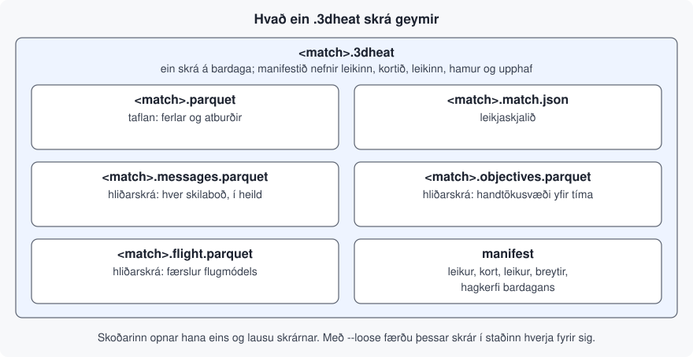
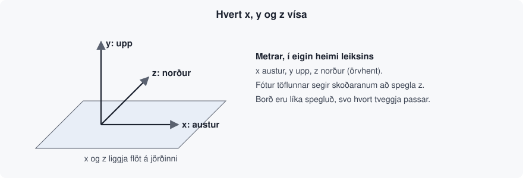

# Úttaksskrár {#output-files}

Sjálfgefið er hver bardagi **ein skrá**, `out/<map>/<match>.3dheat`: taflan,
leikjaskjalið og hliðarskrárnar pakkaðar saman, með lýsingu (manifest) sem
nefnir leikinn, kortið, leikinn, bardagahaminn, upphafstímann og breytinn (og
hagkerfi bardagans undir `extensions["heat3d/economy"]`). Sniðið er skoðarans:
[Ein skrá á leik (.3dheat)](https://holdi601.github.io/3DHeat/container.html).

Með `--loose` eru sömu skrárnar skrifaðar hlið við hlið í staðinn:

| Skrá | Hvað | Síða |
|---|---|---|
| `<match>.parquet` | ein röð fyrir hvert sýni eða atburð | [Taflan](table.md) |
| `<match>.match.json` | allt annað sem upptakan segir | [Leikjaskjalið](match-document.md) |
| `<match>.messages.parquet` | hver skilaboð, hvert íhlutagildi og hver pakki, í heild | [Hliðarskrár](sidecars.md) |
| `<match>.objectives.parquet` | handtökusvæðin yfir tíma | [Hliðarskrár](sidecars.md) |
| `<match>.flight.parquet` | hver færsla flugmódels hverrar flugvélar, í heild | [Hliðarskrár](sidecars.md) |

Ef pökkun mistekst eru lausu skrárnar geymdar og línan segir frá því.

## Nöfn {#names}

`<match>` er `<map>_<AB|RB|SB>_<mode>_<start, UTC>_<session id>`, eins og á
myndinni: sjá [Hvaða skrár eru einn bardagi](converting.md#which-files-are-one-battle).
`<map>` er eigið auðkenni leiksins á kortinu (`99_testmap` á myndunum).

## Hnit {#coordinates}

Metrar, í eigin heimi leiksins: x austur, y upp, z norður. Fótur töflunnar
segir skoðaranum að spegla z, og borð frá `heat3d-wt-level` eru skrifuð eins,
svo upptaka og borð hennar liggja hvort ofan á öðru.

---

Hluti af [3DHeat](https://github.com/Holdi601/3DHeat) ([skjölun](https://holdi601.github.io/3DHeat/)). Frumkóði: [3DHeat-Ext-WarThunder](https://github.com/Holdi601/3DHeat-Ext-WarThunder).
