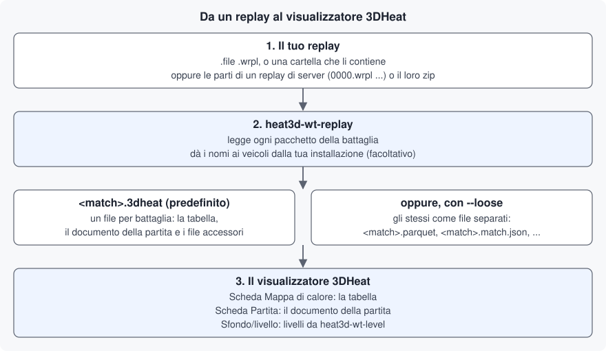

# Replay di War Thunder per 3DHeat {#dheat-war-thunder-replays}

**Cos'è?** War Thunder può registrare una battaglia come file di replay. Questo strumento
trasforma la registrazione in un file che puoi guardare dall'alto nel
[visualizzatore 3DHeat](https://holdi601.github.io/3DHeat/), con ogni aereo, carro
e nave, ogni missile e bomba, e ogni colpo dove è avvenuto. Un secondo comando trasforma i livelli della
tua installazione del gioco in livelli 3D su cui mostrare le battaglie.

**Perché usarlo?** Per un resoconto in 3D di una battaglia; per mappe di calore di dove tu voli, guidi, combatti e muori in
molte battaglie; per vedere dove sono arrivati i colpi su un veicolo; per vedere quanto è costata e quanto ha reso una
battaglia. Il risultato è Parquet e JSON semplici, quindi anche altri strumenti possono leggerlo.

**Esempio:** un replay `.wrpl` in entrata, un file `<match>.3dheat` in uscita:



## Avvio rapido {#quick-start}

Non hai mai usato la riga di comando? Leggi prima [Prima di iniziare](before-you-start.md).

```bash
git clone https://github.com/Holdi601/3DHeat-Ext-WarThunder.git
cd 3DHeat-Ext-WarThunder
pip install -e .                                  # installa heat3d-wt-replay e heat3d-wt-level
heat3d-wt-replay "<War Thunder>/Replays" -o out
```

Dovresti vedere una riga per battaglia: `ok out/<map>/<match>.3dheat`. Apri quel
file nel visualizzatore 3DHeat.

## Questa documentazione {#this-documentation}

| Pagina | Cosa contiene |
|---|---|
| [Prima di iniziare](before-you-start.md) | Python, un terminale, e come si presenta il successo |
| [Installazione](installing.md) | installazione, nomi dalla tua installazione, aggiornamenti |
| [Conversione dei replay](converting.md) | `heat3d-wt-replay` passo dopo passo, ogni opzione, messaggi |
| [File di output](output-files.md) | il file `.3dheat`, i file `--loose`, i nomi |
| [La tabella](table.md) | ogni colonna ed evento |
| [Il documento della partita](match-document.md) | ogni chiave di `<match>.match.json` |
| [File accessori e completezza](sidecars.md) | cosa viene conservato intero oltre alla tabella, e i conteggi |
| [Livelli](levels.md) | `heat3d-wt-level`: livelli dalla tua installazione come `.glb` |
| [Come legge un replay](how-it-reads.md) | cosa viene letto, e come è stato verificato |
| [Aerei](aircraft.md), [Unità di terra e telecamera](ground.md), [Colpi, fuoco sparato e incendi](hits.md) | i dettagli dietro le colonne |
| [Economia](economy.md), [Obiettivi](objectives.md) | Argento Leoni e punti di ricerca; zone di cattura, aeroporti |
| [Condizioni e licenza](terms.md) | condizioni di Gaijin, fonti, test, licenza |
| [Riferimento dei comandi](../cli-reference.md), [Elenco delle colonne](../columns.md) | generati dal codice |

## Parte di 3DHeat {#part-of-3dheat}

Questo convertitore è uno degli strumenti di [3DHeat](https://github.com/Holdi601/3DHeat),
un visualizzatore 3D in tempo reale di telemetria e replay ([documentazione](https://holdi601.github.io/3DHeat/)).
Il visualizzatore apre il file `.3dheat`: la tabella nella sua scheda Mappa di calore, il documento della partita nella
sua scheda Partita ([Un file per partita](https://holdi601.github.io/3DHeat/container.html)).
Ciò che ogni convertitore deve conservare: [I convertitori conservano tutto](https://holdi601.github.io/3DHeat/converters.html).

**Perché è uno strumento separato.** Il formato `.wrpl` non è documentato, e
il contratto di licenza di Gaijin (3.2.2, 3.2.9) vieta il reverse engineering del gioco e l'estrazione di
dati non destinati a essere mostrati; non cita i replay, che il gioco stesso mostra al giocatore. Affinché una questione di licenza tocchi solo questo
convertitore, vive fuori dal Watcher di 3DHeat: il Watcher lo esegue sui nuovi replay quando è
installato, e funziona senza di esso.

| Strumento | Cosa fa | Sorgente | Documentazione |
|---|---|---|---|
| Visualizzatore 3DHeat | mostra i dati in 3D: mappe di calore, replay, analisi di gara | [3DHeat](https://github.com/Holdi601/3DHeat) | [sito](https://holdi601.github.io/3DHeat/) |
| GameFiles | percorsi e livelli dai file che i giochi distribuiscono | [3DHeat-GameFiles](https://github.com/Holdi601/3DHeat-GameFiles) | [sito](https://holdi601.github.io/3DHeat-GameFiles/) |
| GameCapture | telemetria dei giri, e livelli ricostruiti dal video di gioco | [3DHeat-GameCapture](https://github.com/Holdi601/3DHeat-GameCapture) | [sito](https://holdi601.github.io/3DHeat-GameCapture/) |
| Unreal Exporter | un plugin per l'Unreal Editor che esporta un livello | [3DHeat-UnrealExporter](https://github.com/Holdi601/3DHeat-UnrealExporter) | [sito](https://holdi601.github.io/3DHeat-UnrealExporter/) |
| CS2 | demo e mappe di Counter-Strike 2 | [3DHeat-CS2](https://github.com/Holdi601/3DHeat-CS2) | [sito](https://holdi601.github.io/3DHeat-CS2/) |
| Watcher | registra ciò che i giochi pubblicano mentre giochi | [3DHeat-Watcher](https://github.com/Holdi601/3DHeat-Watcher) | [sito](https://holdi601.github.io/3DHeat-Watcher/) |
| Replay di War Thunder | replay `.wrpl` e livelli di War Thunder | [3DHeat-Ext-WarThunder](https://github.com/Holdi601/3DHeat-Ext-WarThunder) | [sito](https://holdi601.github.io/3DHeat-Ext-WarThunder/) |
| Replay di World of Tanks | replay `.wotreplay` | [3DHeat-Ext-WoT](https://github.com/Holdi601/3DHeat-Ext-WoT) | [sito](https://holdi601.github.io/3DHeat-Ext-WoT/) |
| Replay di World of Warships | replay `.wowsreplay` | [3DHeat-Ext-WoWs](https://github.com/Holdi601/3DHeat-Ext-WoWs) | [sito](https://holdi601.github.io/3DHeat-Ext-WoWs/) |
| Demo di Squad | demo dei server di Squad | [3DHeat-Ext-Squad](https://github.com/Holdi601/3DHeat-Ext-Squad) | [sito](https://holdi601.github.io/3DHeat-Ext-Squad/) |
| Mappe DCS | mappe di DCS World come livelli 3D | [3DHeat-Ext-DCS](https://github.com/Holdi601/3DHeat-Ext-DCS) | [sito](https://holdi601.github.io/3DHeat-Ext-DCS/) |
| Mappe IL-2 | mappe di IL-2 Great Battles come livelli 3D | [3DHeat-Ext-IL2](https://github.com/Holdi601/3DHeat-Ext-IL2) | [sito](https://holdi601.github.io/3DHeat-Ext-IL2/) |
| Mappa di Dota 2 | la mappa di Dota 2 dalla tua installazione come livello 3D | [3DHeat-Ext-Dota](https://github.com/Holdi601/3DHeat-Ext-Dota) | [sito](https://holdi601.github.io/3DHeat-Ext-Dota/) |
| Replay di Dota 2 | replay di Dota 2 | [3DHeat-Ext-DotaReplay](https://github.com/Holdi601/3DHeat-Ext-DotaReplay) | [sito](https://holdi601.github.io/3DHeat-Ext-DotaReplay/) |
| Replay di Riot | replay di League of Legends e VALORANT (ciò che contengono senza cifratura) | [3DHeat-Ext-Riot](https://github.com/Holdi601/3DHeat-Ext-Riot) | [sito](https://holdi601.github.io/3DHeat-Ext-Riot/) |
| Mappe di Forza | percorsi, gare e auto di Forza dalla tua installazione | [3DHeat-Ext-Forza](https://github.com/Holdi601/3DHeat-Ext-Forza) | [sito](https://holdi601.github.io/3DHeat-Ext-Forza/) |
| Mappe di Battlefield | livelli di Battlefield (Frostbite) come livelli 3D | [3DHeat-Ext-Battlefield](https://github.com/Holdi601/3DHeat-Ext-Battlefield) | [sito](https://holdi601.github.io/3DHeat-Ext-Battlefield/) |
| Mappe di BeamNG | percorsi di BeamNG.drive | [3DHeat-Ext-BeamNG](https://github.com/Holdi601/3DHeat-Ext-BeamNG) | [sito](https://holdi601.github.io/3DHeat-Ext-BeamNG/) |
| Mappe di AC Rally | tappe di Assetto Corsa Rally come percorsi | [3DHeat-Ext-ACRally](https://github.com/Holdi601/3DHeat-Ext-ACRally) | [sito](https://holdi601.github.io/3DHeat-Ext-ACRally/) |
| Mappe di Reforger | mondi di Arma Reforger (Enfusion) come livelli 3D | [3DHeat-Ext-Reforger](https://github.com/Holdi601/3DHeat-Ext-Reforger) | [sito](https://holdi601.github.io/3DHeat-Ext-Reforger/) |
| Replay di R6 | replay di partite di Rainbow Six Siege | [3DHeat-Ext-R6](https://github.com/Holdi601/3DHeat-Ext-R6) | [sito](https://holdi601.github.io/3DHeat-Ext-R6/) |

---

Parte di [3DHeat](https://github.com/Holdi601/3DHeat) ([documentazione](https://holdi601.github.io/3DHeat/)). Fonte: [3DHeat-Ext-WarThunder](https://github.com/Holdi601/3DHeat-Ext-WarThunder).
