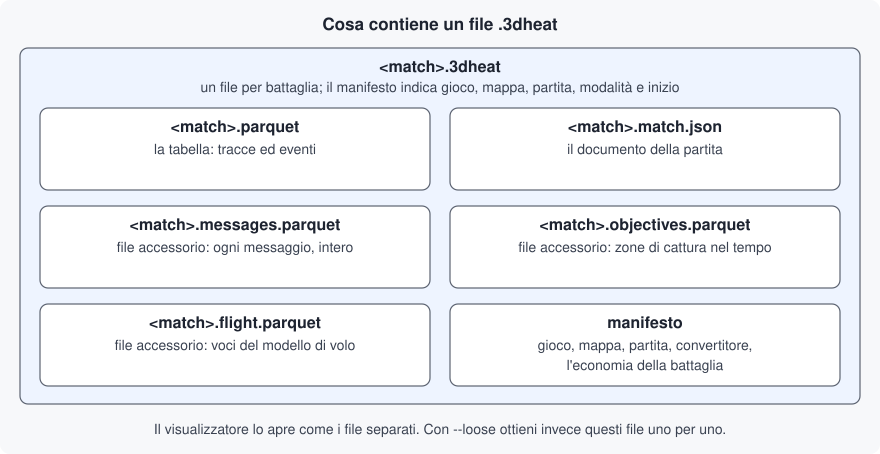
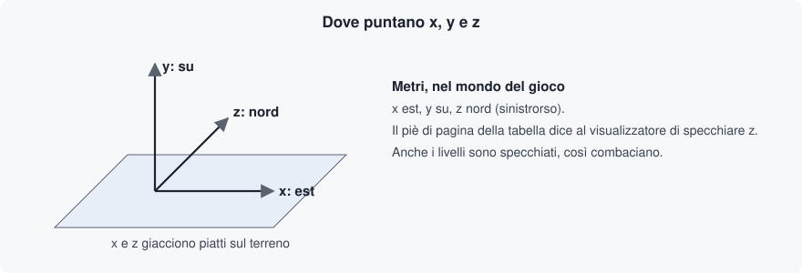

# File di output {#output-files}

Per impostazione predefinita ogni battaglia è **un unico file**, `out/<map>/<match>.3dheat`: la
tabella, il documento della partita e i file accessori raccolti insieme, con un manifesto
che indica gioco, mappa, partita, modalità di battaglia, ora di inizio e convertitore (e l'
economia della battaglia sotto `extensions["heat3d/economy"]`). Il formato è quello del
visualizzatore: [Un file per partita (.3dheat)](https://holdi601.github.io/3DHeat/container.html).

Con `--loose` gli stessi file vengono scritti uno accanto all'altro:

| File | Contenuto | Pagina |
|---|---|---|
| `<match>.parquet` | una riga per campione o evento | [La tabella](table.md) |
| `<match>.match.json` | tutto il resto che dice il replay | [Il documento della partita](match-document.md) |
| `<match>.messages.parquet` | ogni messaggio, valore dei componenti e pacchetto, intero | [File accessori](sidecars.md) |
| `<match>.objectives.parquet` | le zone di cattura nel tempo | [File accessori](sidecars.md) |
| `<match>.flight.parquet` | ogni voce del modello di volo di ogni aereo, intera | [File accessori](sidecars.md) |

Se la raccolta non riesce, i file separati vengono mantenuti e la riga lo dice.

## Nomi {#names}

`<match>` è `<map>_<AB|RB|SB>_<mode>_<start, UTC>_<session id>`, come nell'
immagine: vedi [Quali file sono una battaglia](converting.md#which-files-are-one-battle).
`<map>` è l'ID della mappa dato dal gioco (`99_testmap` nelle immagini).

## Coordinate {#coordinates}

Metri, nel mondo del gioco: x est, y su, z nord. Il piè di pagina della tabella dice al
visualizzatore di specchiare z, e i livelli di `heat3d-wt-level` vengono scritti
allo stesso modo, così un replay e il suo livello combaciano.

---

Parte di [3DHeat](https://github.com/Holdi601/3DHeat) ([documentazione](https://holdi601.github.io/3DHeat/)). Fonte: [3DHeat-Ext-WarThunder](https://github.com/Holdi601/3DHeat-Ext-WarThunder).
