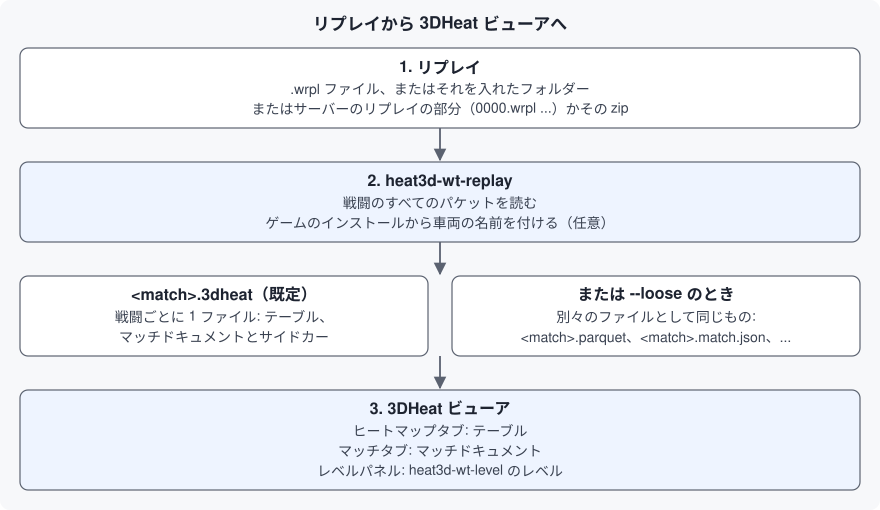

# 3DHeat War Thunder リプレイ {#dheat-war-thunder-replays}

**これは何？** War Thunder は戦闘をリプレイファイルとして録画できます。このツールは
その録画を、上から立体的に見られるファイルに変えます。[3DHeat ビューア](https://holdi601.github.io/3DHeat/)
で開けば、すべての飛行機、戦車、艦船、ミサイルと爆弾、そして命中した場所が見えます。
2 つ目のコマンドは、お使いのゲームのインストールからマップを取り出し、戦闘を映す 3D のレベルに変えます。

**なぜ使うの？** 戦闘を 3D で振り返るため。多くの戦闘で、あなたや他の人が飛び、走り、戦い、
やられた場所をヒートマップで見るため。戦車や艦船のどこに弾が当たったかを見るため。
戦闘にいくら使い、いくら稼いだかを見るため。出力は普通の Parquet と JSON なので、
ほかのツールでも読めます。

**例:** `.wrpl` のリプレイを 1 つ入れると、`<match>.3dheat` のファイルが 1 つ出てきます。



## かんたんな始め方 {#quick-start}

コマンドラインは初めてですか？ まず [始める前に](before-you-start.md) を読んでください。

```bash
git clone https://github.com/Holdi601/3DHeat-Ext-WarThunder.git
cd 3DHeat-Ext-WarThunder
pip install -e .                                  # heat3d-wt-replay と heat3d-wt-level を入れる
heat3d-wt-replay "<War Thunder>/Replays" -o out
```

戦闘 1 つにつき 1 行が表示されます: `ok out/<map>/<match>.3dheat`。そのファイルを
3DHeat ビューアで開いてください。

## このドキュメントの内容 {#this-documentation}

| ページ | 内容 |
|---|---|
| [始める前に](before-you-start.md) | Python、ターミナル、成功したときの見え方 |
| [インストール](installing.md) | インストール、インストール先からの名前、更新 |
| [リプレイの変換](converting.md) | `heat3d-wt-replay` の手順、すべてのオプション、メッセージ |
| [出力ファイル](output-files.md) | `.3dheat` ファイル、`--loose` のファイル、名前 |
| [テーブル](table.md) | すべての列とイベント |
| [マッチドキュメント](match-document.md) | `<match>.match.json` のすべてのキー |
| [サイドカーと完全性](sidecars.md) | テーブルのほかに丸ごと保存されるもの、件数 |
| [レベル](levels.md) | `heat3d-wt-level`: インストールからの `.glb` レベル |
| [リプレイの読み取り方](how-it-reads.md) | 何を読み、どう確かめたか |
| [飛行機](aircraft.md)、[地上ユニットとカメラ](ground.md)、[命中・射撃・火災](hits.md) | 列の裏にある詳しい内容 |
| [経済](economy.md)、[目的](objectives.md) | シルバーライオンと研究ポイント、占領地点、飛行場 |
| [用語とライセンス](terms.md) | 読み取るもの、出典、テスト、ライセンス |
| [コマンドリファレンス](../cli-reference.md)、[列の一覧](../columns.md) | コードから生成 |

## 3DHeat の一部として {#part-of-3dheat}

この変換ツールは [3DHeat](https://github.com/Holdi601/3DHeat) の道具の 1 つです。
3DHeat は、リアルタイムの 3D テレメトリとリプレイのビューアです
（[ドキュメント](https://holdi601.github.io/3DHeat/)）。ビューアは `.3dheat` ファイルを開きます。
テーブルは ヒートマップ タブで、マッチドキュメントは マッチ タブで表示されます
（[1 マッチを 1 ファイルに](https://holdi601.github.io/3DHeat/container.html)）。
どの変換ツールも残さなければならないもの: [変換ツールはすべてを残す](https://holdi601.github.io/3DHeat/converters.html)。

各ゲームリーダーは、それぞれ独自のライセンスファイル、リリース、Issue トラッカーを持つ小さな独立したプロジェクトです。そのため、ビューアや他のツールに影響を与えずに単独でインストール、更新、保守でき、権利者の求めがあれば単独で取り下げることもできます。3DHeat Watcher は、この変換ツールがインストールされていれば新しいリプレイに対して実行し、なくても動作します。

| ツール | 内容 | ソース | ドキュメント |
|---|---|---|---|
| 3DHeat ビューア | データを 3D で表示: ヒートマップ、リプレイ、レース分析 | [3DHeat](https://github.com/Holdi601/3DHeat) | [サイト](https://holdi601.github.io/3DHeat/) |
| GameFiles | ゲーム自身のファイルからのレベルとコース | [3DHeat-GameFiles](https://github.com/Holdi601/3DHeat-GameFiles) | [サイト](https://holdi601.github.io/3DHeat-GameFiles/) |
| GameCapture | ラップのテレメトリ、ゲームプレイ動画から組み直したレベル | [3DHeat-GameCapture](https://github.com/Holdi601/3DHeat-GameCapture) | [サイト](https://holdi601.github.io/3DHeat-GameCapture/) |
| Unreal Exporter | レベルを書き出す Unreal Editor プラグイン | [3DHeat-UnrealExporter](https://github.com/Holdi601/3DHeat-UnrealExporter) | [サイト](https://holdi601.github.io/3DHeat-UnrealExporter/) |
| CS2 | Counter-Strike 2 のデモとマップ | [3DHeat-CS2](https://github.com/Holdi601/3DHeat-CS2) | [サイト](https://holdi601.github.io/3DHeat-CS2/) |
| Watcher | プレイ中にゲームが公開する情報を記録 | [3DHeat-Watcher](https://github.com/Holdi601/3DHeat-Watcher) | [サイト](https://holdi601.github.io/3DHeat-Watcher/) |
| War Thunder リプレイ | `.wrpl` リプレイと War Thunder のレベル | [3DHeat-Ext-WarThunder](https://github.com/Holdi601/3DHeat-Ext-WarThunder) | [サイト](https://holdi601.github.io/3DHeat-Ext-WarThunder/) |
| World of Tanks リプレイ | `.wotreplay` リプレイ | [3DHeat-Ext-WoT](https://github.com/Holdi601/3DHeat-Ext-WoT) | [サイト](https://holdi601.github.io/3DHeat-Ext-WoT/) |
| World of Warships リプレイ | `.wowsreplay` リプレイ | [3DHeat-Ext-WoWs](https://github.com/Holdi601/3DHeat-Ext-WoWs) | [サイト](https://holdi601.github.io/3DHeat-Ext-WoWs/) |
| Squad デモ | Squad のサーバーデモ | [3DHeat-Ext-Squad](https://github.com/Holdi601/3DHeat-Ext-Squad) | [サイト](https://holdi601.github.io/3DHeat-Ext-Squad/) |
| DCS マップ | DCS World のマップを 3D レベルに | [3DHeat-Ext-DCS](https://github.com/Holdi601/3DHeat-Ext-DCS) | [サイト](https://holdi601.github.io/3DHeat-Ext-DCS/) |
| IL-2 マップ | IL-2 Great Battles のマップを 3D レベルに | [3DHeat-Ext-IL2](https://github.com/Holdi601/3DHeat-Ext-IL2) | [サイト](https://holdi601.github.io/3DHeat-Ext-IL2/) |

---

[3DHeat](https://github.com/Holdi601/3DHeat)（[ドキュメント](https://holdi601.github.io/3DHeat/)）の一部です。ソース: [3DHeat-Ext-WarThunder](https://github.com/Holdi601/3DHeat-Ext-WarThunder)。
