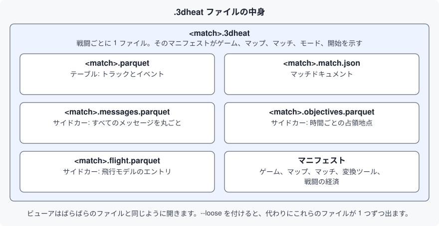
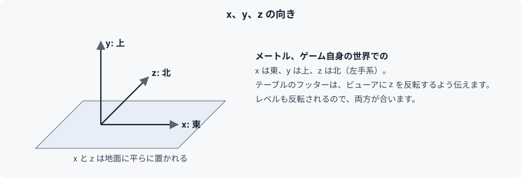

# 出力ファイル {#output-files}

既定では、戦闘ごとに **1 つのファイル** `out/<map>/<match>.3dheat` ができます。テーブル、マッチドキュメント、
サイドカーをまとめたもので、マニフェストにゲーム、マップ、マッチ、戦闘モード、開始時刻、変換ツールの名前が書かれます
（戦闘の経済は `extensions["heat3d/economy"]` の下に入ります）。形式はビューアのものです:
[1 マッチを 1 ファイルに（.3dheat）](https://holdi601.github.io/3DHeat/container.html)。

`--loose` を付けると、同じファイルが並んだ別々のファイルとして書き出されます:

| ファイル | 内容 | ページ |
|---|---|---|
| `<match>.parquet` | サンプルまたはイベント 1 行につき 1 行 | [テーブル](table.md) |
| `<match>.match.json` | ほかにリプレイが伝えるすべてのこと | [マッチドキュメント](match-document.md) |
| `<match>.messages.parquet` | すべてのメッセージ、コンポーネントの値、パケットを丸ごと | [サイドカー](sidecars.md) |
| `<match>.objectives.parquet` | 時間ごとの占領地点 | [サイドカー](sidecars.md) |
| `<match>.flight.parquet` | すべての飛行機のすべての飛行モデルのエントリを丸ごと | [サイドカー](sidecars.md) |

まとめる処理が失敗した場合は、別々のファイルが残り、その旨が表示されます。

## 名前 {#names}

`<match>` は `<map>_<AB|RB|SB>_<mode>_<start, UTC>_<session id>` です。図のとおりです。
詳しくは [どのファイルが 1 つの戦闘か](converting.md#which-files-are-one-battle) を参照してください。
`<map>` はゲームが付けたマップの ID です（図では `99_testmap`）。

## 座標 {#coordinates}

単位はメートルで、ゲーム自身の世界の座標です: x は東、y は上、z は北。テーブルのフッターは、
ビューアに z を反転するよう伝えます。`heat3d-wt-level` が書き出すレベルも同じ形式なので、
リプレイとそのレベルはぴったり重なります。

---

[3DHeat](https://github.com/Holdi601/3DHeat)（[ドキュメント](https://holdi601.github.io/3DHeat/)）の一部です。ソース: [3DHeat-Ext-WarThunder](https://github.com/Holdi601/3DHeat-Ext-WarThunder)。
