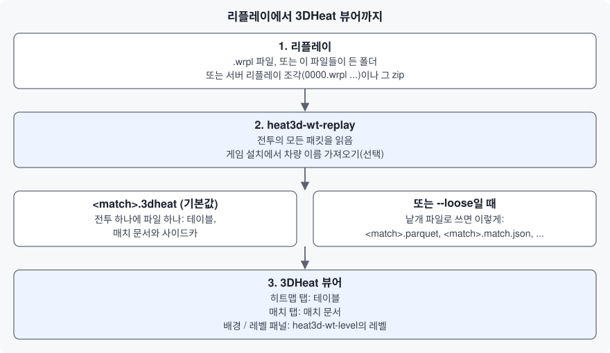

# 3DHeat 워 썬더 리플레이 {#dheat-war-thunder-replays}

**무엇입니까?** 워 썬더는 전투를 리플레이 파일로 녹화할 수 있습니다. 이 도구는 그 녹화를 [3DHeat 뷰어](https://holdi601.github.io/3DHeat/)에서 위에서 내려다보며 볼 수 있는 파일로 바꿉니다. 모든 비행기, 전차, 함선, 미사일과 폭탄, 그리고 맞은 곳까지 그대로 보여 줍니다. 두 번째 명령은 여러분의 게임 설치본에 있는 레벨을 전투를 보여 줄 3D 레벨로 바꿉니다.

**왜 씁니까?** 전투를 3D로 되돌아보기 위해서입니다. 여러분과 다른 사람들이 많은 전투에서 어디로 날고, 달리고, 싸우고, 죽었는지 히트맵으로 보기 위해서입니다. 차량 어디에 공격이 맞았는지 보기 위해서입니다. 전투에 얼마가 들고 얼마를 벌었는지 보기 위해서입니다. 결과물은 평범한 Parquet과 JSON 파일이라서 다른 도구도 읽을 수 있습니다.

**예시:** `.wrpl` 리플레이 하나를 넣으면 `<match>.3dheat` 파일 하나가 나옵니다.



## 빠른 시작 {#quick-start}

명령줄이 처음이라면 먼저 [시작하기 전에](before-you-start.md)를 읽어 주세요.

```bash
git clone https://github.com/Holdi601/3DHeat-Ext-WarThunder.git
cd 3DHeat-Ext-WarThunder
pip install -e .                                  # heat3d-wt-replay와 heat3d-wt-level을 설치합니다
heat3d-wt-replay "<War Thunder>/Replays" -o out
```

전투마다 `ok out/<map>/<match>.3dheat` 한 줄이 보입니다. 그 파일을 3DHeat 뷰어에서 열어 주세요.

## 이 문서 {#this-documentation}

| 페이지 | 내용 |
|---|---|
| [시작하기 전에](before-you-start.md) | Python, 터미널, 제대로 되었는지 확인하는 법 |
| [설치](installing.md) | 설치, 설치본의 이름, 업데이트 |
| [리플레이 변환하기](converting.md) | `heat3d-wt-replay` 단계별 설명, 모든 옵션, 메시지 |
| [출력 파일](output-files.md) | `.3dheat` 파일, `--loose` 파일, 이름 |
| [테이블](table.md) | 모든 열과 이벤트 |
| [매치 문서](match-document.md) | `<match>.match.json`의 모든 키 |
| [사이드카와 완전성](sidecars.md) | 테이블 말고 통째로 보관하는 것들과 개수 |
| [레벨](levels.md) | `heat3d-wt-level`: 설치본의 레벨을 `.glb`로 |
| [리플레이를 읽는 법](how-it-reads.md) | 무엇을 읽는지, 그리고 어떻게 확인했는지 |
| [항공기](aircraft.md), [지상 유닛과 카메라](ground.md), [명중, 사격, 화재](hits.md) | 열의 바탕이 되는 세부 내용 |
| [경제](economy.md), [목표](objectives.md) | 실버 라이온과 연구 포인트; 점령 구역, 비행장 |
| [용어와 라이선스](terms.md) | 읽는 것, 출처, 테스트, 라이선스 |
| [명령 참조](../cli-reference.md), [열 목록](../columns.md) | 코드에서 생성됨 |

## 3DHeat의 일부 {#part-of-3dheat}

이 변환기는 [3DHeat](https://github.com/Holdi601/3DHeat)의 도구 중 하나입니다. 3DHeat는 실시간 3D 텔레메트리와 리플레이 뷰어입니다([문서](https://holdi601.github.io/3DHeat/)). 뷰어는 `.3dheat` 파일을 엽니다. 테이블은 히트맵 탭에, 매치 문서는 매치 탭에 나옵니다([파일 하나에 매치 하나](https://holdi601.github.io/3DHeat/container.html)). 모든 변환기가 지켜야 할 것: [변환기는 모든 것을 보관합니다](https://holdi601.github.io/3DHeat/converters.html).

각 게임 리더는 자체 라이선스 파일, 릴리스, 이슈 트래커를 갖춘 작은 독립 프로젝트입니다. 그래서 뷰어나 다른 도구에 영향을 주지 않고 따로 설치, 업데이트, 유지 관리할 수 있으며, 권리자의 요청이 있으면 따로 철회할 수도 있습니다.3DHeat Watcher는 이 변환기가 설치되어 있으면 새 리플레이에 실행하며, 없어도 작동합니다.

| 도구 | 하는 일 | 소스 | 문서 |
|---|---|---|---|
| 3DHeat 뷰어 | 데이터를 3D로 보여 줍니다: 히트맵, 리플레이, 레이스 분석 | [3DHeat](https://github.com/Holdi601/3DHeat) | [사이트](https://holdi601.github.io/3DHeat/) |
| GameFiles | 게임이 함께 배포하는 파일에서 꺼낸 코스와 레벨 | [3DHeat-GameFiles](https://github.com/Holdi601/3DHeat-GameFiles) | [사이트](https://holdi601.github.io/3DHeat-GameFiles/) |
| GameCapture | 랩 텔레메트리, 그리고 게임 영상으로 다시 만든 레벨 | [3DHeat-GameCapture](https://github.com/Holdi601/3DHeat-GameCapture) | [사이트](https://holdi601.github.io/3DHeat-GameCapture/) |
| Unreal Exporter | 레벨을 내보내는 Unreal Editor 플러그인 | [3DHeat-UnrealExporter](https://github.com/Holdi601/3DHeat-UnrealExporter) | [사이트](https://holdi601.github.io/3DHeat-UnrealExporter/) |
| CS2 | Counter-Strike 2 데모와 맵 | [3DHeat-CS2](https://github.com/Holdi601/3DHeat-CS2) | [사이트](https://holdi601.github.io/3DHeat-CS2/) |
| Watcher | 여러분이 플레이하는 동안 게임이 공개하는 것을 기록 | [3DHeat-Watcher](https://github.com/Holdi601/3DHeat-Watcher) | [사이트](https://holdi601.github.io/3DHeat-Watcher/) |
| 워 썬더 리플레이 | `.wrpl` 리플레이와 워 썬더 레벨 | [3DHeat-Ext-WarThunder](https://github.com/Holdi601/3DHeat-Ext-WarThunder) | [사이트](https://holdi601.github.io/3DHeat-Ext-WarThunder/) |
| 월드 오브 탱크 리플레이 | `.wotreplay` 리플레이 | [3DHeat-Ext-WoT](https://github.com/Holdi601/3DHeat-Ext-WoT) | [사이트](https://holdi601.github.io/3DHeat-Ext-WoT/) |
| 월드 오브 워십 리플레이 | `.wowsreplay` 리플레이 | [3DHeat-Ext-WoWs](https://github.com/Holdi601/3DHeat-Ext-WoWs) | [사이트](https://holdi601.github.io/3DHeat-Ext-WoWs/) |
| Squad 데모 | Squad 서버 데모 | [3DHeat-Ext-Squad](https://github.com/Holdi601/3DHeat-Ext-Squad) | [사이트](https://holdi601.github.io/3DHeat-Ext-Squad/) |
| DCS 맵 | DCS World 맵을 3D 레벨로 | [3DHeat-Ext-DCS](https://github.com/Holdi601/3DHeat-Ext-DCS) | [사이트](https://holdi601.github.io/3DHeat-Ext-DCS/) |
| IL-2 맵 | IL-2 Great Battles 맵을 3D 레벨로 | [3DHeat-Ext-IL2](https://github.com/Holdi601/3DHeat-Ext-IL2) | [사이트](https://holdi601.github.io/3DHeat-Ext-IL2/) |

---

[3DHeat](https://github.com/Holdi601/3DHeat)의 일부([문서](https://holdi601.github.io/3DHeat/)). 소스: [3DHeat-Ext-WarThunder](https://github.com/Holdi601/3DHeat-Ext-WarThunder).
