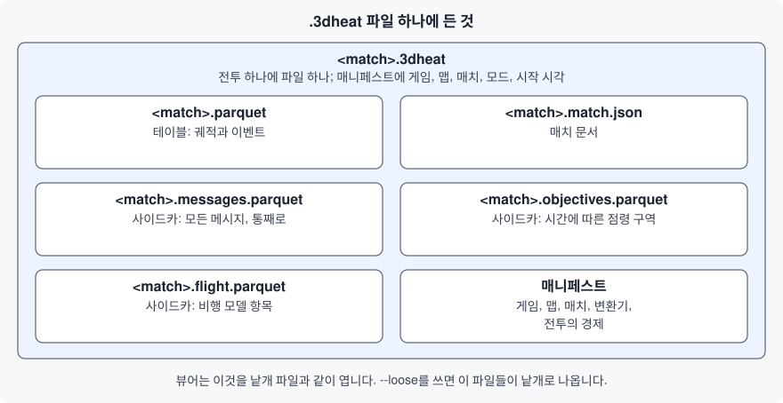
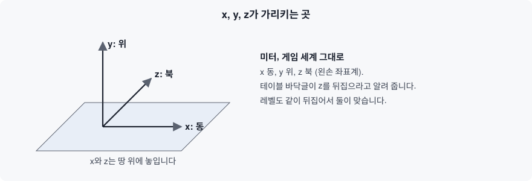

# 출력 파일 {#output-files}

기본적으로 전투마다 **파일 하나**, `out/<map>/<match>.3dheat`가 나옵니다. 테이블, 매치 문서, 사이드카를 한데 묶고, 매니페스트에 게임, 맵, 매치, 전투 모드, 시작 시각, 변환기 이름을 적습니다(그리고 전투의 경제는 `extensions["heat3d/economy"]` 아래에 있습니다). 형식은 뷰어의 형식입니다: [매치 하나를 담은 파일(.3dheat)](https://holdi601.github.io/3DHeat/container.html).

`--loose`를 쓰면 같은 파일들이 나란히 따로 쓰입니다:

| 파일 | 내용 | 페이지 |
|---|---|---|
| `<match>.parquet` | 샘플이나 이벤트 하나당 한 행 | [테이블](table.md) |
| `<match>.match.json` | 리플레이가 말하는 그 밖의 모든 것 | [매치 문서](match-document.md) |
| `<match>.messages.parquet` | 모든 메시지, 컴포넌트 값, 패킷을 통째로 | [사이드카](sidecars.md) |
| `<match>.objectives.parquet` | 시간에 따른 점령 구역 | [사이드카](sidecars.md) |
| `<match>.flight.parquet` | 모든 항공기의 모든 비행 모델 항목을 통째로 | [사이드카](sidecars.md) |

묶기에 실패하면 낱개 파일을 남기고, 그 사실을 줄에 알려 줍니다.

## 이름 {#names}

`<match>`는 `<map>_<AB|RB|SB>_<mode>_<start, UTC>_<session id>`입니다. 그림에 나온 대로입니다. [전투 하나가 어떤 파일인지](converting.md#which-files-are-one-battle)를 보세요. `<map>`은 맵의 게임 고유 ID입니다(그림에서는 `99_testmap`).

## 좌표 {#coordinates}

미터 단위이고, 게임 세계 그대로입니다: x 동, y 위, z 북. 테이블 바닥글이 뷰어에게 z를 뒤집으라고 알려 줍니다. `heat3d-wt-level`이 만드는 레벨도 같은 방식으로 쓰여서, 리플레이와 그 레벨이 서로 겹칩니다.

---

[3DHeat](https://github.com/Holdi601/3DHeat)의 일부([문서](https://holdi601.github.io/3DHeat/)). 소스: [3DHeat-Ext-WarThunder](https://github.com/Holdi601/3DHeat-Ext-WarThunder).
