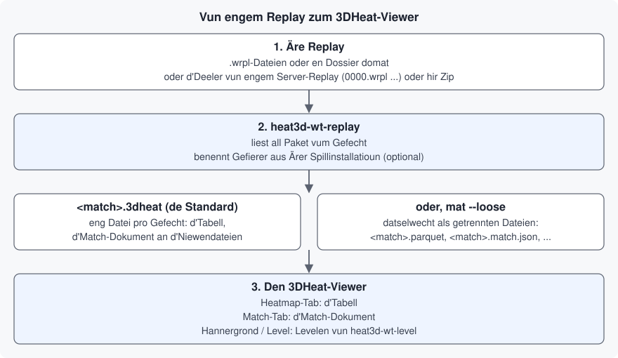

# 3DHeat War Thunder Replays {#dheat-war-thunder-replays}

**Wat ass dat?** War Thunder kann e Gefecht als Replay-Datei ophuelen. Dëst Tool
mécht aus der Opnam eng Datei, déi Dir vun uewen am
[3DHeat-Viewer](https://holdi601.github.io/3DHeat/) kucke kënnt, mat all Fliger, Panzer
a Schëff, all Rakéit a Bomm, an all Treffer do, wou en higaangen ass. E weidere
Befehl mécht aus de Levelen vun Ärer eegener Spillinstallatioun 3D-Levelen, op deenen d'Gefechter gewise ginn.

**Firwat soll ech et benotzen?** Fir eng Nobespriechung vun engem Gefecht a 3D; fir Heatmaps
doriwwer, wou Dir an anerer iwwer vill Gefechter fléit, fuert, kämpft a stierft; fir ze gesinn,
wou d'Treffer op engem Gefier gelant sinn; fir ze gesinn, wat e Gefecht kascht an agedron huet. D'Ausgab
ass einfachen Parquet a JSON, sou datt aner Tools se och kënne liesen.

**Beispill:** eng `.wrpl`-Replay eragitt, eng `<match>.3dheat`-Datei erauskennt:



## Schnellstart {#quick-start}

Nei op der Kommandozeil? Liest fir d'éischt [Ier Dir ufänkt](before-you-start.md).

```bash
git clone https://github.com/Holdi601/3DHeat-Ext-WarThunder.git
cd 3DHeat-Ext-WarThunder
pip install -e .                                  # installs heat3d-wt-replay and heat3d-wt-level
heat3d-wt-replay "<War Thunder>/Replays" -o out
```

Dir sollt eng Zeil pro Gefecht gesinn: `ok out/<map>/<match>.3dheat`. Mécht déi
Datei am 3DHeat-Viewer op.

## Dës Dokumentatioun {#this-documentation}

| Säit | Wat se ofdeckt |
|---|---|
| [Ier Dir ufänkt](before-you-start.md) | Python, en Terminal, a wéi et ausgesäit, wann et geklappt huet |
| [Installéieren](installing.md) | Installatioun, Nimm aus Ärer Installatioun, Updates |
| [Replays émwandelen](converting.md) | `heat3d-wt-replay` Schrëtt fir Schrëtt, all Optioun, Meldungen |
| [Ausgabedateien](output-files.md) | d'`.3dheat`-Datei, `--loose`-Dateien, Nimm |
| [D'Tabell](table.md) | all Kolonn an all Evenement |
| [D'Match-Dokument](match-document.md) | all Schlëssel vun `<match>.match.json` |
| [Niewendateien a Vollstännegkeet](sidecars.md) | wat nieft der Tabell ganz behale gëtt, an d'Zuelen |
| [Levelen](levels.md) | `heat3d-wt-level`: Levelen aus Ärer Installatioun als `.glb` |
| [Wéi e Replay gelies gëtt](how-it-reads.md) | wat gelies gëtt, a wéi et gepréift gouf |
| [Fliger](aircraft.md), [Buedemeenheeten a Kamera](ground.md), [Treffer, Schéiss a Brand](hits.md) | d'Detailer hannert de Kolonnen |
| [Wirtschaft](economy.md), [Ziler](objectives.md) | Silver Lions a Fuerschungspunkten; Eroberungszonen, Fluchhäfen |
| [Konditiounen a Lizenz](terms.md) | wat gelies gëtt, Quellen, Tester, Lizenz |
| [Befehlsreferenz](../cli-reference.md), [Kolonnelëscht](../columns.md) | aus dem Code generéiert |

## Deel vun 3DHeat {#part-of-3dheat}

Dëse Konverter ass ee vun den Tools vun [3DHeat](https://github.com/Holdi601/3DHeat),
engem 3D-Telemetrie- a Replay-Viewer a Echtzäit ([Dokumentatioun](https://holdi601.github.io/3DHeat/)).
De Viewer mécht d'`.3dheat`-Datei op: d'Tabell a sengem Heatmap-Tab, d'Match-Dokument
a sengem Match-Tab ([Eng Datei pro Match](https://holdi601.github.io/3DHeat/container.html)).
Wat all Konverter muss behalen: [Konverteren behalen alles](https://holdi601.github.io/3DHeat/converters.html).

All Spill-Lieser ass e klengt eegestännegt Projet mat senger eegener Lizenzdatei, senge Releases a sengem Issue-Tracker, sou datt e sech eleng installéieren, aktualiséieren, ënnerhalen - oder op Ufro vun engem Rechteinhaber zréckzéien - léisst, ouni de Viewer oder déi aner Tools ze beaflossen.
Den 3DHeat Watcher léisst dëse Konverter op nei Replays lafen, wann en installéiert ass, a funktionéiert och ouni en.

| Tool | Wat et mécht | Quell | Dokumentatioun |
|---|---|---|---|
| 3DHeat-Viewer | weist d'Daten a 3D: Heatmaps, Replays, Course-Analys | [3DHeat](https://github.com/Holdi601/3DHeat) | [Site](https://holdi601.github.io/3DHeat/) |
| GameFiles | Streckenverläf a Levelen aus de Dateien, déi Spiller matliwwere | [3DHeat-GameFiles](https://github.com/Holdi601/3DHeat-GameFiles) | [Site](https://holdi601.github.io/3DHeat-GameFiles/) |
| GameCapture | Ronnen-Telemetrie, a Levelen, déi aus Gameplay-Video nogebaut ginn | [3DHeat-GameCapture](https://github.com/Holdi601/3DHeat-GameCapture) | [Site](https://holdi601.github.io/3DHeat-GameCapture/) |
| Unreal Exporter | e Plugin fir den Unreal Editor, dat e Level exportéiert | [3DHeat-UnrealExporter](https://github.com/Holdi601/3DHeat-UnrealExporter) | [Site](https://holdi601.github.io/3DHeat-UnrealExporter/) |
| CS2 | Counter-Strike-2-Demoen a -Kaarten | [3DHeat-CS2](https://github.com/Holdi601/3DHeat-CS2) | [Site](https://holdi601.github.io/3DHeat-CS2/) |
| Watcher | hält fest, wat Spiller wärend dem Spillen publizéieren | [3DHeat-Watcher](https://github.com/Holdi601/3DHeat-Watcher) | [Site](https://holdi601.github.io/3DHeat-Watcher/) |
| War Thunder Replays | `.wrpl`-Replays a War-Thunder-Levelen | [3DHeat-Ext-WarThunder](https://github.com/Holdi601/3DHeat-Ext-WarThunder) | [Site](https://holdi601.github.io/3DHeat-Ext-WarThunder/) |
| World of Tanks Replays | `.wotreplay`-Replays | [3DHeat-Ext-WoT](https://github.com/Holdi601/3DHeat-Ext-WoT) | [Site](https://holdi601.github.io/3DHeat-Ext-WoT/) |
| World of Warships Replays | `.wowsreplay`-Replays | [3DHeat-Ext-WoWs](https://github.com/Holdi601/3DHeat-Ext-WoWs) | [Site](https://holdi601.github.io/3DHeat-Ext-WoWs/) |
| Squad-Demoen | Squad-Server-Demoen | [3DHeat-Ext-Squad](https://github.com/Holdi601/3DHeat-Ext-Squad) | [Site](https://holdi601.github.io/3DHeat-Ext-Squad/) |
| DCS-Kaarten | DCS-World-Kaarten als 3D-Levelen | [3DHeat-Ext-DCS](https://github.com/Holdi601/3DHeat-Ext-DCS) | [Site](https://holdi601.github.io/3DHeat-Ext-DCS/) |
| IL-2-Kaarten | IL-2-Great-Battles-Kaarten als 3D-Levelen | [3DHeat-Ext-IL2](https://github.com/Holdi601/3DHeat-Ext-IL2) | [Site](https://holdi601.github.io/3DHeat-Ext-IL2/) |

---

Deel vun [3DHeat](https://github.com/Holdi601/3DHeat) ([Dokumentatioun](https://holdi601.github.io/3DHeat/)). Quell: [3DHeat-Ext-WarThunder](https://github.com/Holdi601/3DHeat-Ext-WarThunder).
