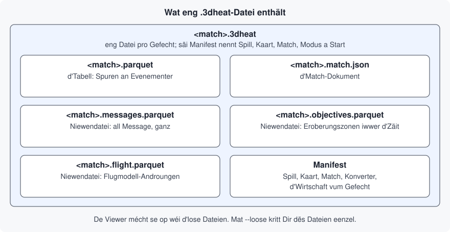
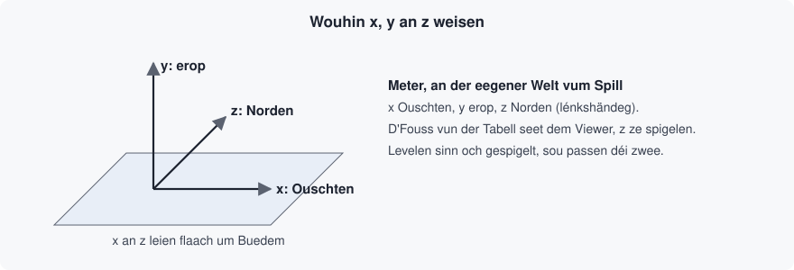

# Ausgabedateien {#output-files}

Standardméisseg ass all Gefecht **eng Datei**, `out/<map>/<match>.3dheat`: d'
Tabell, d'Match-Dokument an d'Sidecars zesummegepaakt, mat engem Manifest,
dat d'Spill, d'Kaart, de Match, de Gefechtsmodus, d'Startzäit an de Konverter nennt (an
d'Wirtschaft vum Gefecht ënner `extensions["heat3d/economy"]`). D'Format ass dat vum
Viewer: [Eng Datei pro Match (.3dheat)](https://holdi601.github.io/3DHeat/container.html).

Mat `--loose` ginn déiselwecht Dateie niewenteneen geschriwwen:

| Datei | Wat | Säit |
|---|---|---|
| `<match>.parquet` | eng Zeil pro Echantillon oder Evenement | [D'Tabell](table.md) |
| `<match>.match.json` | alles anescht, wat de Replay seet | [D'Match-Dokument](match-document.md) |
| `<match>.messages.parquet` | all Message, Komponentewäert a Paket, ganz | [Sidecars](sidecars.md) |
| `<match>.objectives.parquet` | d'Eroberungszonen iwwer d'Zäit | [Sidecars](sidecars.md) |
| `<match>.flight.parquet` | all Flugmodell-Androung vun all Fliger, ganz | [Sidecars](sidecars.md) |

Wann d'Paken scheitert, bleiwe d'lose Dateien, an d'Zeil seet et.

## Nimm {#names}

`<match>` ass `<map>_<AB|RB|SB>_<mode>_<start, UTC>_<session id>`, wéi am
Bild: kuck [Wéi eng Dateie ee Gefecht sinn](converting.md#which-files-are-one-battle).
`<map>` ass dem Spill seng eege ID vun der Kaart (`99_testmap` op de Biller).

## Koordinaten {#coordinates}

Meter, an der eegener Welt vum Spill: x Ouschten, y erop, z Norden. D'Fouss vun der Tabell
seet dem Viewer, z ze spigelen, a Leveler vun `heat3d-wt-level` ginn
op déiselwecht Manéier geschriwwen, sou datt e Replay a säi Level openeen läit.

---

Deel vun [3DHeat](https://github.com/Holdi601/3DHeat) ([Dokumentatioun](https://holdi601.github.io/3DHeat/)). Quell: [3DHeat-Ext-WarThunder](https://github.com/Holdi601/3DHeat-Ext-WarThunder).
