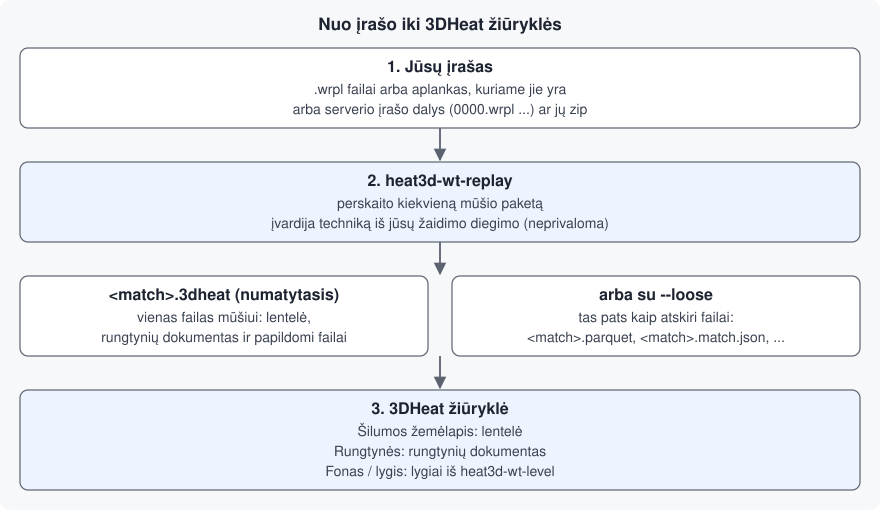

# 3DHeat War Thunder įrašai {#dheat-war-thunder-replays}

**Kas tai?** War Thunder gali įrašyti mūšį kaip pakartojimo failą. Šis įrankis paverčia įrašą
failu, kurį galima žiūrėti iš viršaus [3DHeat žiūryklėje](https://holdi601.github.io/3DHeat/),
su kiekvienu lėktuvu, tanku ir laivu, kiekviena raketa ir bomba bei kiekvienu pataikymu ten, kur
jis įvyko. Antra komanda paverčia jūsų žaidimo diegimo lygius 3D lygiais, kuriuose rodomi mūšiai.

**Kam tai naudoti?** Norint 3D būdu aptarti mūšį; norint šilumos žemėlapių, rodančių, kur jūs ir
kiti skrendate, važiuojate, kaunatės ir žūvate per daugelį mūšių; norint matyti, kur pataikymai
trenkė į techniką; norint matyti, kiek kainavo ir kiek uždirbta mūšyje. Rezultatas - paprastas
Parquet ir JSON formatas, todėl jį gali skaityti ir kiti įrankiai.

**Pavyzdys:** vienas `.wrpl` įrašas įeina, vienas `<match>.3dheat` failas išeina:



## Greita pradžia {#quick-start}

Nesate dirbę su komandine eilute? Pirma perskaitykite [Prieš pradedant](before-you-start.md).

```bash
git clone https://github.com/Holdi601/3DHeat-Ext-WarThunder.git
cd 3DHeat-Ext-WarThunder
pip install -e .                                  # installs heat3d-wt-replay and heat3d-wt-level
heat3d-wt-replay "<War Thunder>/Replays" -o out
```

Turėtumėte matyti po vieną eilutę kiekvienam mūšiui: `ok out/<map>/<match>.3dheat`. Atidarykite
tą failą 3DHeat žiūryklėje.

## Ši dokumentacija {#this-documentation}

| Puslapis | Ką aprašo |
|---|---|
| [Prieš pradedant](before-you-start.md) | Python, terminalas ir kaip atrodo sėkmė |
| [Diegimas](installing.md) | diegimas, vardai iš jūsų diegimo, atnaujinimai |
| [Įrašų konvertavimas](converting.md) | `heat3d-wt-replay` žingsnis po žingsnio, kiekvienas parametras, pranešimai |
| [Išvesties failai](output-files.md) | `.3dheat` failas, `--loose` failai, vardai |
| [Lentelė](table.md) | kiekvienas stulpelis ir įvykis |
| [Rungtynių dokumentas](match-document.md) | kiekvienas `<match>.match.json` raktas |
| [Papildomi failai ir pilnumas](sidecars.md) | kas saugoma pilnai šalia lentelės, ir skaičiai |
| [Lygiai](levels.md) | `heat3d-wt-level`: lygiai iš jūsų diegimo kaip `.glb` |
| [Kaip įrankis skaito įrašą](how-it-reads.md) | kas skaitoma ir kaip tai patikrinta |
| [Orlaiviai](aircraft.md), [Sausumos technika ir kamera](ground.md), [Pataikymai, šaudymas ir gaisrai](hits.md) | detalės už stulpelių |
| [Ekonomika](economy.md), [Tikslai](objectives.md) | Sidabro liūtai ir tyrimų taškai; kapitalo zonos, aerodromai |
| [Sąlygos ir licencija](terms.md) | Gaijin sąlygos, šaltiniai, testai, licencija |
| [Komandų nuorodos](../cli-reference.md), [Stulpelių sąrašas](../columns.md) | sugeneruota iš kodo |

## Dalis 3DHeat {#part-of-3dheat}

Šis konverteris yra vienas [3DHeat](https://github.com/Holdi601/3DHeat) įrankių - realaus
laiko 3D telemetrijos ir įrašų žiūryklės ([dokumentacija](https://holdi601.github.io/3DHeat/)).
Žiūryklė atidaro `.3dheat` failą: lentelę jos Šilumos žemėlapio skirtuke, rungtynių dokumentą
Rungtynių skirtuke ([Vienas failas rungtynėms](https://holdi601.github.io/3DHeat/container.html)).
Ką privalo išsaugoti kiekvienas konverteris: [Konverteriai išsaugo viską](https://holdi601.github.io/3DHeat/converters.html).

**Kodėl tai atskiras įrankis.** `.wrpl` formatas nedokumentuotas, o Gaijin EULA (3.2.2, 3.2.9)
draudžia atvirkštinę inžineriją ir duomenų kasimą, kurie nėra skirti viešam rodymui; ji
neįvardija įrašų, kuriuos pats žaidimas rodo žaidėjui. Kad licencijos klausimas liestų tik šį
konverterį, jis gyvena atskirai: 3DHeat Watcher jį paleidžia naujiems įrašams, kai jis įdiegtas,
bet veikia ir be jo.

| Įrankis | Ką daro | Šaltinis | Dokumentacija |
|---|---|---|---|
| 3DHeat žiūryklė | rodo duomenis 3D: šilumos žemėlapius, įrašus, lenktynių analizę | [3DHeat](https://github.com/Holdi601/3DHeat) | [svetainė](https://holdi601.github.io/3DHeat/) |
| GameFiles | trasos ir lygiai iš failų, kuriuos žaidimai pateikia | [3DHeat-GameFiles](https://github.com/Holdi601/3DHeat-GameFiles) | [svetainė](https://holdi601.github.io/3DHeat-GameFiles/) |
| GameCapture | ratų telemetrija ir lygiai, atkurti iš žaidimo vaizdo | [3DHeat-GameCapture](https://github.com/Holdi601/3DHeat-GameCapture) | [svetainė](https://holdi601.github.io/3DHeat-GameCapture/) |
| Unreal Exporter | Unreal Editor papildinys, eksportuojantis lygį | [3DHeat-UnrealExporter](https://github.com/Holdi601/3DHeat-UnrealExporter) | [svetainė](https://holdi601.github.io/3DHeat-UnrealExporter/) |
| CS2 | Counter-Strike 2 demonstracijos ir žemėlapiai | [3DHeat-CS2](https://github.com/Holdi601/3DHeat-CS2) | [svetainė](https://holdi601.github.io/3DHeat-CS2/) |
| Watcher | įrašo, ką žaidimai skelbia, kol žaidžiate | [3DHeat-Watcher](https://github.com/Holdi601/3DHeat-Watcher) | [svetainė](https://holdi601.github.io/3DHeat-Watcher/) |
| War Thunder įrašai | `.wrpl` įrašai ir War Thunder lygiai | [3DHeat-Ext-WarThunder](https://github.com/Holdi601/3DHeat-Ext-WarThunder) | [svetainė](https://holdi601.github.io/3DHeat-Ext-WarThunder/) |
| World of Tanks įrašai | `.wotreplay` įrašai | [3DHeat-Ext-WoT](https://github.com/Holdi601/3DHeat-Ext-WoT) | [svetainė](https://holdi601.github.io/3DHeat-Ext-WoT/) |
| World of Warships įrašai | `.wowsreplay` įrašai | [3DHeat-Ext-WoWs](https://github.com/Holdi601/3DHeat-Ext-WoWs) | [svetainė](https://holdi601.github.io/3DHeat-Ext-WoWs/) |
| Squad demonstracijos | Squad serverio demonstracijos | [3DHeat-Ext-Squad](https://github.com/Holdi601/3DHeat-Ext-Squad) | [svetainė](https://holdi601.github.io/3DHeat-Ext-Squad/) |
| DCS žemėlapiai | DCS World žemėlapiai kaip 3D lygiai | [3DHeat-Ext-DCS](https://github.com/Holdi601/3DHeat-Ext-DCS) | [svetainė](https://holdi601.github.io/3DHeat-Ext-DCS/) |
| IL-2 žemėlapiai | IL-2 Great Battles žemėlapiai kaip 3D lygiai | [3DHeat-Ext-IL2](https://github.com/Holdi601/3DHeat-Ext-IL2) | [svetainė](https://holdi601.github.io/3DHeat-Ext-IL2/) |

---

Dalis [3DHeat](https://github.com/Holdi601/3DHeat) ([dokumentacija](https://holdi601.github.io/3DHeat/)). Šaltinis: [3DHeat-Ext-WarThunder](https://github.com/Holdi601/3DHeat-Ext-WarThunder).
