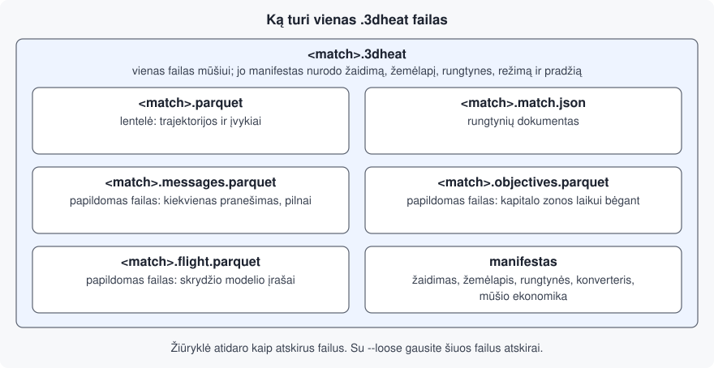
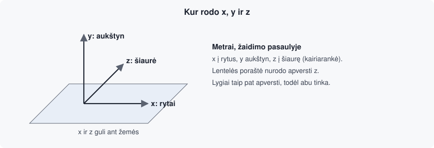

# Išvesties failai {#output-files}

Pagal numatytuosius nustatymus kiekvienas mūšis yra **vienas failas**, `out/<map>/<match>.3dheat`:
lentelė, rungtynių dokumentas ir papildomi failai supakuoti kartu, su manifestu, kuriame nurodomi
žaidimas, žemėlapis, rungtynės, mūšio režimas, pradžios laikas ir konverteris (ir mūšio ekonomika
`extensions["heat3d/economy"]` skiltyje). Formatas yra žiūryklės formatas:
[Vienas failas rungtynėms (.3dheat)](https://holdi601.github.io/3DHeat/container.html).

Su `--loose` tie patys failai rašomi greta vienas kito:

| Failas | Kas tai | Puslapis |
|---|---|---|
| `<match>.parquet` | viena eilutė kiekvienam pavyzdžiui ar įvykiui | [Lentelė](table.md) |
| `<match>.match.json` | viskas kita, ką įrašas sako | [Rungtynių dokumentas](match-document.md) |
| `<match>.messages.parquet` | kiekvienas pranešimas, komponento reikšmė ir paketas, visi pilnai | [Papildomi failai](sidecars.md) |
| `<match>.objectives.parquet` | kapitalo zonos laikui bėgant | [Papildomi failai](sidecars.md) |
| `<match>.flight.parquet` | kiekvienas skrydžio modelio įrašas kiekvieno orlaivio, visi pilnai | [Papildomi failai](sidecars.md) |

Jei supakavimas nepavyksta, atskiri failai išlieka, o eilutėje tai nurodoma.

## Vardai {#names}

`<match>` yra `<map>_<AB|RB|SB>_<mode>_<start, UTC>_<session id>`, kaip paveikslėlyje: žr.
[Kurie failai yra vienas mūšis](converting.md#which-files-are-one-battle).
`<map>` yra žaidimo žemėlapio id (paveikslėliuose - `99_testmap`).

## Koordinatės {#coordinates}

Metrais, žaidimo pasaulyje: x - į rytus, y - aukštyn, z - į šiaurę. Lentelės poraštė nurodo
žiūryklei apversti z, o lygiai iš `heat3d-wt-level` rašomi tokiu pačiu būdu, todėl įrašas ir jo
lygis sutampa vienas su kitu.

---

Dalis [3DHeat](https://github.com/Holdi601/3DHeat) ([dokumentacija](https://holdi601.github.io/3DHeat/)). Šaltinis: [3DHeat-Ext-WarThunder](https://github.com/Holdi601/3DHeat-Ext-WarThunder).
