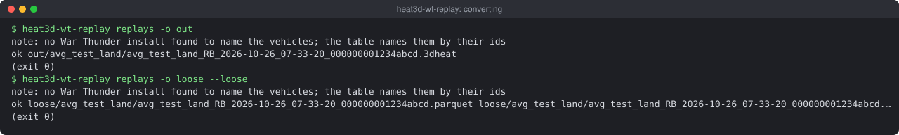

# Atkārtojumu pārvēršana {#converting-replays}

Rezultāts: viens `.3dheat` fails katrai kaujai (noklusējums) vai atsevišķi faili ar
`--loose`.

## Soli pa solim {#step-by-step}

1. **Ieslēdz atkārtojumu saglabāšanu.** War Thunder saglabā klienta atkārtojumus
   spēles mapē `Replays`, ja atkārtojumu saglabāšana ir ieslēgta tās iestatījumos,
   piemēram `C:\Program Files (x86)\Steam\steamapps\common\War Thunder\Replays`.
   Servera atkārtojumu, kas saglabāts no spēles atkārtojumu lapas (zip ar `0000.wrpl`,
   `0001.wrpl` ...), arī var pārvērst.
2. **Atver termināli** mapē, kurā rezultāti drīkst tikt rakstīti
   ([Pirms sākat](before-you-start.md)).
3. **Pārvērs:**

   ```bash
   heat3d-wt-replay "<War Thunder>/Replays" -o out
   heat3d-wt-replay a.wrpl b.wrpl -o out           # faili, mapes vai abi
   heat3d-wt-replay battle.zip -o out              # servera atkārtojuma zip
   heat3d-wt-replay a.wrpl -o out --loose          # atsevišķi faili, nevis viens .3dheat
   ```

   `out` tiek izveidota mapē, kurā atrodas tavs termināls.
4. **Izlasi, ko tas saka.** Vajadzētu redzēt vienu rindu katrai kaujai.
5. **Atver to:** ielādē `out/<map>/<match>.3dheat` 3DHeat skatītājā
   ([Ielādējot vienu](https://holdi601.github.io/3DHeat/container.html#loading-one)).



Attēls ir izpilde ar atkārtojumu, ko testi izveido kodā (ne īsts atkārtojums, bez
instalācijas):

- `ok <fails>`: kauja pārvērsta (ar `--loose`: `ok <tabula> <mača dokuments>`);
- `failed <fails>: <iemesls>`: failu nevarēja nolasīt (izejas statuss 1; pārējie
  joprojām tiek pārvērsti);
- `no .wrpl files given`: nav ko pārvērst (izejas statuss 2);
- `note: ...`: piemēram, ka War Thunder instalācija transportlīdzekļu nosaukumiem
  nav atrasta.

## Iespējas {#options}

| Iespēja | Noklusējums | Ko dara |
|---|---|---|
| `replays` (viens vai vairāki) | - | `.wrpl` faili, to mapes (pati mape, ne tās apakšmapes) vai to zip arhīvi (servera atkārtojums: tā `.wrpl` daļas tiek izpakotas pagaidu mapē) |
| `-o`, `--out` | obligāta | kur rakstīt: mape katrai kartei iekšā |
| `--game MAPE` | atrasts | War Thunder mape, kuras teksts nosauc transportlīdzekļus, ieročus un munīciju un kuras tabulas nosaka [ekonomikas](economy.md) cenas; arī `HEAT3D_WT_GAME` |
| `--no-smoothing` | izslēgts | paturēt citu vienību novērtētās un saņemtās pozīcijas tādas, kādas tās ir atkārtojumā ([Dead reckoning](aircraft.md#dead-reckoning-and-the-smoother)) |
| `--container` | ieslēgts | iepakot katru kauju vienā `.3dheat` failā |
| `--loose` | izslēgts | paturēt katru kauju kā atsevišķus failus (tabula, mača dokuments, papildfaili) |
| `--version` | - | izdrukāt `heat3d-wt-replay <version>` un apstāties |
| `-h`, `--help` | - | izdrukāt iespējas un apstāties |

Kauja, kas pārvērsta vēlreiz, tiek rakstīta vēlreiz. Iespējas tā, kā tās izdrukā
programma: [Komandu atsauce](../cli-reference.md).

## Kuri faili ir viena kauja {#which-files-are-one-battle}

Katra kauja kļūst par vienu failu
`out/<map>/<map>_<AB|RB|SB>_<mode>_<start, UTC>_<session id>.3dheat`. AB, RB un SB
ir spēles īsās formas: arkādes, reālistiskā un simulatora kaujas; `<mode>` ir misijas
režīms, kā to atslēgā nosauc spēle (`Conq4` Conquest #4, `Dom` Domination, `Bttl`
Battle; skat. [Kaujas režīms](ground.md#battle-mode)); jebkura daļa tiek izlaista,
ja atkārtojums to nenosauc. Servera atkārtojuma daļas (`0000.wrpl`, `0001.wrpl` ...)
tiek nolasītas kopā kā viena kauja; klienta atkārtojums un servera daļas no tās pašas
kaujas ir divi ieraksti un paliek divi.

## Izejas statuss {#exit-status}

`0`, ja katra kauja tika pārvērsta, `1`, ja kāda neizdevās (pārējās joprojām tiek
pārvērstas), `2`, ja starp argumentiem nav atrasts neviens atkārtojuma fails.

---

Daļa no [3DHeat](https://github.com/Holdi601/3DHeat) ([dokumentācija](https://holdi601.github.io/3DHeat/)). Avots: [3DHeat-Ext-WarThunder](https://github.com/Holdi601/3DHeat-Ext-WarThunder).
