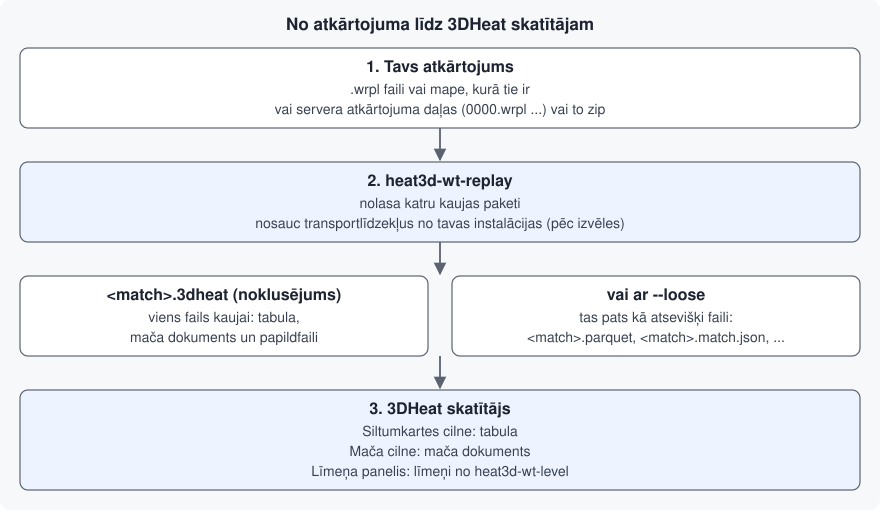

# 3DHeat War Thunder atkārtojumi {#dheat-war-thunder-replays}

**Kas tas ir?** War Thunder var ierakstīt kauju kā atkārtojuma failu. Šis rīks
pārvērš ierakstu failā, ko vari skatīt no augšas
[3DHeat skatītājā](https://holdi601.github.io/3DHeat/): ar katru lidmašīnu, tanku
un kuģi, katru raketi un bumbu un katru trāpījumu tur, kur tas notika. Otra
komanda pārvērš tavas spēles instalācijas līmeņus 3D līmeņos, kuros rādīt kaujas.

**Kāpēc to izmantot?** Lai kaujas pēcpārskatu 3D; lai redzētu siltumkartes, kur tu
un citi lidojat, braucat, cīnāties un krītat daudzās kaujās; lai redzētu, kur
trāpījumi skārusi transportlīdzekli; lai redzētu, cik kauja maksāja un ko
nopelnīja. Rezultāts ir vienkāršs Parquet un JSON, tāpēc to var lasīt arī citi
rīki.

**Piemērs:** viens `.wrpl` atkārtojums ienāk, viens `<match>.3dheat` fails
iziet:



## Ātrais sākums {#quick-start}

Jauns komandrindā? Vispirms izlasi [Pirms sākat](before-you-start.md).

```bash
git clone https://github.com/Holdi601/3DHeat-Ext-WarThunder.git
cd 3DHeat-Ext-WarThunder
pip install -e .                                  # uzstāda heat3d-wt-replay un heat3d-wt-level
heat3d-wt-replay "<War Thunder>/Replays" -o out
```

Katrai kaujai redzēsi vienu rindu: `ok out/<map>/<match>.3dheat`. Atver šo failu
3DHeat skatītājā.

## Šī dokumentācija {#this-documentation}

| Lappuse | Ko tā aptver |
|---|---|
| [Pirms sākat](before-you-start.md) | Python, termināls un kā izskatās veiksme |
| [Uzstādīšana](installing.md) | uzstādīšana, nosaukumi no tavas instalācijas, atjauninājumi |
| [Atkārtojumu pārvēršana](converting.md) | `heat3d-wt-replay` solis pa solim, katra iespēja, ziņojumi |
| [Izvades faili](output-files.md) | `.3dheat` fails, `--loose` faili, nosaukumi |
| [Tabula](table.md) | katra kolonna un notikums |
| [Mača dokuments](match-document.md) | katra `<match>.match.json` atslēga |
| [Papildfaili un pilnība](sidecars.md) | kas tiek saglabāts pilnībā blakus tabulai un skaitļi |
| [Levels](levels.md) | `heat3d-wt-level`: instalācijas līmeņi kā `.glb` |
| [Kā tas nolasa atkārtojumu](how-it-reads.md) | kas tiek nolasīts un kā tas pārbaudīts |
| [Lidmašīnas](aircraft.md), [Sauszemes vienības un kamera](ground.md), [Trāpījumi, šaušana un ugunsgrēki](hits.md) | detaļas aiz kolonnām |
| [Ekonomika](economy.md), [Mērķi](objectives.md) | sudraba lauvas un pētniecības punkti; kapitāla zonas, aerodromi |
| [Noteikumi un licence](terms.md) | Gaijin noteikumi, avoti, testi, licence |
| [Komandu atsauce](../cli-reference.md), [Kolonnu saraksts](../columns.md) | ģenerēts no koda |

## Daļa no 3DHeat {#part-of-3dheat}

Šis konvertētājs ir viens no [3DHeat](https://github.com/Holdi601/3DHeat) rīkiem,
reāllaika 3D telemetrijas un atkārtojumu skatītāja ([dokumentācija](https://holdi601.github.io/3DHeat/)).
Skatītājs atver `.3dheat` failu: tabulu tā Siltumkartes cilnē, mača dokumentu
tā Mača cilnē ([Viens fails vienam mačam](https://holdi601.github.io/3DHeat/container.html)).
Ko katram konvertētājam jāsaglabā: [Konvertētāji saglabā visu](https://holdi601.github.io/3DHeat/converters.html).

**Kāpēc tas ir atsevišķs rīks.** `.wrpl` formāts nav dokumentēts, un Gaijin EULA
(3.2.2, 3.2.9) aizliedz spēles reversēšanu un datu ieguvi, kas nav paredzēta
publiskai parādīšanai; tajā nav minēti atkārtojumi, ko pati spēle rāda spēlētājam.
Lai licences jautājums skartu tikai šo konvertētāju, tas atrodas ārpus 3DHeat Watcher:
Watcher to palaiž jaunajiem atkārtojumiem, ja tas ir uzstādīts, un darbojas arī bez tā.

| Rīks | Ko tas dara | Avots | Dokumentācija |
|---|---|---|---|
| 3DHeat skatītājs | rāda datus 3D: siltumkartes, atkārtojumus, sacīkšu analīzi | [3DHeat](https://github.com/Holdi601/3DHeat) | [vietne](https://holdi601.github.io/3DHeat/) |
| GameFiles | trases un līmeņi no failiem, ko spēles piegādā | [3DHeat-GameFiles](https://github.com/Holdi601/3DHeat-GameFiles) | [vietne](https://holdi601.github.io/3DHeat-GameFiles/) |
| GameCapture | apļu telemetrija un līmeņi, kas atjaunoti no spēles video | [3DHeat-GameCapture](https://github.com/Holdi601/3DHeat-GameCapture) | [vietne](https://holdi601.github.io/3DHeat-GameCapture/) |
| Unreal Exporter | Unreal Editor spraudnis, kas eksportē līmeni | [3DHeat-UnrealExporter](https://github.com/Holdi601/3DHeat-UnrealExporter) | [vietne](https://holdi601.github.io/3DHeat-UnrealExporter/) |
| CS2 | Counter-Strike 2 demo un kartes | [3DHeat-CS2](https://github.com/Holdi601/3DHeat-CS2) | [vietne](https://holdi601.github.io/3DHeat-CS2/) |
| Watcher | ieraksta to, ko spēles publicē, kamēr tu spēlē | [3DHeat-Watcher](https://github.com/Holdi601/3DHeat-Watcher) | [vietne](https://holdi601.github.io/3DHeat-Watcher/) |
| War Thunder atkārtojumi | `.wrpl` atkārtojumi un War Thunder līmeņi | [3DHeat-Ext-WarThunder](https://github.com/Holdi601/3DHeat-Ext-WarThunder) | [vietne](https://holdi601.github.io/3DHeat-Ext-WarThunder/) |
| World of Tanks atkārtojumi | `.wotreplay` atkārtojumi | [3DHeat-Ext-WoT](https://github.com/Holdi601/3DHeat-Ext-WoT) | [vietne](https://holdi601.github.io/3DHeat-Ext-WoT/) |
| World of Warships atkārtojumi | `.wowsreplay` atkārtojumi | [3DHeat-Ext-WoWs](https://github.com/Holdi601/3DHeat-Ext-WoWs) | [vietne](https://holdi601.github.io/3DHeat-Ext-WoWs/) |
| Squad demo | Squad servera demo | [3DHeat-Ext-Squad](https://github.com/Holdi601/3DHeat-Ext-Squad) | [vietne](https://holdi601.github.io/3DHeat-Ext-Squad/) |
| DCS kartes | DCS World kartes kā 3D līmeņi | [3DHeat-Ext-DCS](https://github.com/Holdi601/3DHeat-Ext-DCS) | [vietne](https://holdi601.github.io/3DHeat-Ext-DCS/) |
| IL-2 kartes | IL-2 Great Battles kartes kā 3D līmeņi | [3DHeat-Ext-IL2](https://github.com/Holdi601/3DHeat-Ext-IL2) | [vietne](https://holdi601.github.io/3DHeat-Ext-IL2/) |

---

Daļa no [3DHeat](https://github.com/Holdi601/3DHeat) ([dokumentācija](https://holdi601.github.io/3DHeat/)). Avots: [3DHeat-Ext-WarThunder](https://github.com/Holdi601/3DHeat-Ext-WarThunder).
