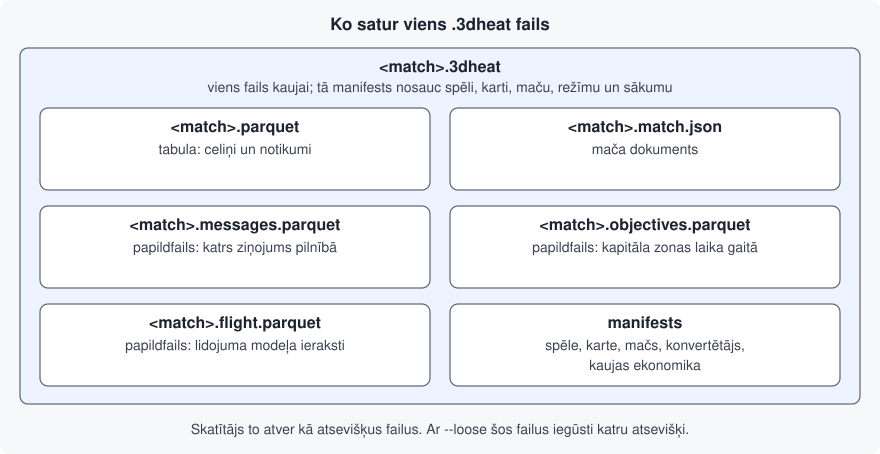
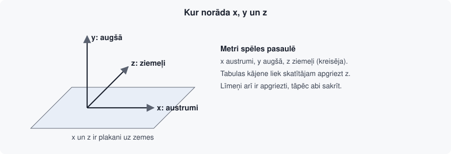

# Izvades faili {#output-files}

Pēc noklusējuma katra kauja ir **viens fails**, `out/<map>/<match>.3dheat`: tabula, mača dokuments un papildfaili sapakoti kopā, ar manifestu, kas nosauc spēli, karti, maču, kaujas režīmu, sākuma laiku un pārvērtēju (un kaujas ekonomiku zem `extensions["heat3d/economy"]`). Formāts ir skatītāja formāts: [Viens fails vienam mačam (.3dheat)](https://holdi601.github.io/3DHeat/container.html).

Ar `--loose` tie paši faili tiek rakstīti blakus viens otram:

| Fails | Kas tas ir | Lappuse |
|---|---|---|
| `<match>.parquet` | viena rinda katram paraugam vai notikumam | [Tabula](table.md) |
| `<match>.match.json` | viss pārējais, ko atkārtojums saka | [Mača dokuments](match-document.md) |
| `<match>.messages.parquet` | katrs ziņojums, katra komponentes vērtība un katra pakete, pilnībā | [Papildfaili](sidecars.md) |
| `<match>.objectives.parquet` | kapitāla zonas laika gaitā | [Papildfaili](sidecars.md) |
| `<match>.flight.parquet` | katrs lidmašīnas lidojuma modeļa ieraksts, katras lidmašīnas, pilnībā | [Papildfaili](sidecars.md) |

Ja iepakošana neizdodas, atsevišķie faili tiek paturēti, un rindā tas tiek pateikts.

## Nosaukumi {#names}

`<match>` ir `<map>_<AB|RB|SB>_<mode>_<start, UTC>_<session id>`, kā attēlā: skat. [Kuri faili ir viena kauja](converting.md#which-files-are-one-battle). `<map>` ir spēles pašas kartes ID (`99_testmap` attēlos).

## Koordinātas {#coordinates}

Metri spēles pašā pasaulē: x uz austrumiem, y uz augšu, z uz ziemeļiem. Tabulas kājene skatītājam norāda apgriezt z, un līmeņi no `heat3d-wt-level` ir rakstīti tādā pašā veidā, tāpēc atkārtojums un tā līmenis atrodas viens uz otra.

---

Daļa no [3DHeat](https://github.com/Holdi601/3DHeat) ([dokumentācija](https://holdi601.github.io/3DHeat/)). Avots: [3DHeat-Ext-WarThunder](https://github.com/Holdi601/3DHeat-Ext-WarThunder).
