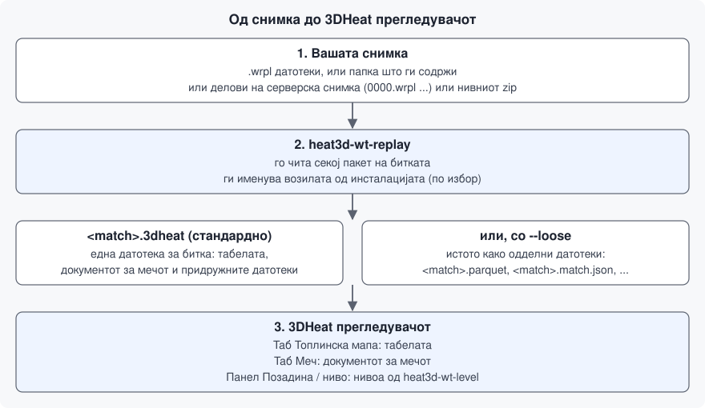

# 3DHeat War Thunder снимки {#dheat-war-thunder-replays}

**Што е тоа?** War Thunder може да ја сними битката како датотека со снимка (replay). Оваа алатка ја претвора снимката во датотека што можете да ја гледате одозгора во [3DHeat прегледувачот](https://holdi601.github.io/3DHeat/), со секој авион, тенк и брод, секоја ракета и бомба и секој погодок онаму каде што се случил. Втора команда ги претвора нивоата од вашата инсталација на играта во 3D нивоа врз кои се прикажуваат битките.

**Зошто би ја користел?** За разгледување на битка во 3D; за топлински мапи на тоа каде вие и другите летате, возите, се борите и гинете во многу битки; за да видите каде погодоците паднале на возилото; за да видите колку чинела и колку донела една битка. Излезот е обичен Parquet и JSON, па и други алатки можат да го читаат.

**Пример:** една `.wrpl` снимка влегува, една `<match>.3dheat` датотека излегува:



## Брз почеток {#quick-start}

Нови сте со командната линија? Прво прочитајте [Пред да започнете](before-you-start.md).

```bash
git clone https://github.com/Holdi601/3DHeat-Ext-WarThunder.git
cd 3DHeat-Ext-WarThunder
pip install -e .                                  # installs heat3d-wt-replay and heat3d-wt-level
heat3d-wt-replay "<War Thunder>/Replays" -o out
```

Треба да видите по една линија за секоја битка: `ok out/<map>/<match>.3dheat`. Отворете ја таа датотека во 3DHeat прегледувачот.

## Оваа документација {#this-documentation}

| Страница | Што опфаќа |
|---|---|
| [Пред да започнете](before-you-start.md) | Python, терминал и како изгледа успехот |
| [Инсталирање](installing.md) | инсталација, имиња од вашата инсталација, ажурирања |
| [Претворање на снимки](converting.md) | `heat3d-wt-replay` чекор по чекор, секоја опција, пораки |
| [Излезни датотеки](output-files.md) | датотеката `.3dheat`, датотеките од `--loose`, имиња |
| [Табелата](table.md) | секоја колона и настан |
| [Документот за мечот](match-document.md) | секој клуч од `<match>.match.json` |
| [Придружни датотеки и комплетност](sidecars.md) | што уште се чува целосно покрај табелата, и броевите |
| [Нивоа](levels.md) | `heat3d-wt-level`: нивоа од вашата инсталација како `.glb` |
| [Како чита снимка](how-it-reads.md) | што се чита и како беше проверено |
| [Авиони](aircraft.md), [Копнени единици и камера](ground.md), [Погодоци, пукање и пожари](hits.md) | подробностите зад колоните |
| [Економија](economy.md), [Цели](objectives.md) | Silver Lions и поени за истражување; зони за заземање, аеродроми |
| [Услови и лиценца](terms.md) | условите на Gaijin, извори, тестови, лиценца |
| [Упатство за команди](../cli-reference.md), [Список на колони](../columns.md) | генерирани од кодот |

## Дел од 3DHeat {#part-of-3dheat}

Овој конвертор е една од алатките на [3DHeat](https://github.com/Holdi601/3DHeat), 3D прегледувач на телеметрија и снимки во реално време ([документација](https://holdi601.github.io/3DHeat/)). Прегледувачот ја отвора датотеката `.3dheat`: табелата во табот Топлинска мапа, документот за мечот во табот Меч ([Една датотека по меч](https://holdi601.github.io/3DHeat/container.html)). Што мора да чува секој конвертор: [Конверторите чуваат сè](https://holdi601.github.io/3DHeat/converters.html).

**Зошто е посебна алатка.** Форматот `.wrpl` не е документиран, а EULA на Gaijin (3.2.2, 3.2.9) забранува reverse engineering на играта и вадење податоци што не се наменети за приказ; снимките не ги именува, а играта самата им ги покажува на играчите. За да се однесува едно лиценцно прашање само на овој конвертор, тој е надвор од 3DHeat Watcher: Watcher го стартува врз нови снимки кога е инсталиран, а работи и без него.

| Алатка | Што прави | Извор | Документација |
|---|---|---|---|
| 3DHeat прегледувач | ги прикажува податоците во 3D: топлински мапи, снимки, анализа на трки | [3DHeat](https://github.com/Holdi601/3DHeat) | [страница](https://holdi601.github.io/3DHeat/) |
| GameFiles | патеки и нивоа од датотеките што ги испорачуваат игрите | [3DHeat-GameFiles](https://github.com/Holdi601/3DHeat-GameFiles) | [страница](https://holdi601.github.io/3DHeat-GameFiles/) |
| GameCapture | телеметрија на кругови и нивоа реконструирани од видео од играње | [3DHeat-GameCapture](https://github.com/Holdi601/3DHeat-GameCapture) | [страница](https://holdi601.github.io/3DHeat-GameCapture/) |
| Unreal Exporter | додаток за Unreal Editor што извезува ниво | [3DHeat-UnrealExporter](https://github.com/Holdi601/3DHeat-UnrealExporter) | [страница](https://holdi601.github.io/3DHeat-UnrealExporter/) |
| CS2 | демоа и мапи од Counter-Strike 2 | [3DHeat-CS2](https://github.com/Holdi601/3DHeat-CS2) | [страница](https://holdi601.github.io/3DHeat-CS2/) |
| Watcher | снима што игрите објавуваат додека играте | [3DHeat-Watcher](https://github.com/Holdi601/3DHeat-Watcher) | [страница](https://holdi601.github.io/3DHeat-Watcher/) |
| War Thunder снимки | `.wrpl` снимки и нивоа од War Thunder | [3DHeat-Ext-WarThunder](https://github.com/Holdi601/3DHeat-Ext-WarThunder) | [страница](https://holdi601.github.io/3DHeat-Ext-WarThunder/) |
| World of Tanks снимки | `.wotreplay` снимки | [3DHeat-Ext-WoT](https://github.com/Holdi601/3DHeat-Ext-WoT) | [страница](https://holdi601.github.io/3DHeat-Ext-WoT/) |
| World of Warships снимки | `.wowsreplay` снимки | [3DHeat-Ext-WoWs](https://github.com/Holdi601/3DHeat-Ext-WoWs) | [страница](https://holdi601.github.io/3DHeat-Ext-WoWs/) |
| Squad демоа | серверски демоа од Squad | [3DHeat-Ext-Squad](https://github.com/Holdi601/3DHeat-Ext-Squad) | [страница](https://holdi601.github.io/3DHeat-Ext-Squad/) |
| DCS мапи | мапи од DCS World како 3D нивоа | [3DHeat-Ext-DCS](https://github.com/Holdi601/3DHeat-Ext-DCS) | [страница](https://holdi601.github.io/3DHeat-Ext-DCS/) |
| IL-2 мапи | мапи од IL-2 Great Battles како 3D нивоа | [3DHeat-Ext-IL2](https://github.com/Holdi601/3DHeat-Ext-IL2) | [страница](https://holdi601.github.io/3DHeat-Ext-IL2/) |

---

Дел од [3DHeat](https://github.com/Holdi601/3DHeat) ([документација](https://holdi601.github.io/3DHeat/)). Извор: [3DHeat-Ext-WarThunder](https://github.com/Holdi601/3DHeat-Ext-WarThunder).
